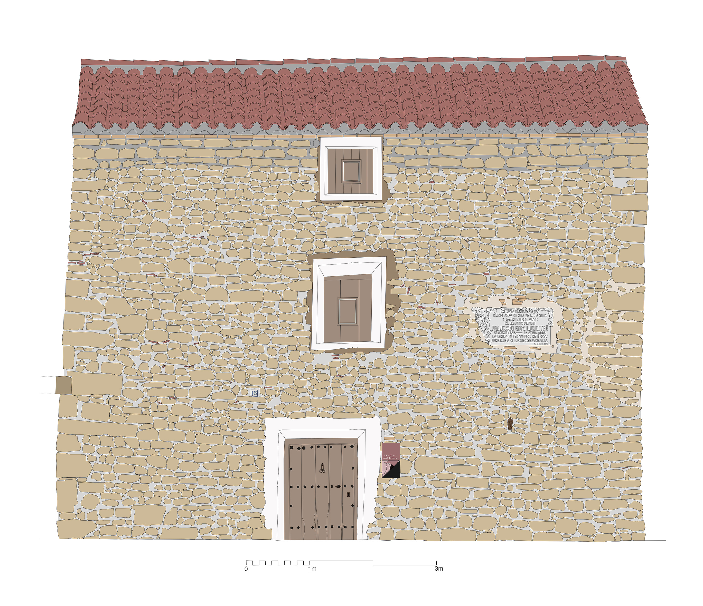
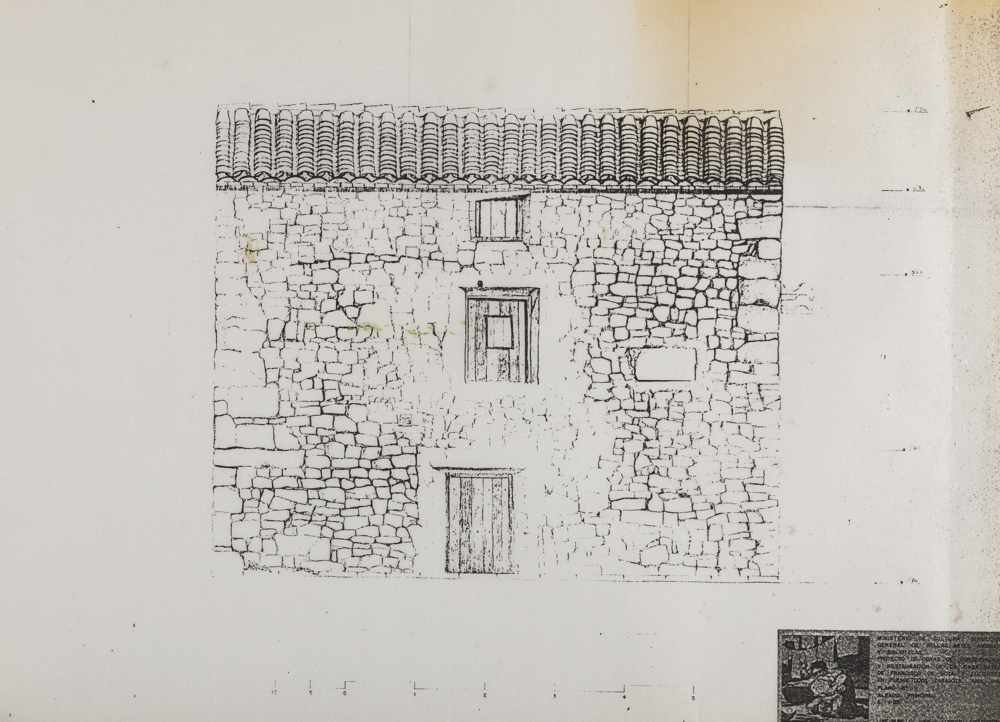
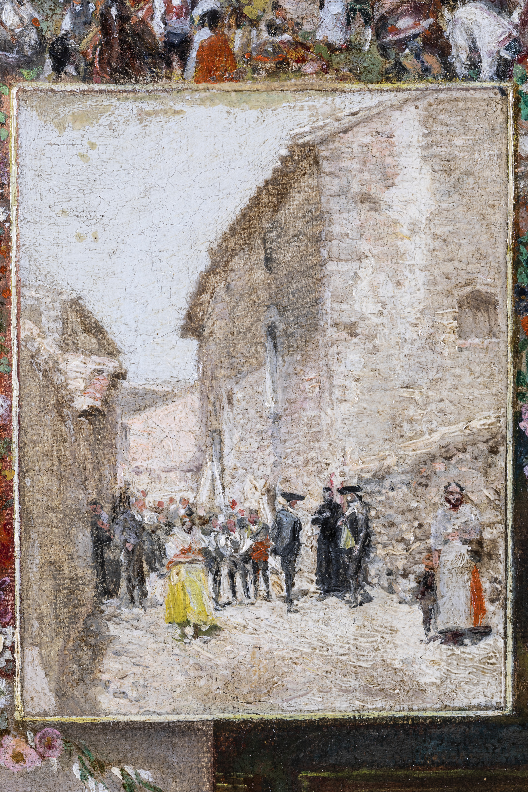
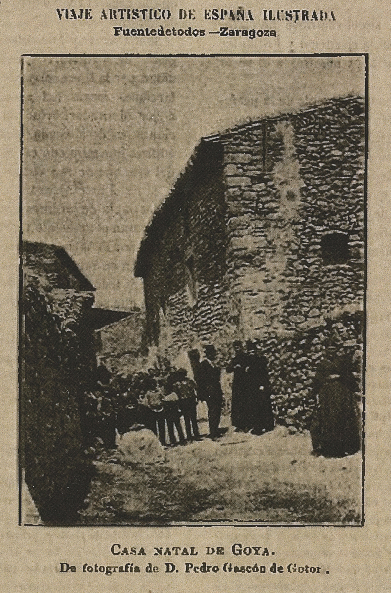
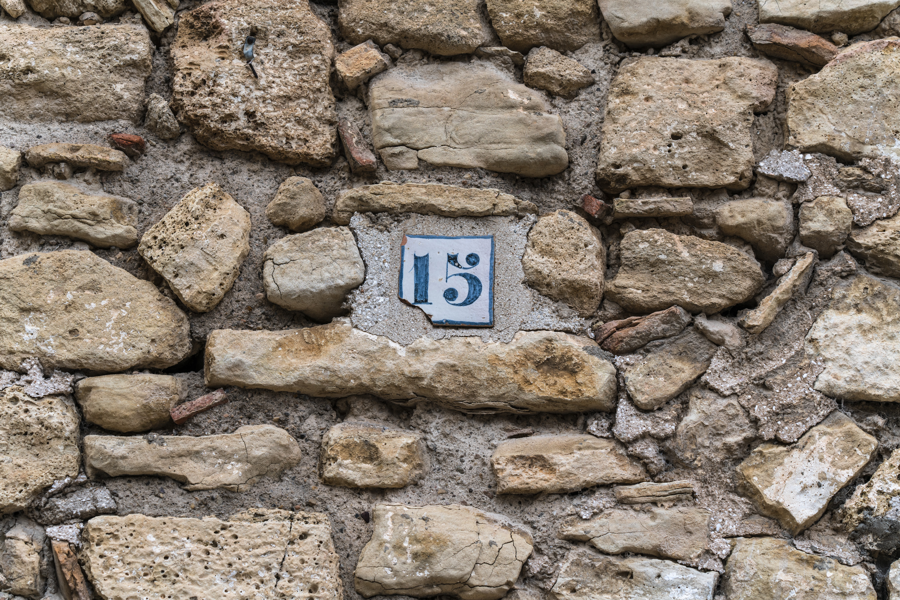
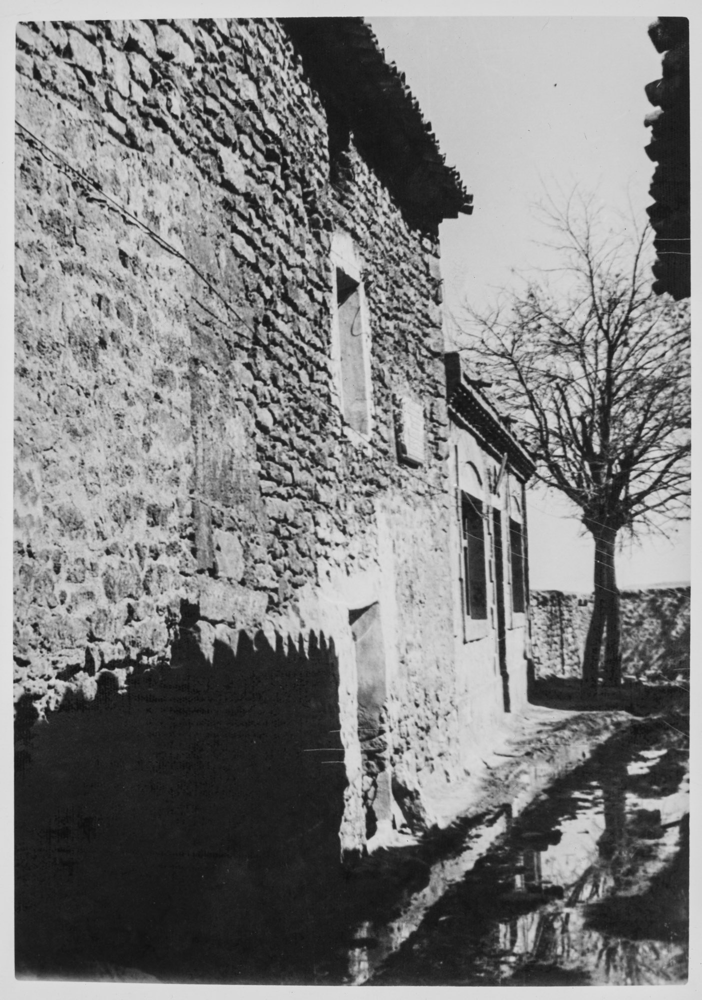
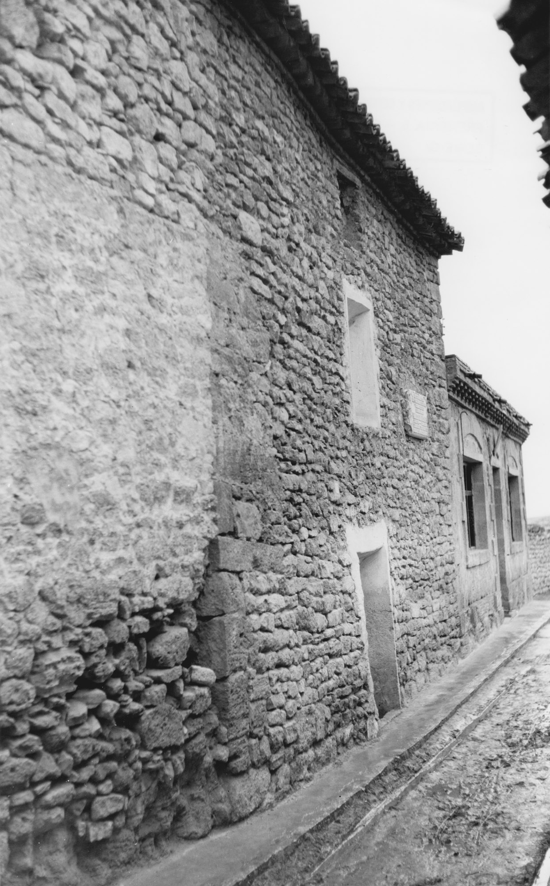
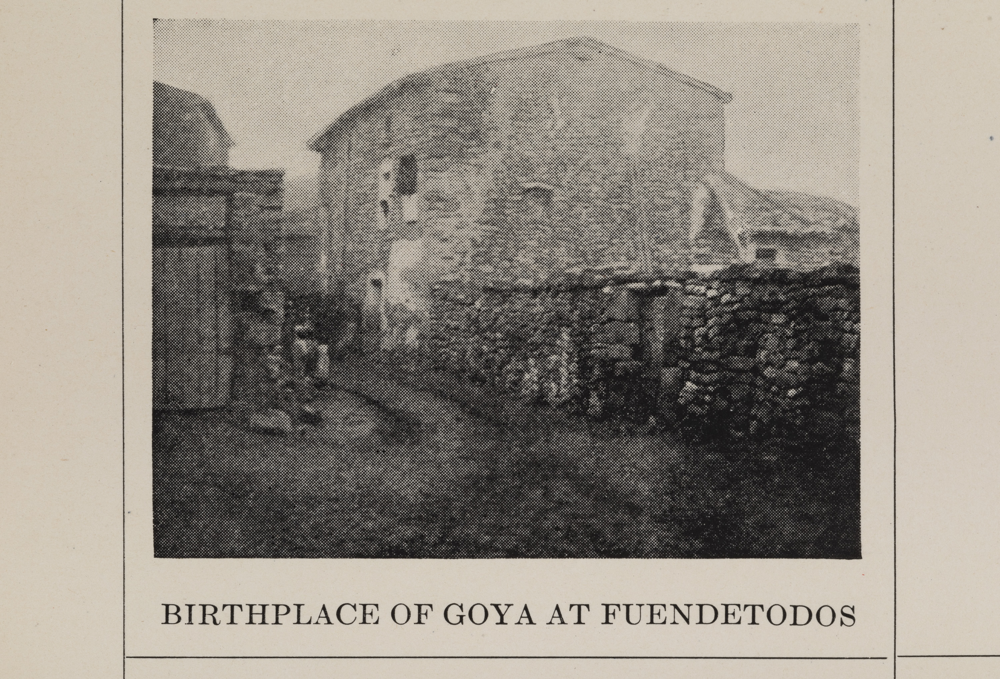
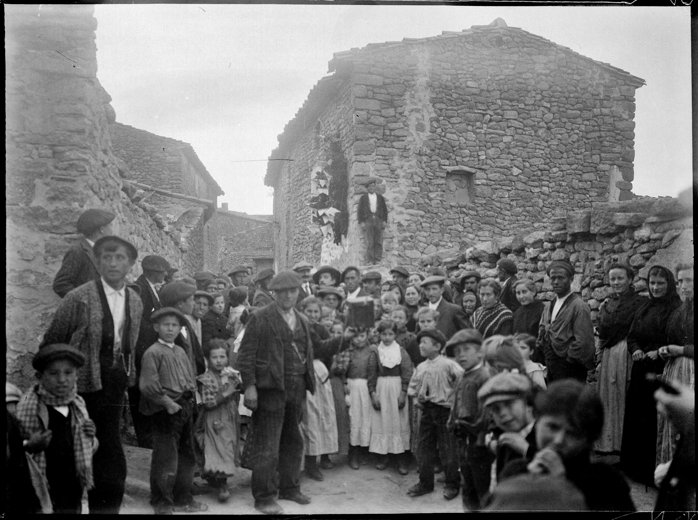

# South façade on Calle Alfóndiga

Francisco de Goya y Lucientes was born in this house on 30 March 1746. [1] It is now number 15 Calle Alfóndiga in Fuendetodos, in the area referred to in historical records as the *Barrio Bajo* (Lower Quarter). [2] The house-number tile is made of ceramics from nearby Muel, a pottery-making centre since the late Middle Ages. [3] A Royal Order of 24 February 1860 standardised street signs and the numbering of homes and buildings throughout Spain. The tiles were painted cobalt blue on a white manganese ground in the Muel style. The only street-name tile of this kind to survive in Fuendetodos is the one for Calle Alta, now Calle Justicia de Aragón, where the tile is on an unnumbered property. Only two number tiles survive in the village: the one on Goya’s birthplace and number 33, now 6 Calle Zuloaga, formerly Calle Mayor. Zapater identified the birthplace as number 18. The original tile now on the façade reads 15 and is the same size and lettering style as number 33. It was clearly moved from another location and set into a patch of modern gypsum mortar. Its missing lower-left corner was probably broken in the move, though when and why it was moved are unknown.

The street name *alfondiga* probably refers to a nearby building that no longer survives. The *Diccionario de la lengua española* (*DLE*) defines it as “a public building for buying and selling wheat. In some villages it also serves for storing, buying and selling other grains, foodstuffs or goods, which incur no taxes or duties until they are sold.” The word is an Aragonese form of the Castilian *alhóndiga*, recorded in a dictionary as early as 1617 and later in the 1726 *Diccionario de autoridades*.

The house was ‘rediscovered’ by Francisco Zapater Gómez, great-nephew of Martín Zapater, Goya’s friend and confidant. He was the first to write about the painter’s home, in his 1868 monograph.

The house is small and “humble”, as the Carrara marble inscription unveiled on its façade in 1913 reads:

> In this humble house | was born, to the honour of his country | and the wonder of art, | the illustrious painter | Francisco Goya Lucientes | 31 March 1746 – 16 April 1828. | In admiration, all pay this | tribute to his undying memory. | 16 April 1913

The inscription mistakes the date of baptism, 31 March, for the date of birth. Goya was born the day before.

The house is modest compared with the houses of the *Barrio Alto* (Upper Quarter) around the square with the wayside pillar of Saint Barbara and the new parish church. It was built with roughly dressed sandstone and fossil-bearing limestone from local quarries. Much of the original mortar has been lost. Broken roof tiles, river pebbles and lumps of gypsum were also used to fill the joints. White and grey Portland cement mortars mixed with sand were used on the lower part in the last restoration. Outside the stable, the end of a timber, probably pollarded poplar, projects from the wall. It once supported the stable joists and was cut during the last restoration. Quoins tie the walls together at the corners.

The façade shows the layout of the house, with a ground floor and no cellar, a principal floor and an attic. The walls become thinner higher up. A small brick-and-tile eave finishes the façade. Three small openings line up vertically: the entrance door, the main room’s first-floor window and the attic opening. Gypsum plaster surrounded the jambs, lintels and sills of the door and the first-floor window to protect their woodwork. The attic opening received no such treatment. The surrounds were also whitewashed, mainly for hygiene. In 1913 the Carrara marble plaque commemorating Goya’s birth was installed on the right side of the façade at the height of the main window.

The original street was narrow, with dirt and rubble underfoot and no pavements. The house was the last building on the odd-numbered side. Beyond it lay fields and the edge of the village towards the old road to Belchite and Villanueva de Huerva. The Provincial Council of Zaragoza created the present square in 1963 after expropriating and demolishing three old buildings opposite.

Axonometric view of the façade on Calle Alfóndiga. Drawing by Héctor Arcusa Magallón.

Façade on Calle Alfóndiga. Architectural drawing by Héctor Arcusa Magallón.

Façade on Calle Alfóndiga. Architectural drawing by Héctor Arcusa Magallón.

Façade on Calle Alfóndiga before its last restoration. Drawing by Luis Burillo Lafarga and Jaime Lorenzo Saiz-Calleja, April 1982.

## Façade looking north before 1913, without the commemorative plaque

Façade on Calle Alfóndiga, looking north towards the start of the street. Marcelino de Unceta, *Homenaje a Goya* (*Homage to Goya*), late nineteenth century, oil on canvas. Francisco Palá Collection, Madrid. Photograph by Javier Romeo Francés.

Goya’s birthplace looking west from Calle Alfóndiga. Photograph by Pedro Gascón de Gotor (1870–1907), 1893. Digital copy by Javier Romeo Francés.

## Tiles

House-number tile for Goya’s birthplace in Fuendetodos under the new numbering system. Muel ceramic painted blue on a white glaze, 1860. Photograph by Javier Romeo Francés.

## Façade looking south after 1913, with the commemorative plaque

Façade on Calle Alfóndiga, looking south. Unknown photographer, after 1917.

Façade on Calle Alfóndiga, looking south. Unknown photographer, after 1917.

## Façade looking north after 1913, with the commemorative plaque

“Birthplace of Goya at Fuendetodos.” Façade on Calle Alfóndiga, looking north. Unknown photographer, after 1913. The Hispanic Society of America, New York.

Façade on Calle Alfóndiga, looking north. Photograph by Luis Gandú Mercadal (1888–1968), May 1913. Library and Archive, Provincial Council of Zaragoza.
