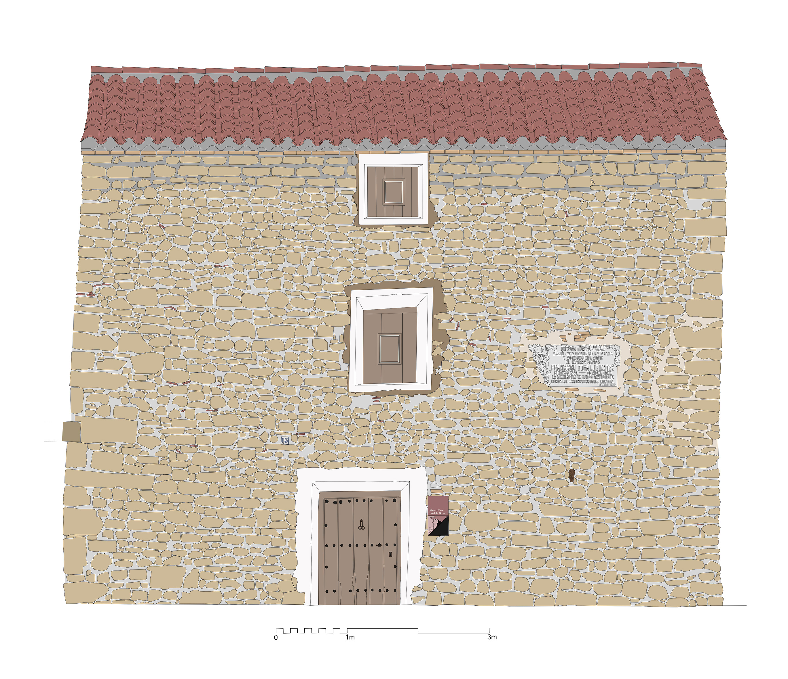
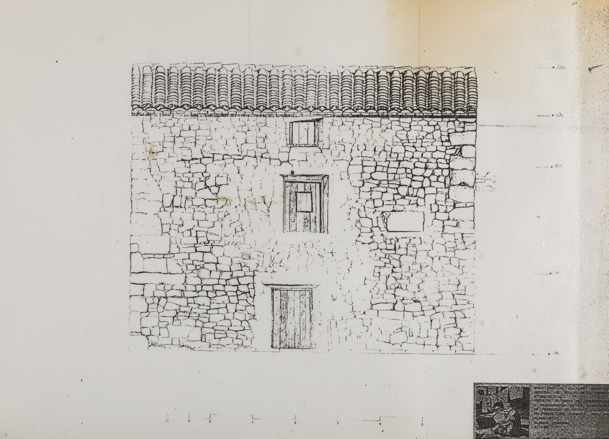
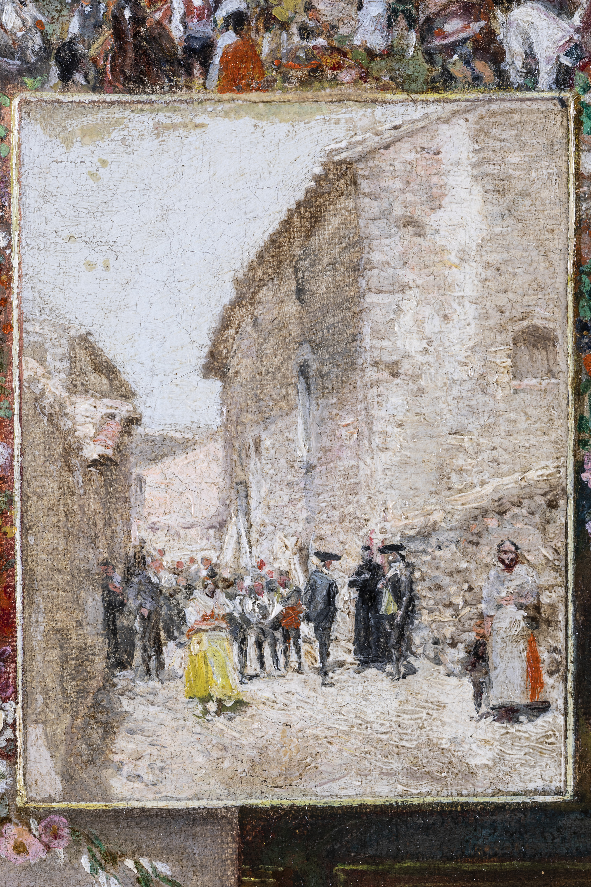
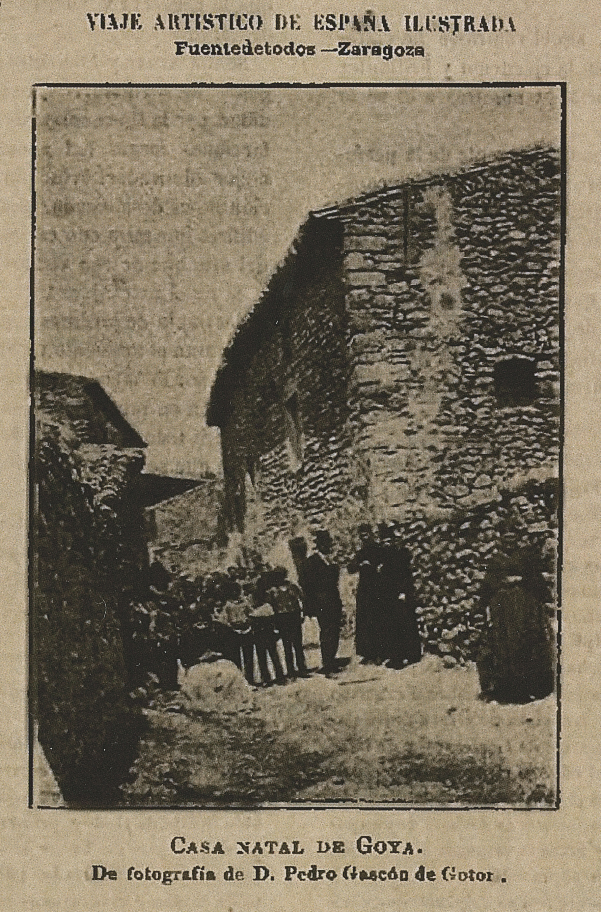
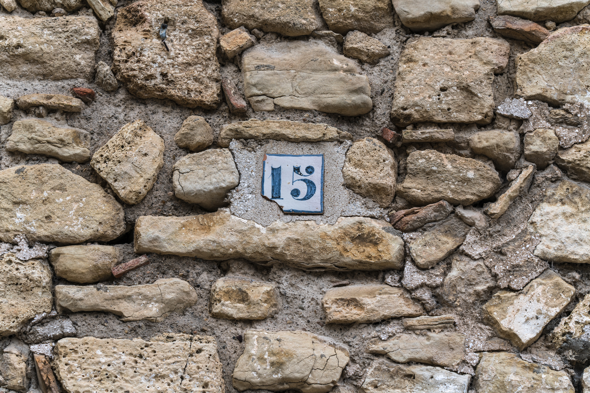
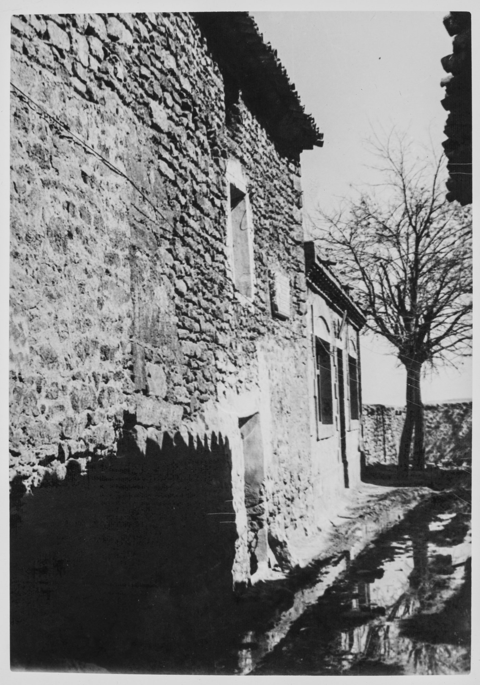
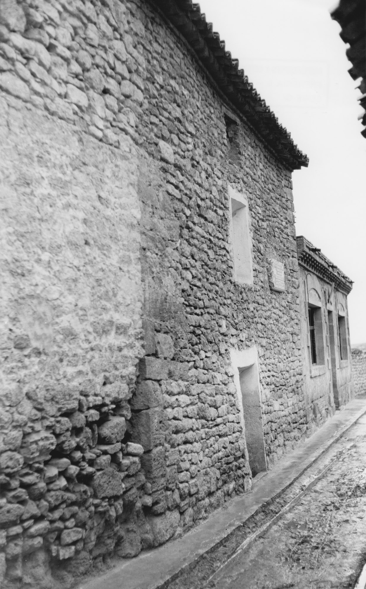
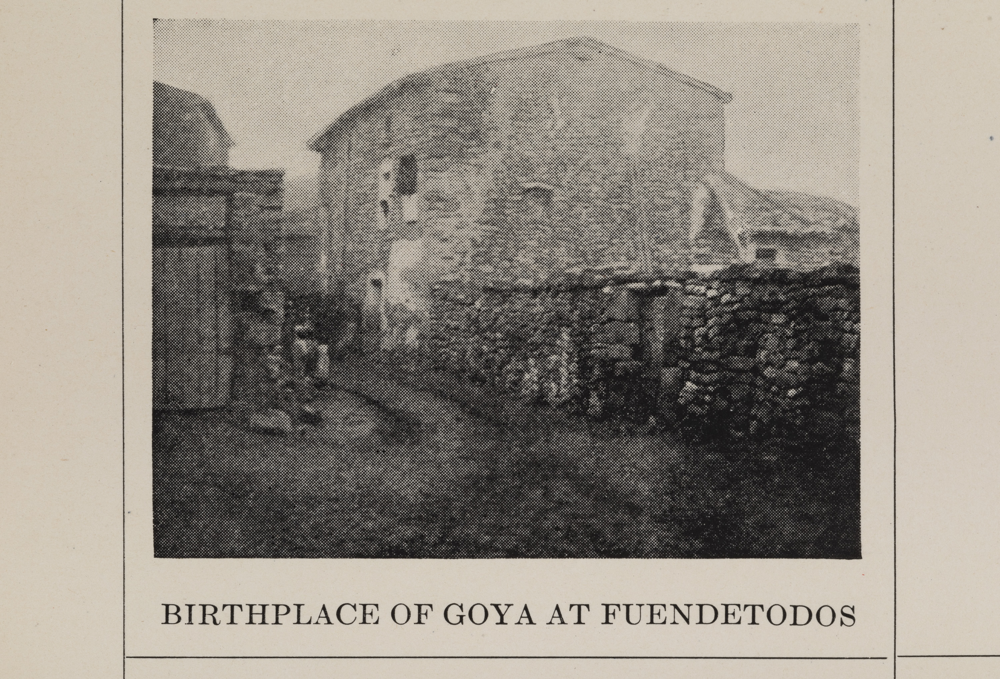
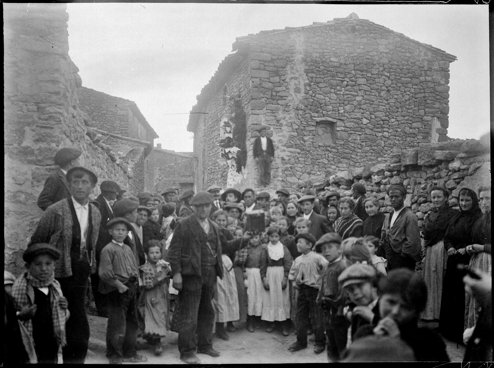

# Façade sud sur la calle Alfóndiga

Francisco de Goya y Lucientes est né dans cette maison le 30 mars 1746. [1] Elle porte aujourd’hui le numéro 15 de la calle Alfóndiga, à Fuendetodos, dans le quartier appelé *Barrio Bajo* (« quartier bas ») dans les sources historiques. [2] Le carreau qui porte le numéro est en céramique de Muel, une localité voisine spécialisée dans la poterie depuis la fin du Moyen Âge. [3] Une ordonnance royale du 24 février 1860 a réglementé les plaques de rue et la numérotation des maisons et bâtiments dans toute l’Espagne. Les carreaux, de type Muel, étaient peints en bleu de cobalt sur un fond blanc au manganèse. À Fuendetodos, seul le carreau de la *Calle Alta* subsiste parmi les plaques de rue de ce type. Il se trouve aujourd’hui dans la calle Justicia de Aragón, sur une propriété sans numéro. Deux carreaux de numérotation ont été conservés : celui de la maison natale de Goya et celui du numéro 33, aujourd’hui le 6 de la calle Zuloaga, ancienne calle Mayor. Zapater situait la maison natale au numéro 18. Le carreau ancien qui orne la façade indique le 15. Il présente les mêmes dimensions et le même lettrage que le numéro 33. Il a manifestement été déplacé puis fixé sur une couche de mortier de plâtre moderne. Son angle inférieur gauche a probablement été cassé lors du déplacement, dont on ignore la date et la raison.

Le nom de la rue, *alfondiga*, évoque probablement un bâtiment voisin disparu. Le *Diccionario de la lengua española* (*DLE*) le définit comme « un bâtiment public destiné à l’achat et à la vente de blé. Dans certains villages, il sert aussi au dépôt, à l’achat et à la vente d’autres grains, denrées ou marchandises, qui ne sont soumis à aucune taxe ni aucun droit tant qu’ils ne sont pas vendus ». C’est une forme aragonaise du castillan *alhóndiga*, attestée dans un dictionnaire dès 1617, puis dans le *Diccionario de autoridades* de 1726.

La « redécouverte » de la maison est due à Francisco Zapater Gómez, petit-neveu de Martín Zapater, ami et confident de Goya. Il fut le premier à évoquer la demeure du peintre dans sa monographie parue en 1868.

La maison est petite et « humble », comme le dit l’inscription en marbre de Carrare dévoilée en 1913 :

> Dans cette humble maison | est né, pour l’honneur de la patrie | et l’émerveillement de l’art, | l’illustre peintre | Francisco Goya Lucientes | 31 mars 1746 – 16 avril 1828. | L’admiration de tous rend cet | hommage à sa mémoire impérissable. | 16 avril 1913

L’inscription a pris la date du baptême, le 31 mars, pour celle de la naissance, survenue la veille.

La maison est modeste comparée à celles du *Barrio Alto* (« quartier haut »), autour de la place où se dressent le pilier votif de sainte Barbe et la nouvelle église paroissiale. Elle est bâtie en moellons très grossiers de calcaire gréseux et fossilifère provenant des carrières locales. Une grande partie du mortier d’origine des joints a disparu. On y avait aussi employé des morceaux de tuiles, des galets de rivière et des débris de plâtre. Lors de la dernière restauration, divers mortiers de ciment Portland blanc et gris, mêlés de sable, ont été appliqués en partie basse. Du côté de l’écurie dépasse l’extrémité d’une poutre, probablement en peuplier têtard. Elle soutenait les solives de l’écurie et a été coupée lors de la dernière restauration. Des pierres d’angle assurent la liaison entre les murs.

La façade traduit la disposition de la demeure : rez-de-chaussée sans cave, étage principal et combles. L’épaisseur des murs diminue avec la hauteur. Un petit avant-toit de briques et de tuiles couronne la façade. Trois petites ouvertures s’alignent verticalement : la porte d’entrée, la fenêtre de la salle du premier étage et le petit jour des combles. Le plâtre protégeait la menuiserie autour de la porte et de la fenêtre du premier étage, au niveau des jambages, du linteau et de l’appui. L’ouverture des combles n’avait pas ce traitement. Le pourtour des baies était également blanchi, surtout par souci de salubrité. En 1913, la plaque en marbre de Carrare commémorant la naissance de Goya a été posée à droite de la façade, à hauteur de la fenêtre principale.

La rue d’origine était étroite, en terre et en gravats, sans trottoirs. La maison était le dernier bâtiment du côté impair. Au-delà se trouvaient les champs et la sortie du village vers l’ancien chemin de Belchite et de Villanueva de Huerva. La Diputación Provincial de Zaragoza a créé la place actuelle en 1963, après l’expropriation et la démolition de trois bâtiments anciens situés en face.

Vue axonométrique de la façade sur la calle Alfóndiga. Dessin de Héctor Arcusa Magallón.

Façade sur la calle Alfóndiga. Relevé de Héctor Arcusa Magallón.

Façade sur la calle Alfóndiga. Relevé de Héctor Arcusa Magallón.

Façade sur la calle Alfóndiga avant la dernière restauration. Dessin de Luis Burillo Lafarga et Jaime Lorenzo Saiz-Calleja, avril 1982.

## Façade vue vers le nord avant 1913, sans la plaque commémorative

Façade sur la calle Alfóndiga, vue vers le nord et le début de la rue. Marcelino de Unceta, *Homenaje a Goya* (*Hommage à Goya*), fin du XIXe siècle, huile sur toile. Collection Francisco Palá, Madrid. Photographie de Javier Romeo Francés.

Maison natale de Goya vue depuis la calle Alfóndiga, en direction de l’ouest. Photographie de Pedro Gascón de Gotor (1870–1907), 1893. Copie numérique de Javier Romeo Francés.

## Carreaux

Carreau portant le numéro attribué à la maison natale de Goya à Fuendetodos lors de la nouvelle numérotation. Céramique de Muel peinte en bleu sur émail blanc, 1860. Photographie de Javier Romeo Francés.

## Façade vue vers le sud après 1913, avec la plaque commémorative

Façade sur la calle Alfóndiga, vue vers le sud. Photographe inconnu, après 1917.

Façade sur la calle Alfóndiga, vue vers le sud. Photographe inconnu, après 1917.

## Façade vue vers le nord après 1913, avec la plaque commémorative

« Birthplace of Goya at Fuendetodos ». Façade sur la calle Alfóndiga, vue vers le nord. Photographe inconnu, après 1913. The Hispanic Society of America, New York.

Façade sur la calle Alfóndiga, vue vers le nord. Photographie de Luis Gandú Mercadal (1888–1968), mai 1913. Bibliothèque et archives de la Diputación Provincial de Zaragoza.
