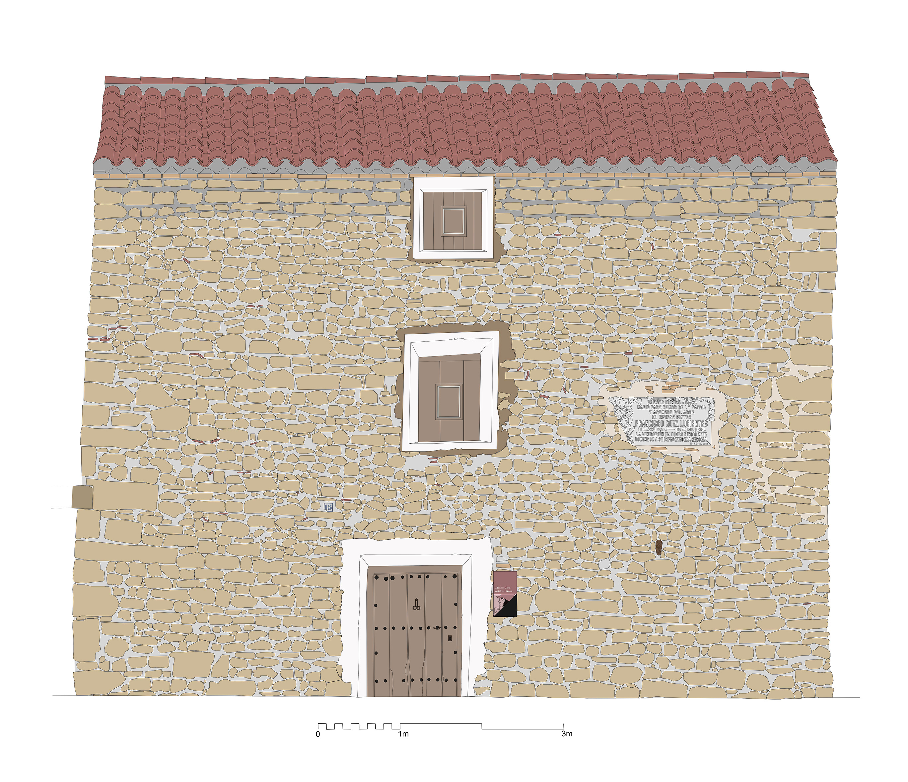
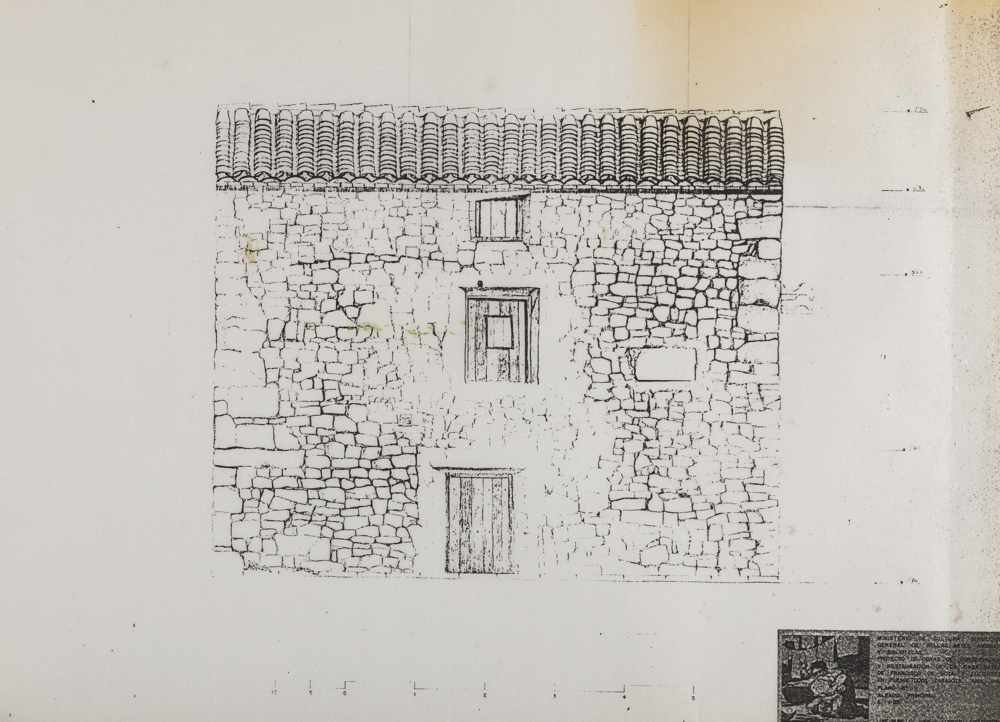
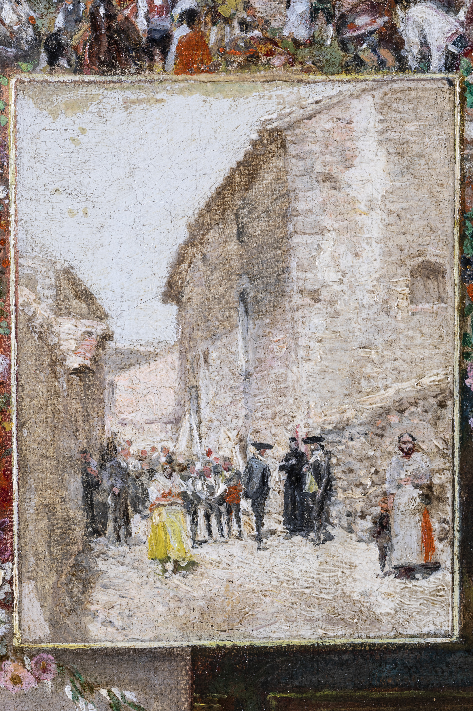
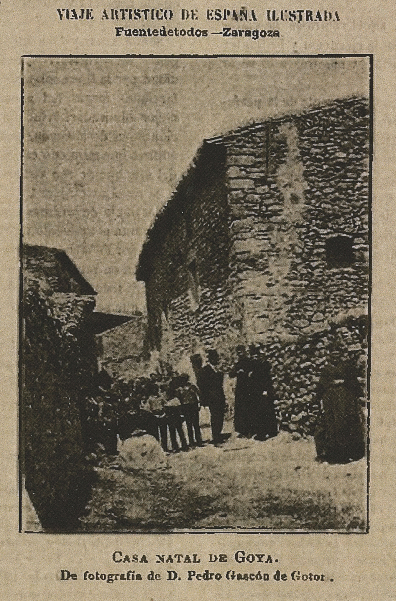
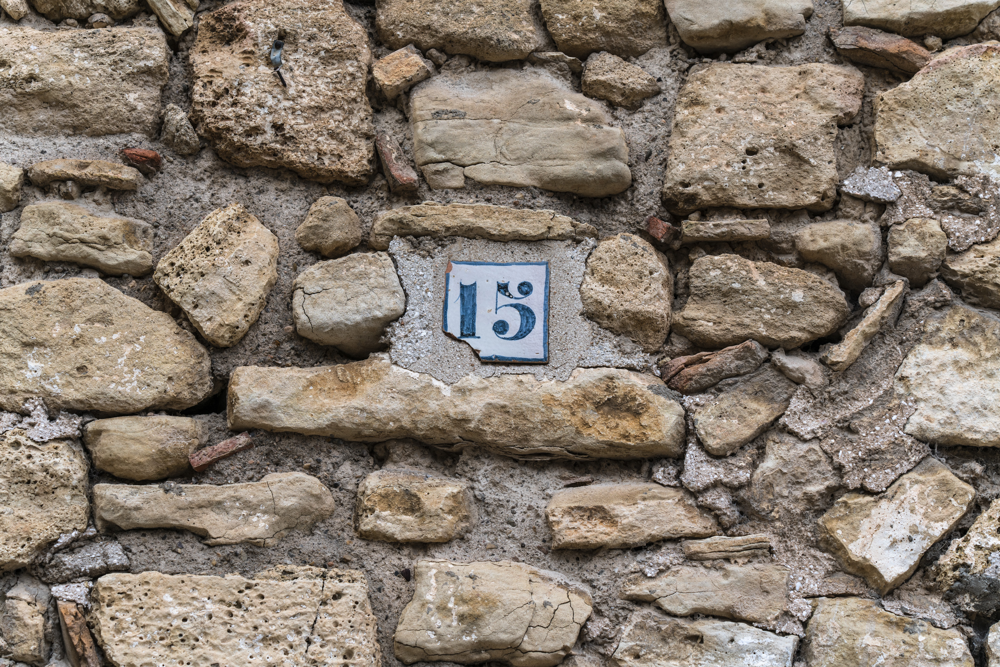
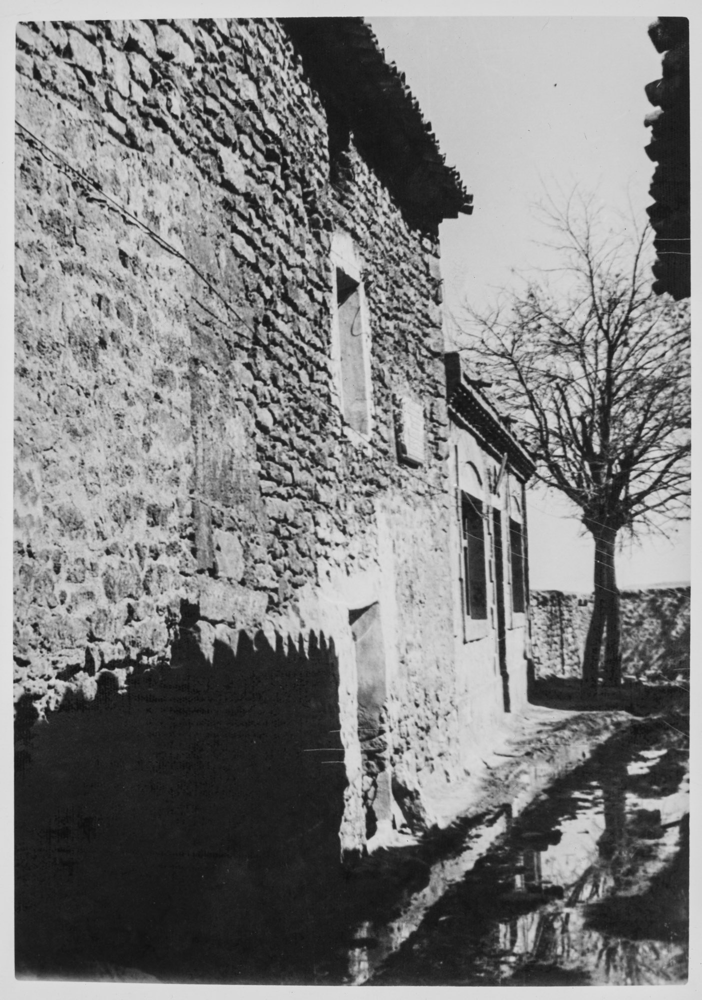
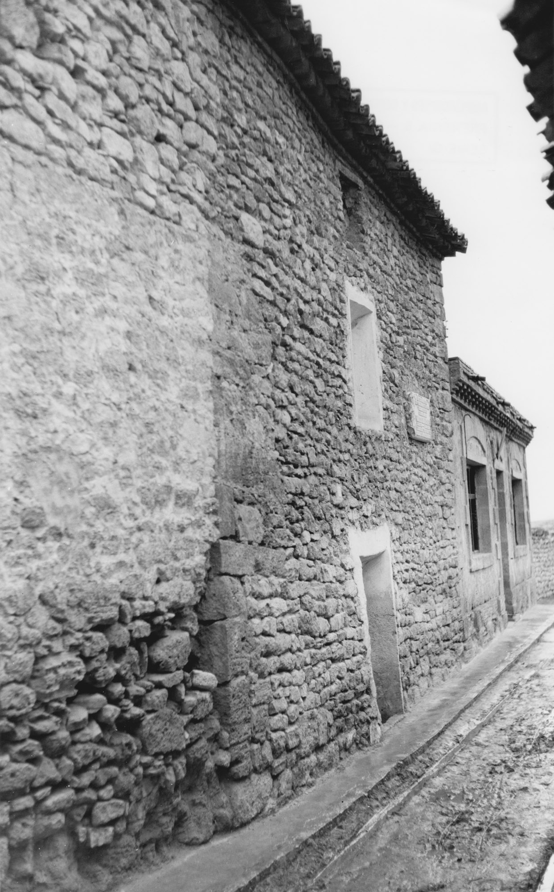
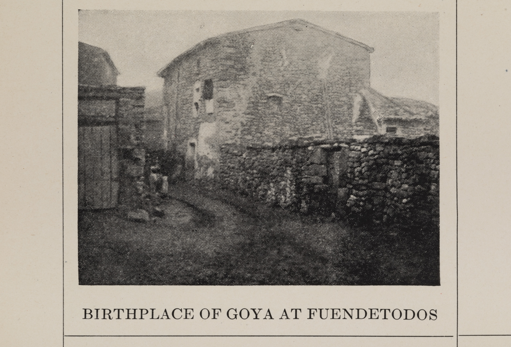
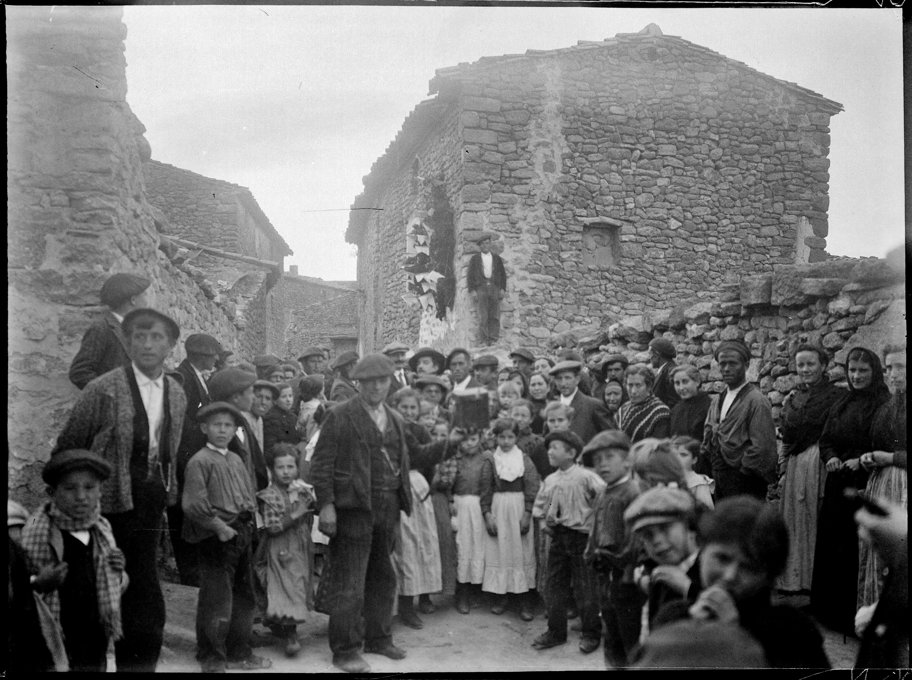

# Fachada sur a la calle alfóndiga

Francisco de Goya y Lucientes nació en 30 de marzo de 1746 en esta casa. [1] Es el actual número 15 de la calle Alfóndiga de Fuendetodos, en el llamado por la fuentes prosopográficas «Barrio bajo». [2] El azulejo de la numeración es de cerámica de Muel, población cercana especializada en la producción cerámica desde la baja Edad Media. [3] Por Real Orden de 24 de febrero de 1860 se aprobó la regulación para la rotulación de las calles así como de la numeración de casas, edificios y viviendas de toda España. De esta rotulación en azulejos pintados en azul cobalto sobre fondo blanco manganeso —tipo Muel— normalizada en todo el territorio español solo se ha conservado en Fuendetodos el perteneciente a la «Calle Alta» (actual Justicia de Aragón, sin número). De la numeración solo dos: el de la casa natal de Goya en la calle Alfóndiga y el correspondiente al 33, actual 6 de la calle Zuloaga (antigua calle Mayor). Zapater identificó la casa natal en el número 18. El azulejo original actual —de idénticas medidas y tipo de letra que el número 33 mencionado— muestra el 15. Es manifiesto que fue removido de otro lugar —la esquina inferior izquierda que falta se debió romper en su traslado— sin que se conozca cuando ni porqué y colocado de nuevo en la fachada sobre un emplasto de mortero de yeso moderno.

	La referencia en el nomenclátor local a la «alfondiga» evoca probablemente la proximidad de este edificio no conservado: «Casa pública destinada para la compra y venta del trigo. En algunos pueblos sirve también para el depósito y para la compra y venta de otros granos, comestibles o mercaderías que no devengan impuestos o arbitrios de ninguna clase mientras no se vendan», *Diccionario de la lengua española *(*DLE*). Es un aragonesismo —documentado en un diccionario desde 1617 y luego en el *Diccionario de autoridades* de 1726— de la palabra castellana *alhóndiga.*

	Su ‘redescubrimiento’ se debió a Francisco Zapater Gómez, sobrino nieto de Martín Zapater, el amigo y confidente de Goya, que escribió por primera vez sobre su morada en su monografía del pintor editada en 1868.

	La casa es pequeña y «humilde» como reza la inscripción de mármol de Carrara de la fachada descubierta en 1913:

> en esta humilde casa | nació para honor de la patria | y asombro del arte | el insigne pintor | francisco goya lucientes | 31 marzo 1746 – 16 abril 1828. | la admiración de todos rindió este | homenaje a su imperecedera memoria. | 16 abril 1913

	Se erró en la fecha del nacimiento por tomar el día del bautismo (31 de marzo) por el del nacimiento que se produjo la víspera.

En comparación con las casas del «Barrio alto» en derredor de la plaza con el peirón de santa Bárbara y de la parroquial nueva. Fue construida en mampostería de sillarejo muy basto de piedra caliza arenisca y caracoleña de las canteras locales. Ha perdido buena parte del mortero original que cubría las juntas del sillarejo. Éstas se rellenaron también con trozos de teja, cantos de río y cascotes de yeso —aljezón—; en la parte baja se aplicaron en la última rehabilitación diferentes morteros de cemento tipo Portland de color blanco y gris con arena. En la parte exterior correspondiente a la cuadra asoma la cabeza de una viga de madera —probablemente de chopo cabecero— que apeó las vigas de la cuadra, cortada en las obras de la última rehabilitación. Las esquinas fueron edificadas con piedras angulares para trabar mejor los lienzos de las paredes.

	El frente muestra la organización de la morada que se compone de una planta baja —sin bodega—, planta principal y falsa. El grueso de los muros decrece conforme sube en altura. La fachada se culminó con un pequeño rafe o alero de ladrillo y teja. Posee tres pequeños vanos alineados de forma vertical: la puerta de ingreso, la ventana de la sala del piso principal y el ventanuco de la falsa. Jambas, dintel y alfeizar de la puerta y de la ventana del piso primero estaban enmarcadas por aljez que protegía la carpintería de madera no así la del desván. El perímetro también fue encalado más que por razón de ornato como medida de salubridad. En la parte derecha del lienzo de fachada, a la altura de la ventana principal se colocó una inscripción conmemorativa del nacimiento de Goya, en mármol de Carrara, en 1913.

	La calle original era estrecha, de tierra y cascotes, sin aceras, y la casa constituía el último inmueble del lado de los impares. Después ya sólo había campos y las afueras del pueblo en dirección al camino viejo a Belchite y Villanueva de Huerva. La plaza que existe hoy la realizó la Diputación Provincial de Zaragoza, en 1963, y se generó a partir del derribo de los tres inmuebles antiguos expropiados que había enfrente.

Vista axonométrica de la fachada a la calle Alfóndiga. Plano de Héctor Arcusa Magallón.

Fachada a la calle Alfóndiga. Planimetría de Héctor Arcusa Magallón.

Fachada a la calle Alfóndiga. Planimetría de Héctor Arcusa Magallón.

Fachada a la calle Alfóndiga antes de su última rehabilitación. Dibujo de Luis Burillo Lafarga y Jaime Lorenzo Saiz-Calleja, abril, 1982.

## Fachada vista en dirección al norte: antes de 1913 (sin la inscripción conmemorativa)

Fachada a la calle Alfóndiga en dirección hacia el norte y el comienzo de la calle. Marcelino de Unceta, *Homenaje a Goya*, finales del siglo XIX, óleo sobre lienzo. Madrid, Colección Francisco Palá. Fotografía Javier Romeo Francés.

La casa natal de Goya vista desde la calle Alfóndiga en dirección al oeste. Fotografía de Pedro Gascón de Gotor (1870-1907), 1893. Copia digital de Javier Romeo Francés.

## Azulejos

Azulejo con la nueva numeración postal de la casa natal de Goya en Fuendetodos. Cerámica de Muel pintada de azul sobre esmalte blanco, 1860. Fotografía Javier Romeo Francés.

## Fachada vista en dirección al sur: después de 1913 (colocada la inscripción conmemorativa)

Fachada a la calle Alfóndiga en dirección hacia el sur. Fotógrafo desconocido, después de 1917.

Fachada a la calle Alfóndiga en dirección hacia el sur. Fotógrafo desconocido, después de 1917.

## Fachada vista en dirección al norte: después de 1913 (colocada la inscripción conmemorativa)

«Birthplace of Goya at Fuendetodos». Fachada a la calle Alfóndiga en dirección hacia el norte. Fotógrafo desconocido, después de 1913. Nueva York, The Hispanic Society of America.

Fachada a la calle Alfóndiga en dirección hacia el norte. Fotografía de Luis Gandú Mercadal (1888-1968) realizada en mayo de 1913. Biblioteca-Archivo, Diputación Provincial de Zaragoza.
