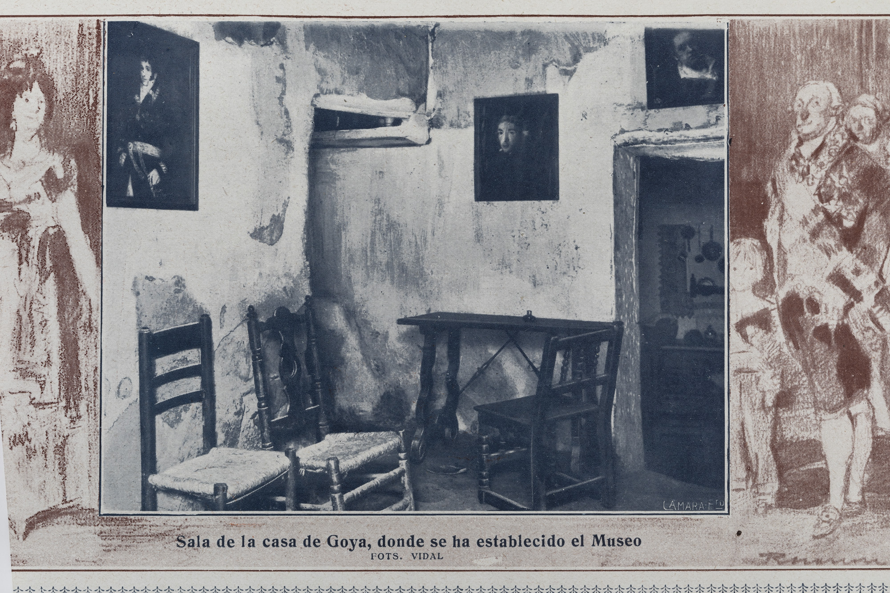
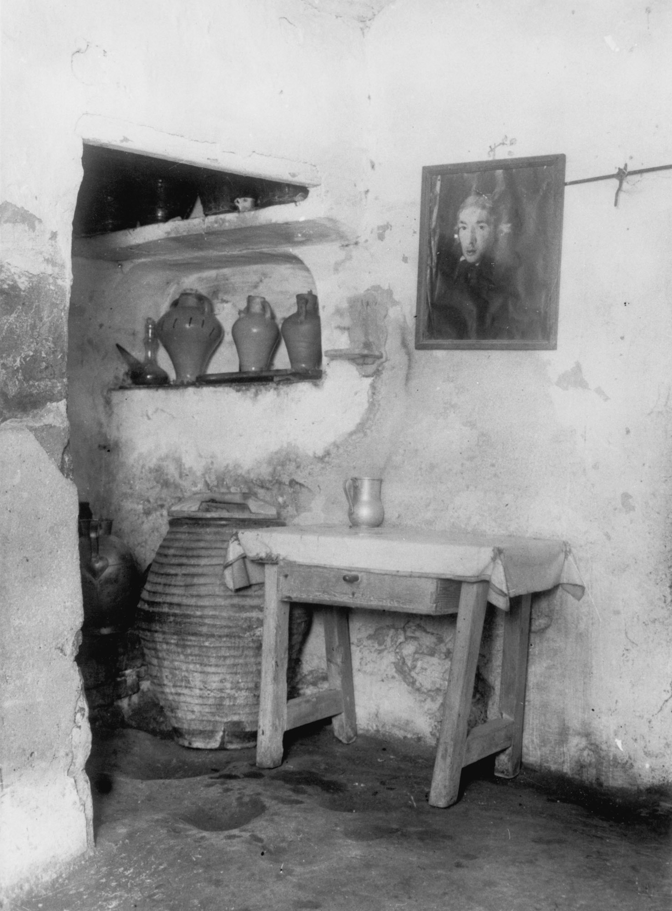
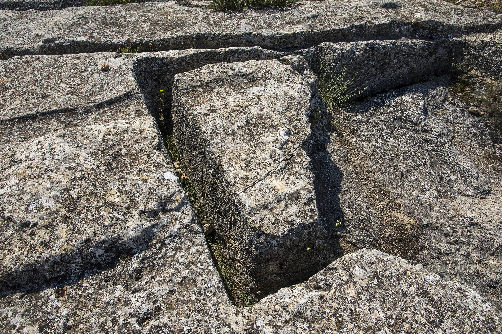
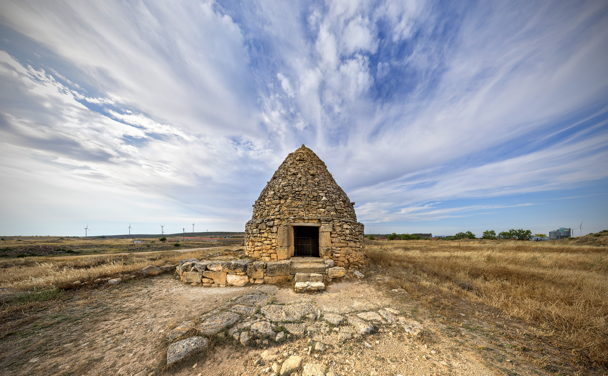

# Entrance hall and cool store

The entrance from Calle Alfóndiga is two steps below street level. To the left is the flight of stairs to the first floor. Straight ahead, at the back, is the kitchen [1], and to the right is the stable, which was opened up during restoration. Under the stairs, beside the north party wall, there is a small cool store with built-in masonry shelves and a block of fossil-bearing limestone [Fossil-bearing limestone] in the floor. Circular recesses in the stone hold pottery or other vessels in place. [2]

Much of the household’s everyday life took place here in summer, with daylight coming in only through the door. The small entrance has a lintel of round timbers on the inside and a plastered, whitewashed surround. The woodwork and iron fittings are old, though probably not original.

The ground floor has a ceiling of local pine joists, replaced with poplar where the timbers were renewed, and whitewashed shallow vaulting between them. The original floor was rammed clay. Stone paving was laid during the last restoration.

Detail of the stable in the ground-floor axonometric drawing. Drawing by Héctor Arcusa Magallón.

Detail of the stable in the ground-floor plan. Drawing by Héctor Arcusa Magallón.

View from the entrance hall towards the cool store, without the recess for the vessels, and the kitchen door. Photograph by José Vidal Gabarró (c. 1869–1935), 1917.

The cool store in the entrance hall, with a recess for earthenware vessels and a glass *porrón*. Above the table is a photographic reproduction of Goya’s portrait of Leandro Fernández de Moratín, held by the Museum of the Royal Academy of Fine Arts of San Fernando, Madrid. Unknown photographer, before 1928.

## Fossil-bearing limestone

The local quarries yielded a limestone formed in the Tertiary, some nine or ten million years ago during the Miocene, when inland lakes covered the area. Its Spanish name, *caracoleña*, comes from *caracol* (snail) and refers to the fossil gastropods deposited in the rock. Their hollow interiors make the stone both light and strong. It was prized in Goya’s day because it was easy to quarry, cut and turn over for use. In Fuendetodos it was used to build ice houses such as La Culroya. [Ω] The nearby Roman dam at Almonacid de la Cuba, dating from the first century AD, and Zaragoza’s Roman wall, medieval Stone Bridge, base of La Seo Cathedral’s bell tower and foundations of the Basilica of El Pilar were also built with this lake-formed stone.

Block of fossil-bearing limestone from Fuendetodos.

La Culroya ice house in Fuendetodos, datable to the eighteenth century.
