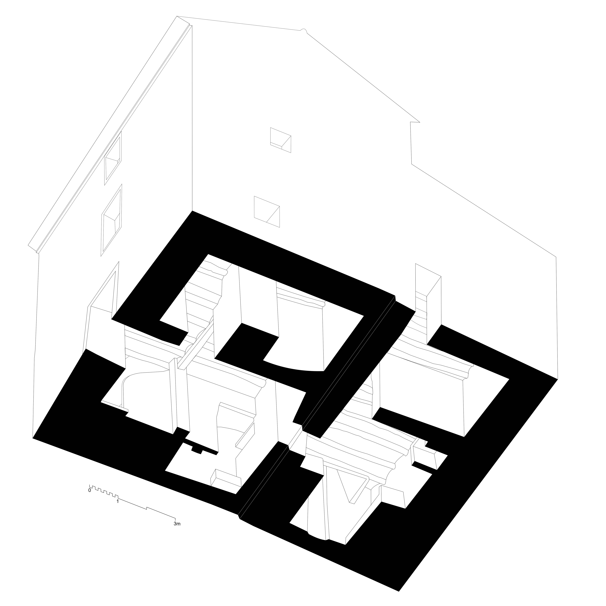
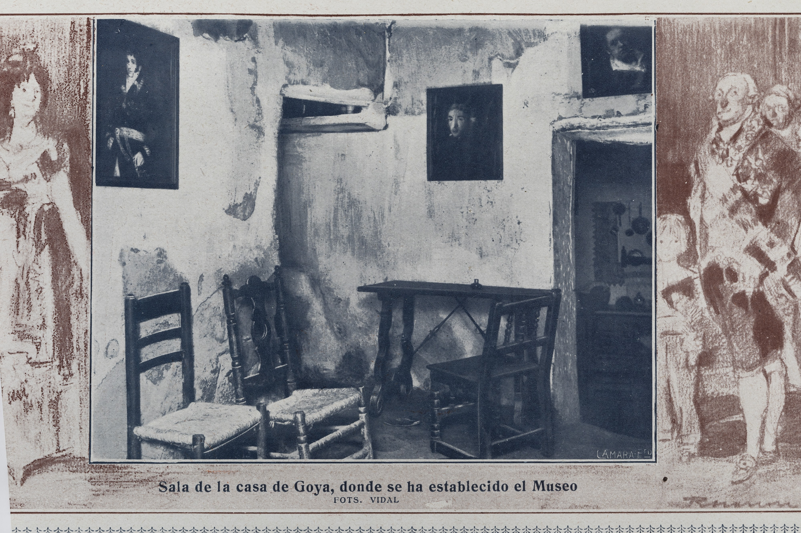
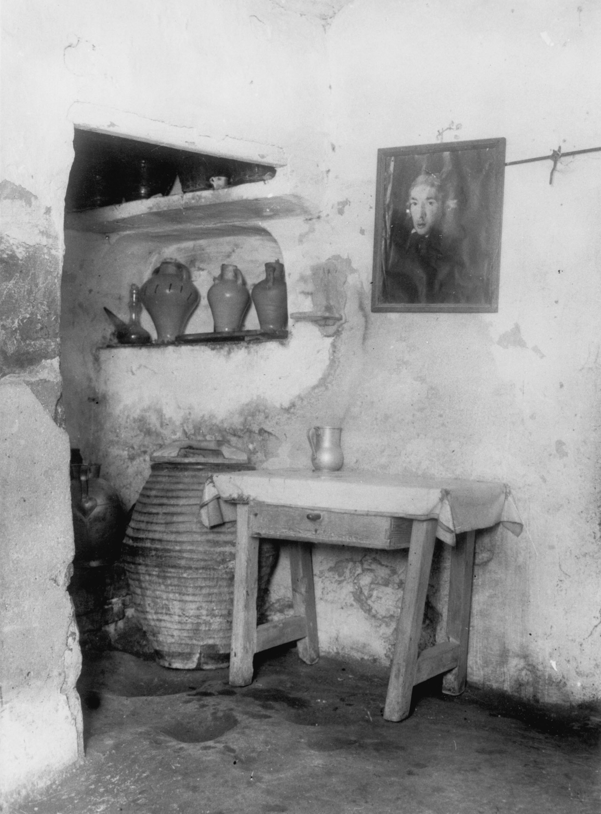
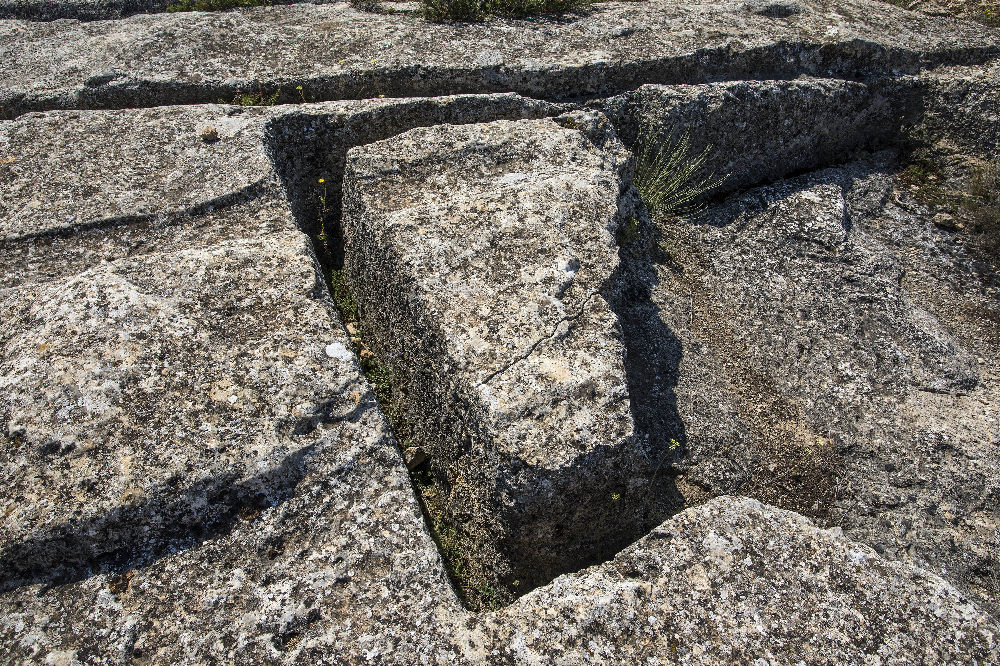
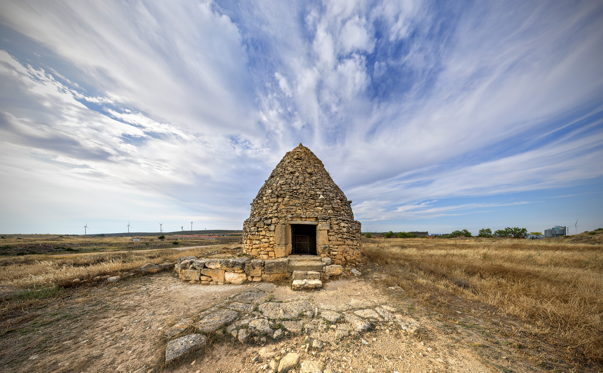

# Vestibule et garde-manger frais

L’entrée donne sur la calle Alfóndiga, située deux marches plus haut. À gauche, un escalier monte à l’étage principal. Au fond, dans l’axe de l’entrée, se trouve la cuisine [1] et, à droite, l’écurie, ouverte lors de la restauration. Sous l’escalier, le long du mur mitoyen nord, un petit garde-manger frais comporte des étagères maçonnées. Un bloc de calcaire fossilifère [Calcaire fossilifère], posé au sol, présente des creux circulaires qui maintenaient en place des récipients en céramique ou en d’autres matériaux. [2]

Une grande partie de la vie domestique se déroulait ici en été. La seule lumière venait de la porte. On y accède par une petite ouverture dont le linteau, à l’intérieur, est formé de rondins. L’encadrement est enduit de plâtre et blanchi à la chaux. La menuiserie et la serrurerie sont anciennes, mais probablement pas d’origine.

Le plafond du rez-de-chaussée est constitué de poutres de pin local, remplacées par du peuplier là où elles ont été renouvelées, et de voûtains blanchis à la chaux. Le sol d’origine était en terre argileuse battue. Il a été dallé de pierre lors de la dernière restauration.

Détail de l’écurie sur la vue axonométrique du rez-de-chaussée. Dessin de Héctor Arcusa Magallón.

Détail de l’écurie sur le plan du rez-de-chaussée. Dessin de Héctor Arcusa Magallón.

Vue du vestibule vers le garde-manger frais, sans la niche destinée aux récipients, et la porte de la cuisine. Photographie de José Vidal Gabarró (vers 1869–1935), 1917.

Le garde-manger frais du vestibule, avec une niche pour les récipients en céramique et un *porrón* en verre. Au-dessus de la table figure une reproduction photographique du portrait de Leandro Fernández de Moratín peint par Goya, conservé au musée de l’Académie royale des beaux-arts de San Fernando, à Madrid. Photographe inconnu, avant 1928.

## Calcaire fossilifère

Ce calcaire des carrières locales s’est formé au Tertiaire, il y a neuf à dix millions d’années, au Miocène, lorsque des lacs intérieurs couvraient la région. Son nom espagnol, *caracoleña*, vient de *caracol* (escargot) et désigne les gastéropodes fossiles présents dans la roche. Leurs cavités rendent la pierre à la fois légère et résistante. À l’époque de Goya, on l’appréciait pour sa facilité d’extraction, de taille et de manipulation. À Fuendetodos, elle a servi à construire des glacières, dont celle de La Culroya. [Ω] Le barrage romain voisin d’Almonacid de la Cuba, du Ier siècle apr. J.-C., ainsi que la muraille romaine, le pont de Pierre médiéval, la base du clocher de la cathédrale de La Seo et les fondations de la basilique du Pilar à Saragosse sont également construits dans cette roche lacustre.

Bloc de calcaire fossilifère de Fuendetodos.

Glacière de La Culroya à Fuendetodos, sans doute du XVIIIe siècle.
