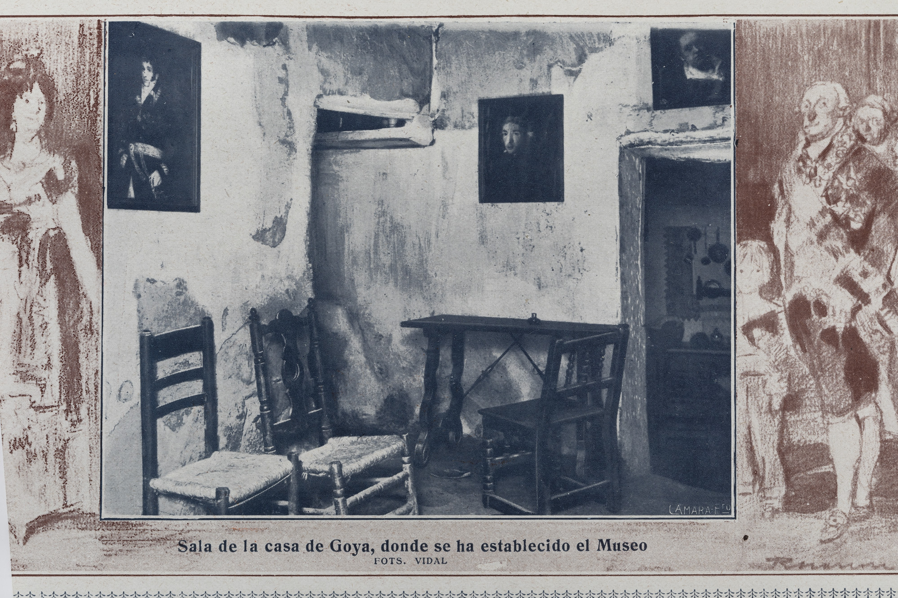
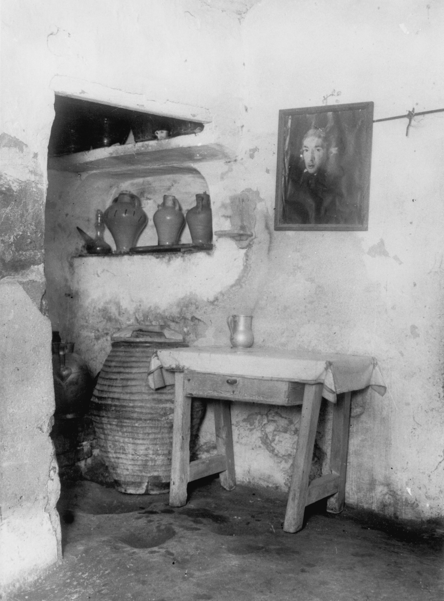
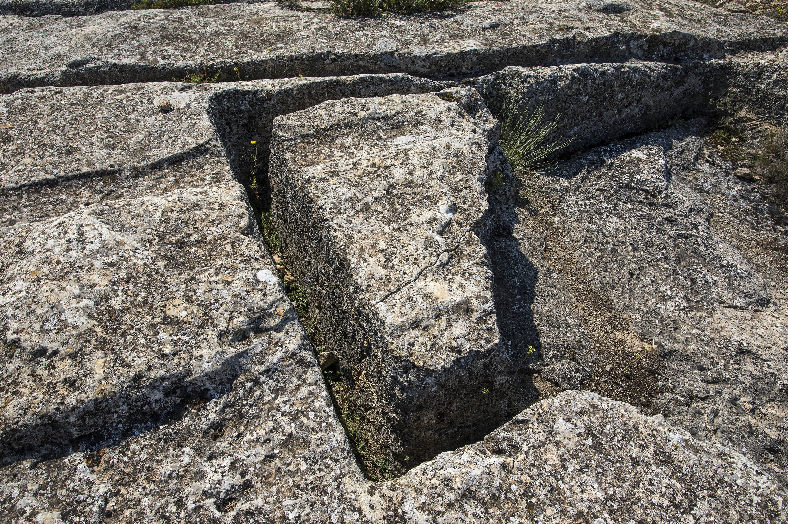
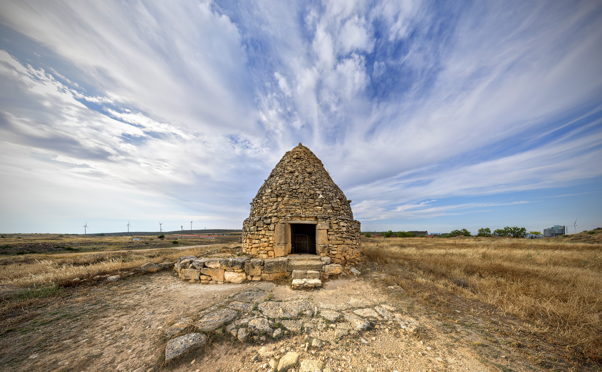

# Zaguán y fresquera [a] [b]

Espacio de entrada por la calle Alfondiga con la que se encuentra a un nivel inferior que se salva mediante dos escalones. Distribuye el paso: a la izquierda, al ramal de la escalera que accede a la planta principal; por el centro, al fondo, a la cocina; [1] y, a la derecha, a la cuadra —abierta durante la rehabilitación—. En el hueco de la escalera junto al medianil norte se encuentra una pequeña fresquera con estantes de obra empotrados y en el suelo, un sillar de piedra caracoleña [Piedra caracoleña] con hendiduras circulares para fijar recipientes de cerámica u otros materiales. [2]

	En este lugar sin más luz que la proveniente de la puerta se hacía una gran parte de la vida hogareña en la época del estío. Se accede por una pequeña puerta adintelada mediante rollos de madera en su interior, recercada en yeso y encalada; la carpintería y la cerrajería son antiguas, pero probablemente no son las originales.

	Toda la planta baja esta techada con vigas de madera de pino del país —chopo en las vigas rehabilitadas— y revoltón encalado. El suelo de la planta baja fue enlosado en piedra durante la última rehabilitación, pero el original fue de arcilla apisonada.

Detalle de la cuadra de la planta axonométrica del piso bajo. Plano de Héctor Arcusa Magallón.

Detalle de la cuadra de la planta baja. Plano de Héctor Arcusa Magallón.

Vista del zaguán hacia la fresquera —sin el nicho para contener las vasijas— y la puerta de la cocina. Fotografía de José Vidal Gabarró (h. 1869-1935) realizada en 1917.

Fresquera del zaguán con un nicho para contener las vasijas de cerámica y un porrón de vidrio. Encima de la mesa una reproducción fotográfica del retrato de Leandro Fernández de Moratín pintado por Goya (Madrid, Museo de la Real Academia de Bellas Artes de San Fernando). Fotógrafo desconocido, antes de 1928.

## Piedra caracoleña

Tipo de roca caliza de las canteras locales formada en la era Terciaria, hace unos nueve o diez millones de años en el periodo mioceno cuando todo el territorio estaba ocupado por lagos interiores. Recibe su nombre por los fósiles de gasterópodos sedimentados —*caracoleña* derivado de caracol— cuyo interior está hueco lo que provee de gran ligereza a la vez que resistencia a esta piedra. Fue muy apreciada en la época de Goya por su fácil extracción y corte, y su eficacia para voltear y otros usos. Se empleó en Fuendetodos para construir las neveras como, por ejemplo, la de la Culroya. [Ω] La vecina presa romana de Almonacid de la Cuba (siglo I d. C.) y en Zaragoza: la muralla romana, el Puente de Piedra medieval, la base de la torre campanario de la catedral de La Seo y el basamento del templo del Pilar son todos de esta roca lacustre.

Sillar de piedra caracoleña de Fuendetodos.

Nevera de la Culroya en Fuendetodos, datable en el siglo XVIII.
