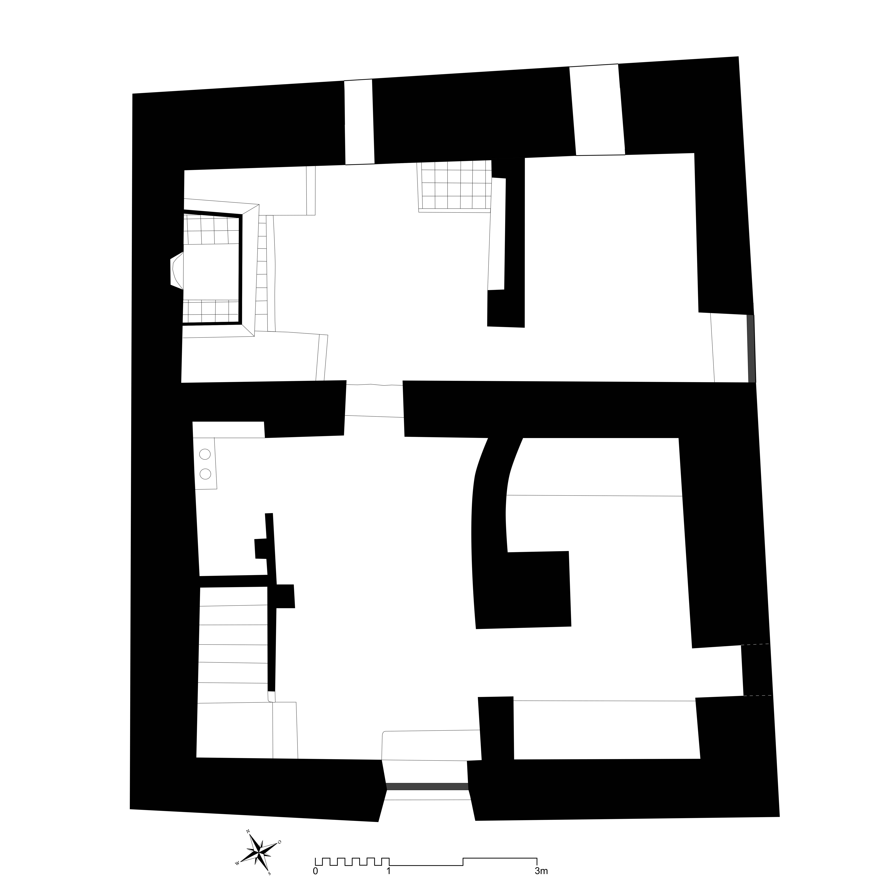
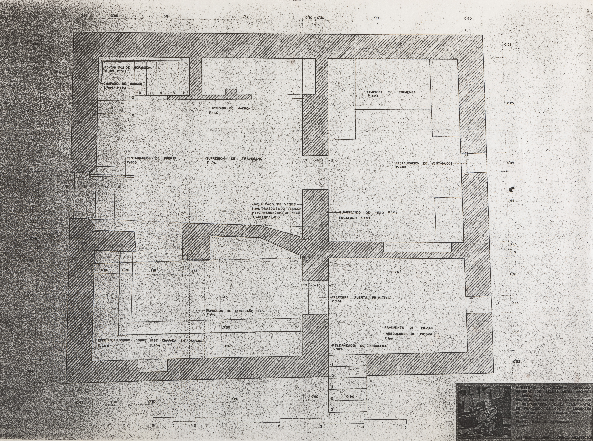

# Stable

Horses and pack animals were housed in this space, which has a ceiling of round timber joists with shallow vaulting between them. A small modern door to the right of the entrance hall gives access. A window in the south wall once overlooked the yard. Its blocked opening is still visible. It was closed off by the party wall of the Goya Schools, built in 1917. Traces of the feeding trough are still visible on the floor. The bedchambers are directly above, so the animals’ warmth would have made those rooms more comfortable in winter.

Access probably changed when the Goya Schools were built in 1917. The original doorway was in the east wall and connected the stable to the room beside the kitchen. It was later blocked up. A new doorway from the entrance hall was opened during restoration. [1] The pier supporting the upper floor was incorporated into this part of the building to keep the entrance hall clear.

Detail of the stable in the ground-floor axonometric drawing. Drawing by Héctor Arcusa Magallón.

Detail of the stable in the ground-floor plan. Drawing by Héctor Arcusa Magallón.

Ground floor in April 1982, before the last restoration. Library and Archive, Provincial Council of Zaragoza.
