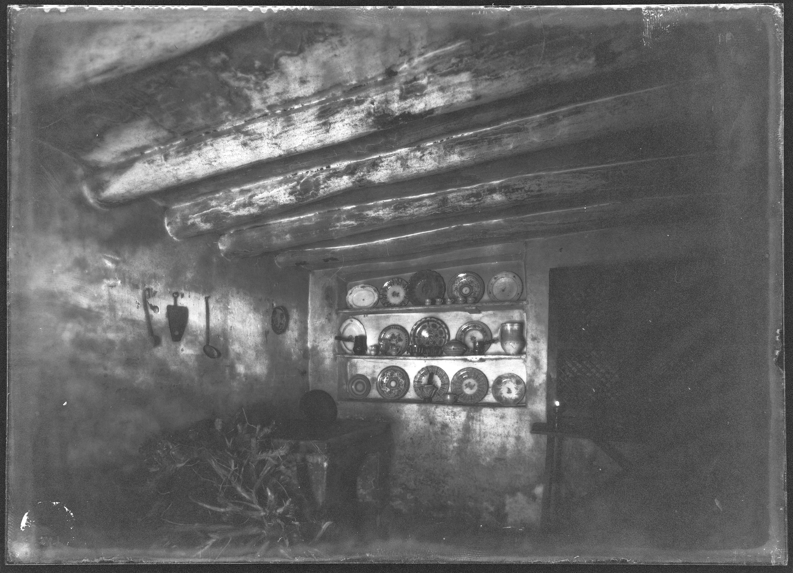
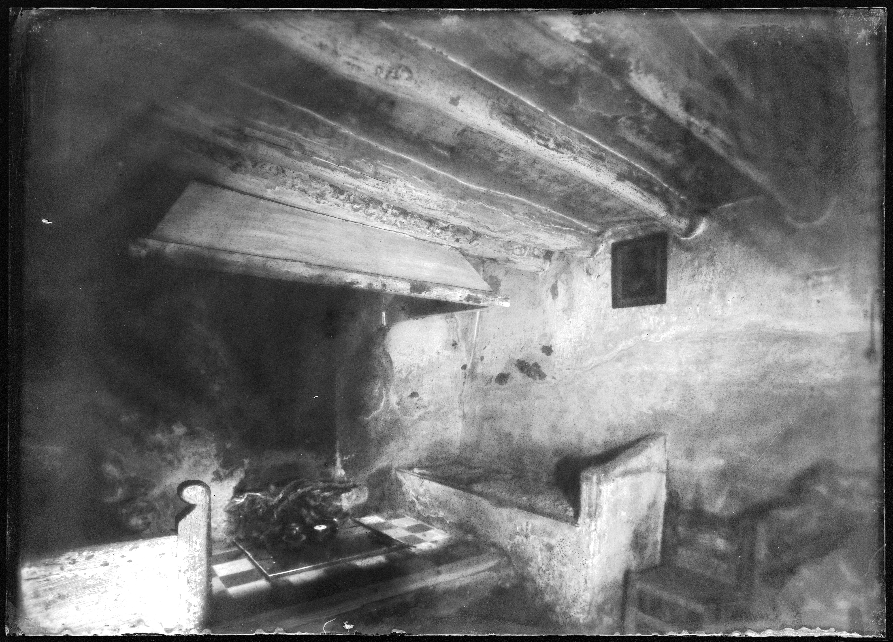
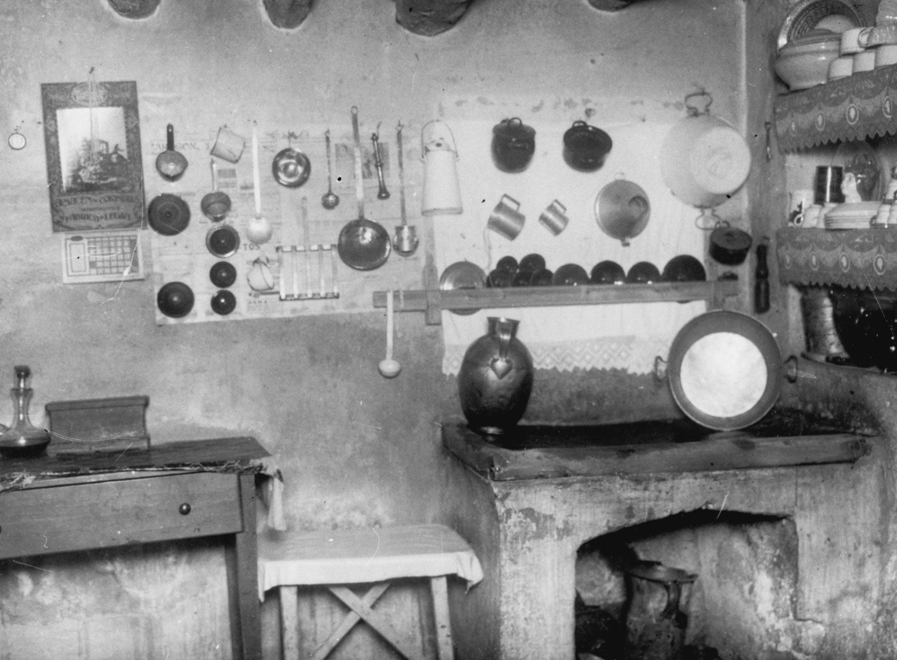
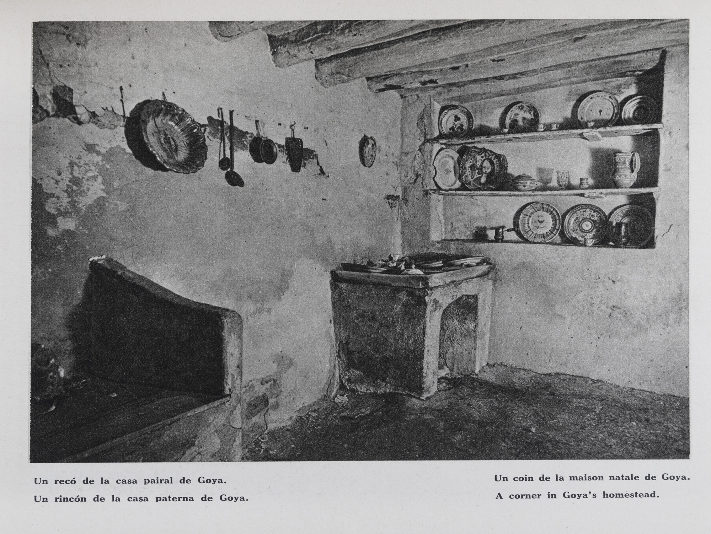

# Kitchen

At the eastern end of the ground floor, the kitchen was one of the principal rooms of the house. It had round ceiling joists with shallow vaulting between them [1], whitewashed walls and a rammed-clay floor, which was covered with irregular stone slabs during the last restoration. The hearth and chimney [2] stand against the north party wall, between two whitewashed masonry benches with built-in armrests. The chimney hood is shaped like a truncated pyramid and made of reeds coated with gypsum plaster, supported by lengths of local pine. The chimney drew poorly and produced considerable smoke. This earned the people of Fuendetodos the nickname *faumaos* (smoked), though how widely or how long the name was used is unknown. Opposite are a masonry sink [3] and a built-in dish rack with local pine shelves [4]. People cooked, ate and spent much of their leisure time by the fire. The benches also served as beds, particularly in cold weather. Daylight came in only through the street door, and the kitchen is one step below the entrance hall. The small barred opening in the east wall was made after 1928, following the demolition of an adjoining building visible in early twentieth-century photographs. The restoration designed in 1982 added a doorway to the adjacent room to the east.

Detail of the stable in the ground-floor axonometric drawing. Drawing by Héctor Arcusa Magallón.

Detail of the stable in the ground-floor plan. Drawing by Héctor Arcusa Magallón.

Southeast corner of the kitchen, showing firewood, the masonry sink and dish rack, and a cupboard. Photograph by Juan Mora Insa (1880–1954), before 1928. Provincial Historical Archive of Zaragoza, Government of Aragón.

The kitchen hearth. Photograph by Juan Mora Insa (1880–1954), before 1928. Provincial Historical Archive of Zaragoza, Government of Aragón.

The kitchen sink and dish rack. Photograph by José Vidal Gabarró (c. 1869–1935), 1917. [*Estampa* weekly]

The kitchen sink and dish rack. Unknown photographer. Published in *Goya*, Barcelona, UGT, 1936.
