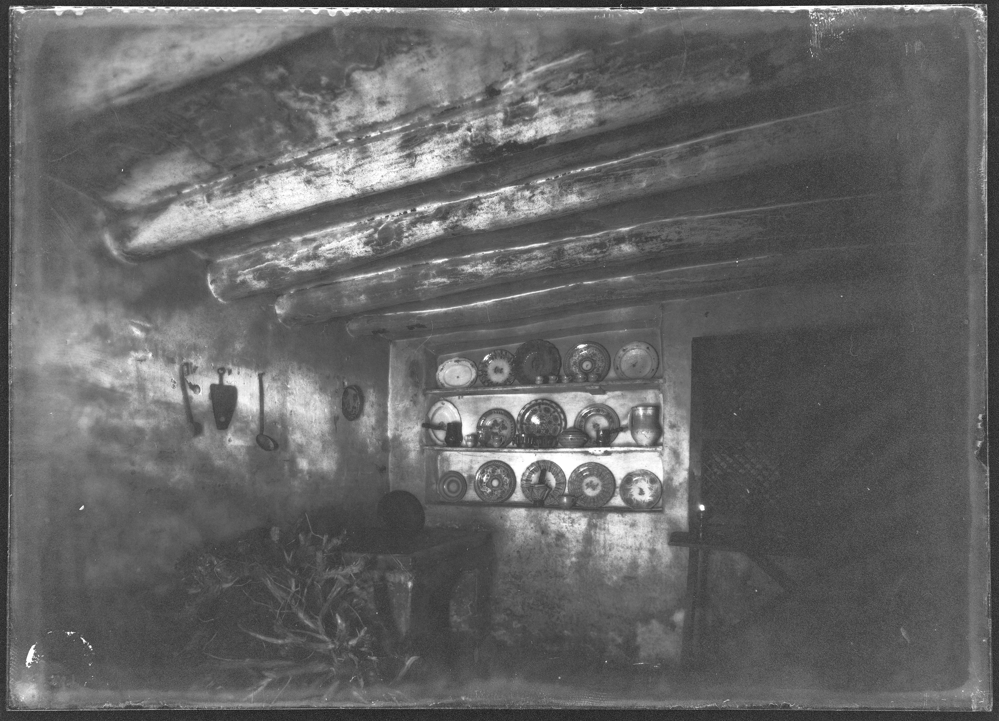
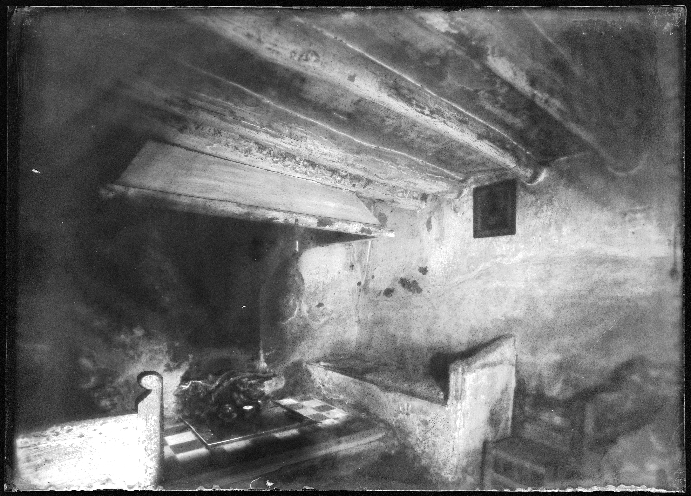
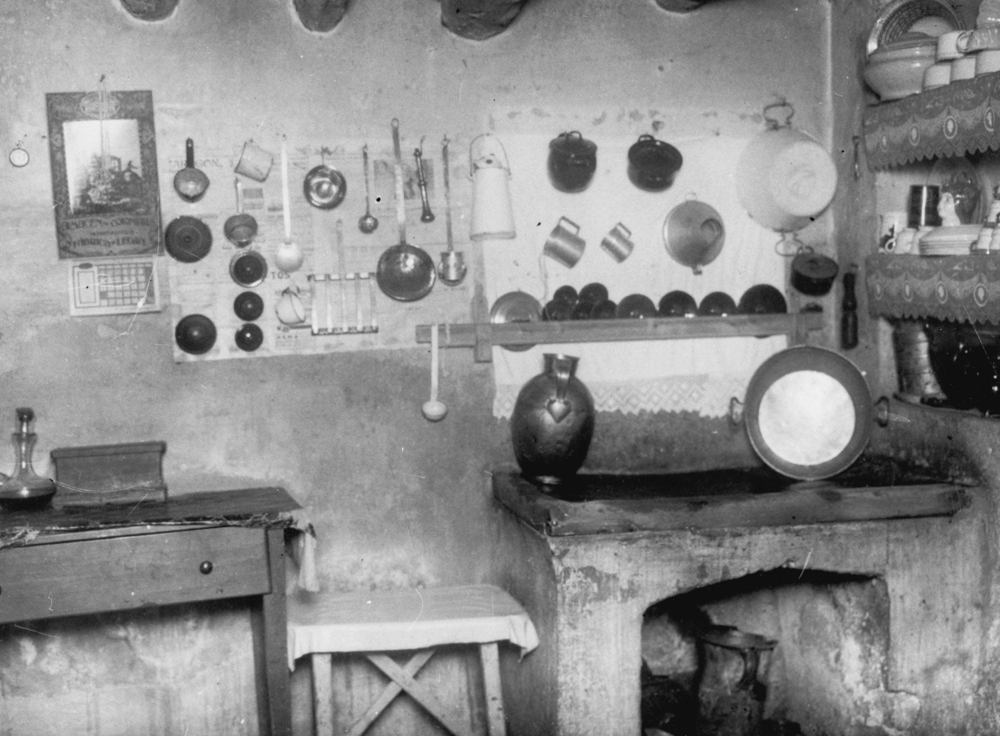
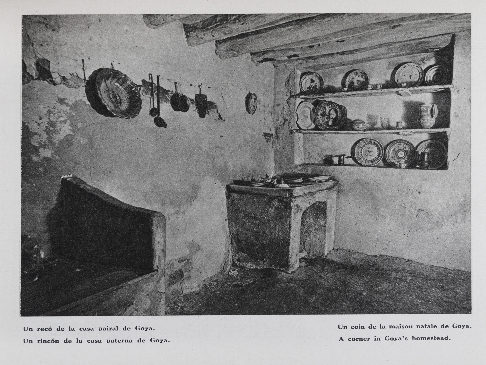

# Cuisine

Au fond du rez-de-chaussée, à l’extrémité est, la cuisine était l’une des pièces principales de la maison. Son plafond était formé de rondins et de voûtains [1], ses murs blanchis à la chaux et son sol en terre argileuse battue. Des dalles irrégulières ont recouvert le sol lors de la dernière restauration. Le foyer et la cheminée [2] s’appuient contre le mur mitoyen nord. Deux bancs maçonnés, dotés d’accoudoirs également maçonnés, l’encadrent. L’ensemble est blanchi à la chaux. La hotte, en forme de pyramide tronquée, est constituée de cannes enduites de plâtre, soutenues par des pièces de pin local. Le mauvais tirage dégageait beaucoup de fumée. Les habitants de Fuendetodos auraient ainsi reçu le surnom de *faumaos* (« enfumés »), dont on ignore l’ancienneté et l’étendue de l’usage. En face se trouvent un évier [3] et un vaisselier maçonné muni d’étagères en pin local. [4] On cuisinait, mangeait et passait une bonne partie de son temps au coin du feu en dehors des heures de travail. Les bancs servaient aussi de lits, surtout pendant les mois froids. La seule lumière naturelle venait de la porte sur rue. Une marche sépare la cuisine, plus basse, du vestibule. La petite fenêtre grillagée du mur extérieur est a été percée après la démolition, postérieure à 1928, d’un bâtiment voisin visible sur des photographies du début du XXe siècle. Lors de la restauration conçue en 1982, on a ajouté une porte vers la pièce attenante à l’est.

Détail de l’écurie sur la vue axonométrique du rez-de-chaussée. Dessin de Héctor Arcusa Magallón.

Détail de l’écurie sur le plan du rez-de-chaussée. Dessin de Héctor Arcusa Magallón.

Angle sud-est de la cuisine, avec le bois de chauffage, l’évier et le vaisselier maçonnés, ainsi qu’un placard. Photographie de Juan Mora Insa (1880–1954), avant 1928. Archives historiques provinciales de Saragosse, Gouvernement d’Aragon.

Le foyer de la cuisine. Photographie de Juan Mora Insa (1880–1954), avant 1928. Archives historiques provinciales de Saragosse, Gouvernement d’Aragon.

L’évier et le vaisselier de la cuisine. Photographie de José Vidal Gabarró (vers 1869–1935), 1917. [Hebdomadaire *Estampa*]

L’évier et le vaisselier de la cuisine. Photographe inconnu. Publié dans *Goya*, Barcelone, UGT, 1936.
