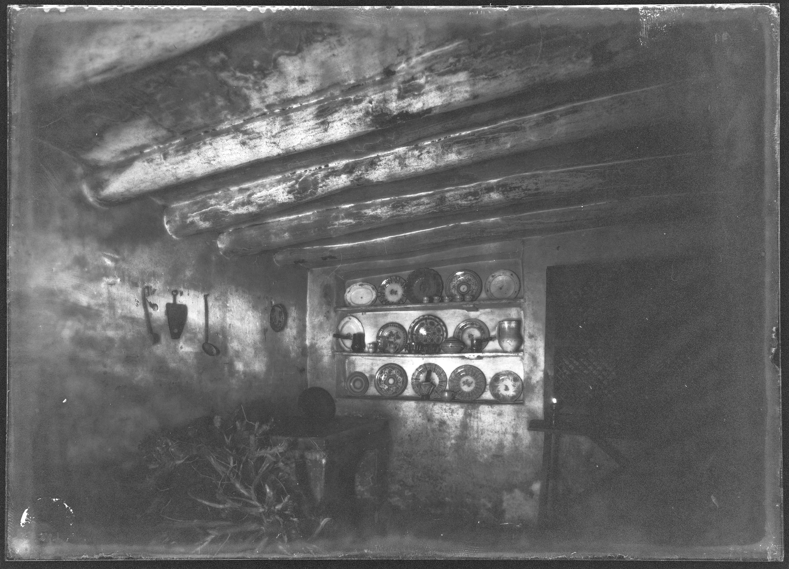
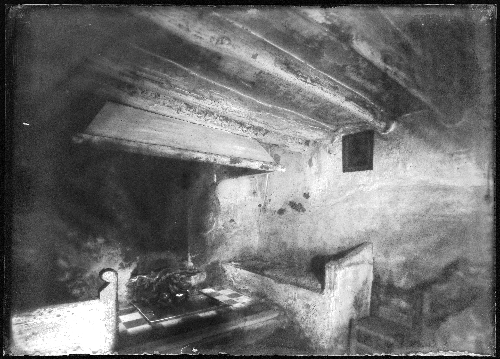
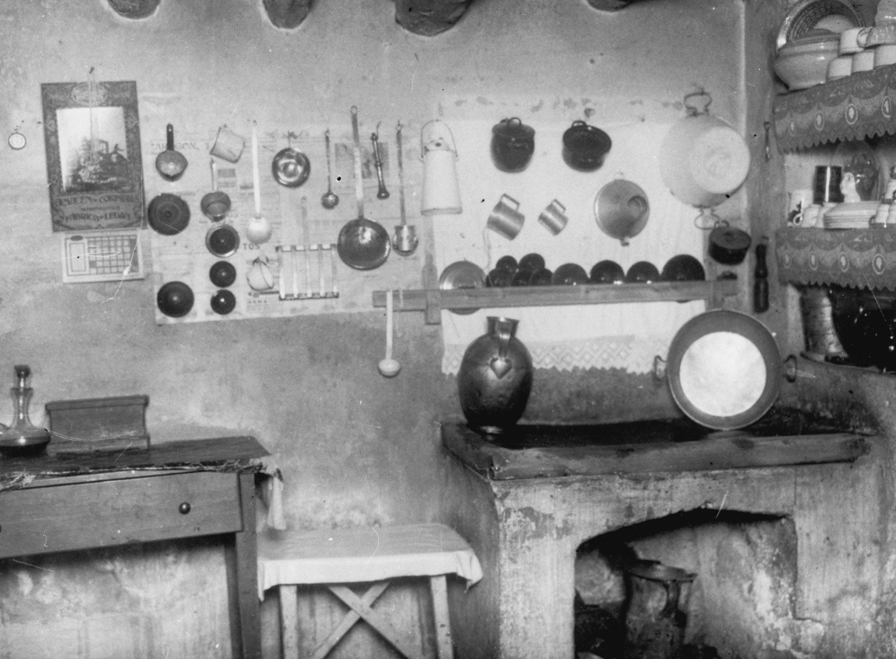
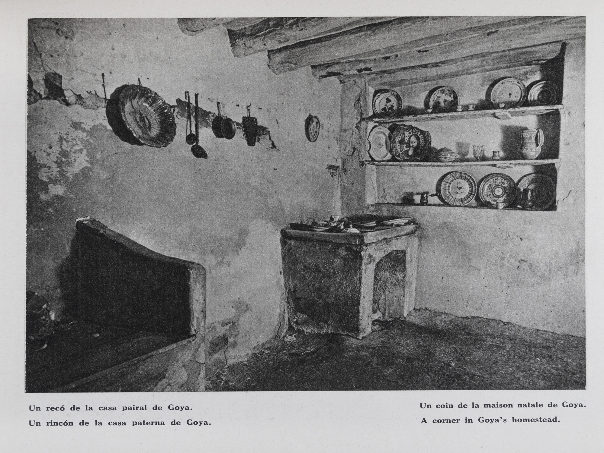

# Cocina [A] [B]

Situada al fondo de la planta baja, al extremo este, la cocina fue una pieza principal de la casa. Techada con rollizos y revoltón, [1] las paredes estaban encaladas y el suelo era de arcilla apisonada que en la última rehabilitación fue cubierto con losas irregulares de piedra. El hogar con la chimenea [2] se levanta sobre el medianil norte y está flanqueado por dos poyos de obra con un pretil apoyabrazos también de obra y todo encalado. La campana de la chimenea es troncopiramidal construida con cañizos cubiertos de aljez que descansan en largueros de pino del país. Las deficiencias del tiro produjeron considerable humo, razón por la que a los fuendetodinos se les apodó  *faumaos* (ahumados) sin que conozca la extensión del uso y antigüedad de este mote. Enfrente, un fregadero [3] y un vajillero [4] con estantes de pino del país, ambos de obra. En esta estancia se cocinaba, comía y se hacía buena parte de la vida al amor de la lumbre, cuando no se trabajaba. Los bancos de obra se utilizaron también como lecho, en especial en los meses fríos. La estancia no tenía luz natural salvo la que procedía de la puerta de la calle; se encuentra a un nivel inferior al del zaguán que se salva mediante un escalón. El ventanuco con reja en el muro exterior E se abrió después del derribo de una construcción aledaña —después de 1928— documentada fotográficamente a comienzos del siglo XX. En la rehabilitación de la casa proyectada en 1982 se practicó una nueva puerta para comunicación con la habitación E contigua.

Detalle de la cuadra de la planta axonométrica del piso bajo. Plano de Héctor Arcusa Magallón.

Detalle de la cuadra de la planta baja. Plano de Héctor Arcusa Magallón.

Vista del ángulo sureste de la cocina que muestra: leña, un fregadero y vajillero de obra, y una alacena. Fotografía de Juan Mora Insa (1880-1954) realizada antes de 1928. Archivo Histórico Provincial de Zaragoza, Gobierno de Aragón.

El hogar de la cocina. Fotografía de Juan Mora Insa (1880-1954) realizada antes de 1928. Archivo Histórico Provincial de Zaragoza, Gobierno de Aragón.

Vista del fregadero y del vajillero en la cocina. Fotografía de José Vidal Gabarró (h. 1869-1935) realizada en 1917. [semanario *Estampa*]

Vista del fregadero y del vajillero en la cocina. Fotógrafo desconocido; publicada en Goya, Bareclona, UGT, 1936.
