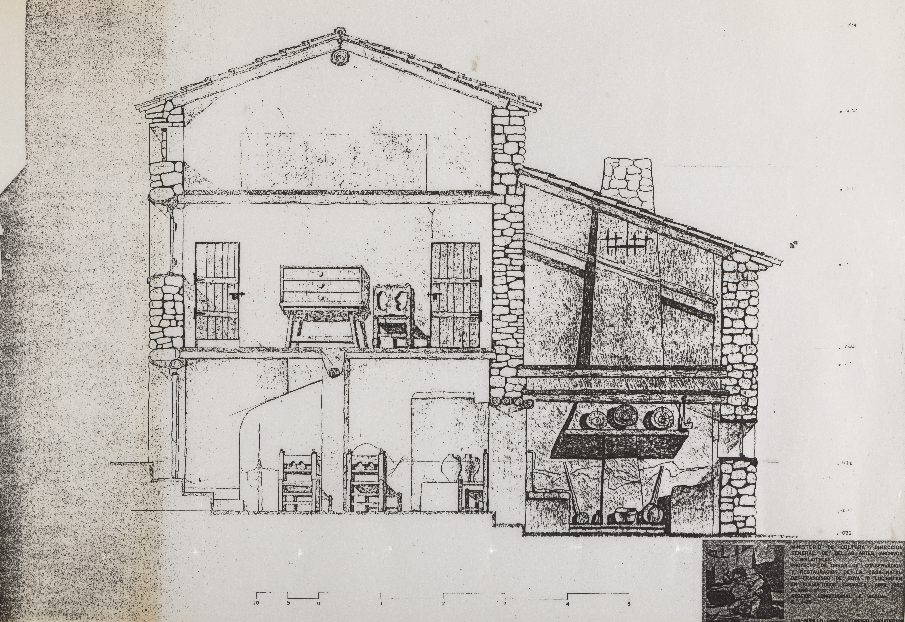
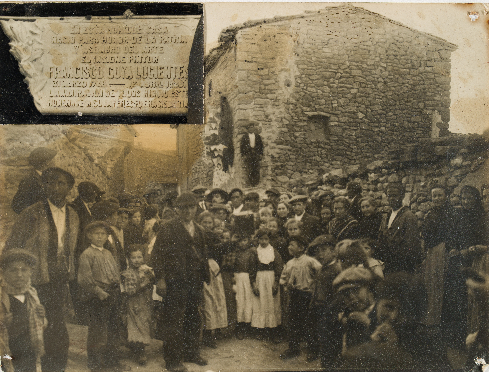

# East room

This first-floor room lies below the level of the main room, whose east wall it shares. [1] It is above the kitchen, with the kitchen chimney flue running along its north wall. Its door faces the top of the first flight of stairs. Its precise use is unknown. Its single-pitch roof rests on round local pine timbers and modern reedwork. A small window was opened in the west wall towards Paseo de Vista Alegre.

The room was added in the twentieth century and did not form part of Goya’s birthplace. It does not appear in known photographs from the early 1900s. [2]

The room presents the history of Fuendetodos through its links to Francisco de Goya and his maternal family, the Lucientes.

Detail of the first-floor axonometric drawing. Drawing by Héctor Arcusa Magallón.

Detail of the first-floor plan. Drawing by Héctor Arcusa Magallón.

Detail of the east room in an east–west section of the house before the last restoration. Library and Archive, Provincial Council of Zaragoza.

Detail of the party wall facing the yard. Gelatin silver bromide photograph by Luis Gandú Mercadal, taken on 16 April 1913. Vintage print, Museum of Zaragoza, inventory no. 56194 (photographic reproduction by Omar El Kadmiri Pedraza).
