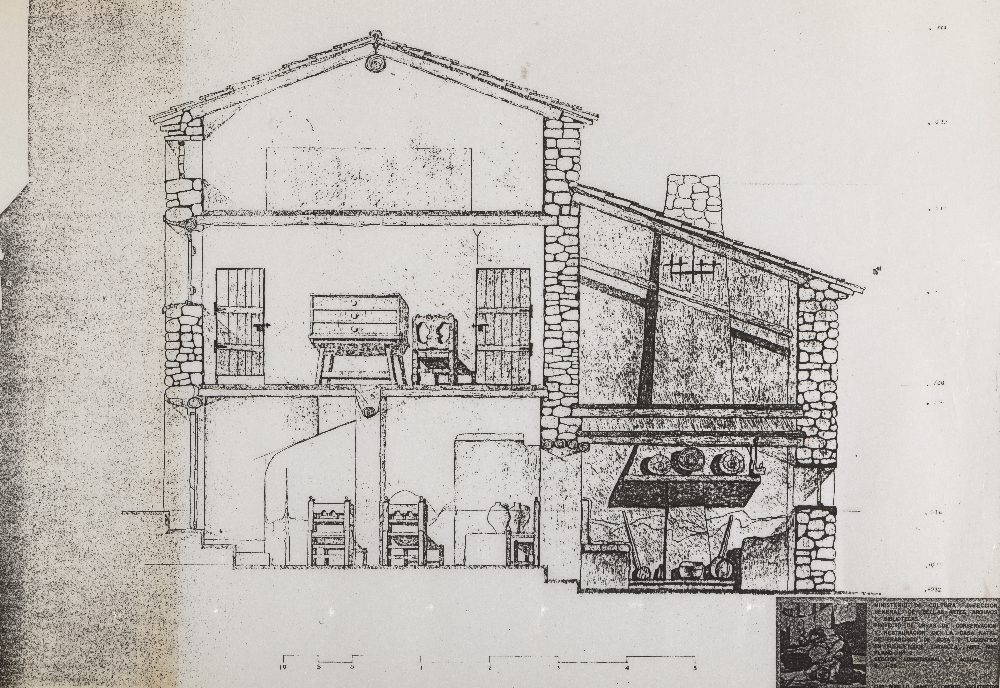
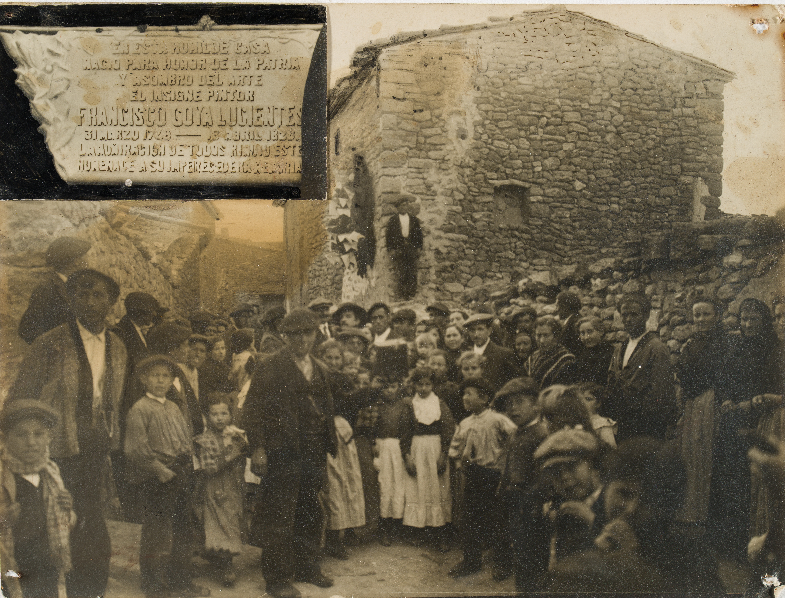

# Pièce est

Cette pièce du premier étage se trouve à un niveau plus bas que la salle, dont elle partage le mur est. [1] Elle est située au-dessus de la cuisine, dont le conduit de cheminée longe le mur nord. On y accède par une porte en face de l’arrivée de la première volée d’escalier. Sa fonction précise demeure inconnue. Le toit à un seul versant repose sur des rondins de pin local et un lattis de cannes moderne. Une petite fenêtre a été ouverte dans le mur ouest en direction du paseo de Vista Alegre.

Cette pièce ne faisait pas partie de la maison natale de Goya. Elle a été construite au XXe siècle, car elle n’apparaît pas sur les photographies connues du début des années 1900. [2]

La pièce présente l’histoire de Fuendetodos à travers ses liens avec Francisco de Goya et sa famille maternelle, les Lucientes.

Détail de la vue axonométrique du premier étage. Dessin de Héctor Arcusa Magallón.

Détail du plan du premier étage. Dessin de Héctor Arcusa Magallón.

Détail de la pièce est sur une coupe est-ouest de la maison avant la dernière restauration. Bibliothèque et archives de la Diputación Provincial de Zaragoza.

Détail du mur mitoyen donnant sur la cour. Photographie au gélatino-bromure d’argent prise par Luis Gandú Mercadal le 16 avril 1913. Tirage d’époque, musée de Saragosse, n° d’inventaire 56194 (reproduction photographique d’Omar El Kadmiri Pedraza).
