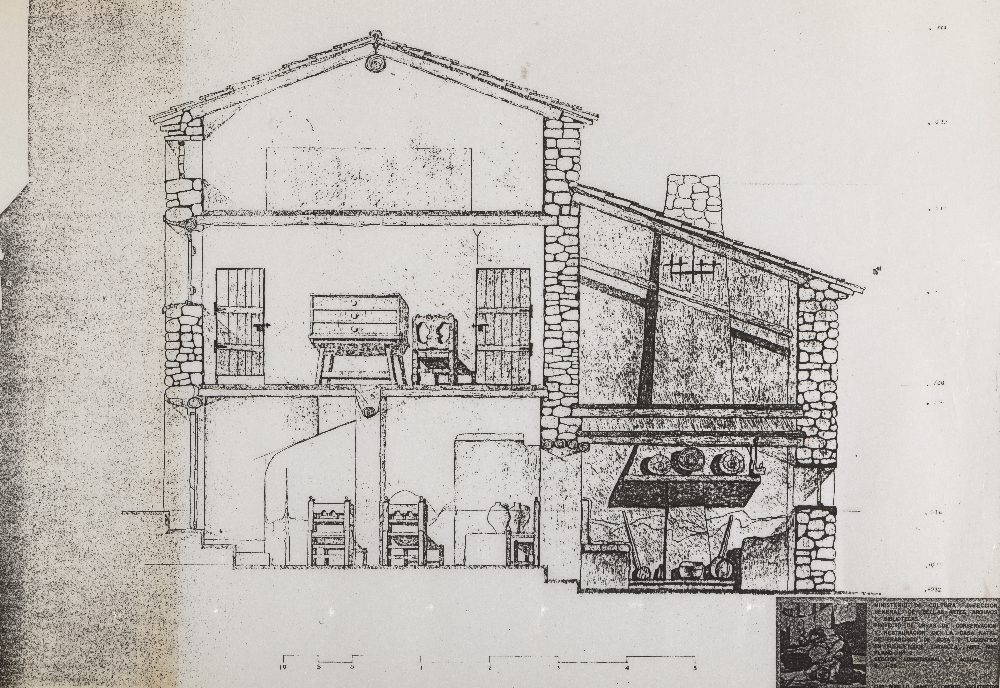
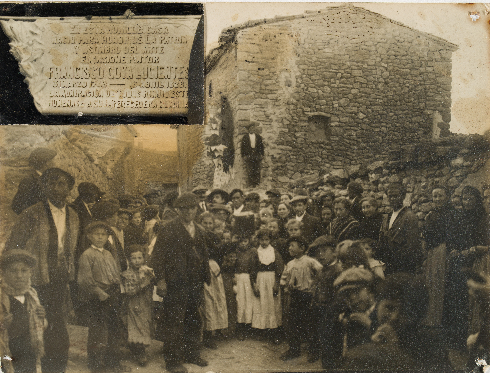

# Habitación este [A] [B]

Estancia de la planta primera, pero construida en un nivel más bajo que el de la sala con la que comparte pared por el lado este.[1] Está situada sobre la cocina —cuyo tiro de chimenea ocupa la pared norte— y se accede por una puerta enfrente del fin del primer ramal de la escalera. No se conoce su uso específico. Se cubre a un agua con un techado de rollizos de madera de pino del país y cañizo modernos. En la pared oeste se abrió una pequeña ventana dirigida hacia el paseo de Vista Alegre.

	No formó parte de la casa natal de Goya y se construyó en el siglo XX pues no se encuentra en las fotografías conocidas de comienzos del novecientos.[2]

	Este cuarto resume la historia de Fuendetodos en relación con Francisco de Goya y su familia materna, los Lucientes.

Detalle de la planta axonométrica del piso primero. Plano de Héctor Arcusa Magallón.

Detalle de la planta del piso primero. Plano de Héctor Arcusa Magallón.

Detalle de la habitación este en la sección E-O de la casa antes de la última rehabilitación. Archivo-Biblioteca, Diputación Provincial de Zaragoza.

Detalle del medianil hacia el corral. Fotografía de Luis Gandú Mercadal tomada el día 16 de abril de 1913; gelatinobromuro, copia *vintage*. Museo de Zaragoza NIG 56194 (reproducción fotográfica de Omar El Kadmiri Pedraza).
