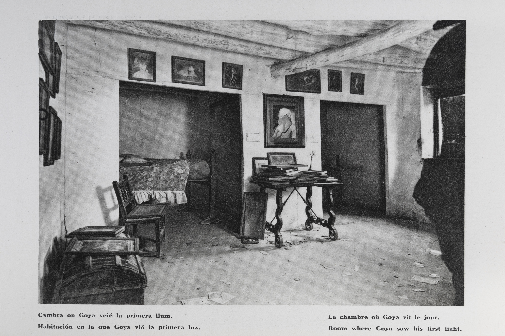
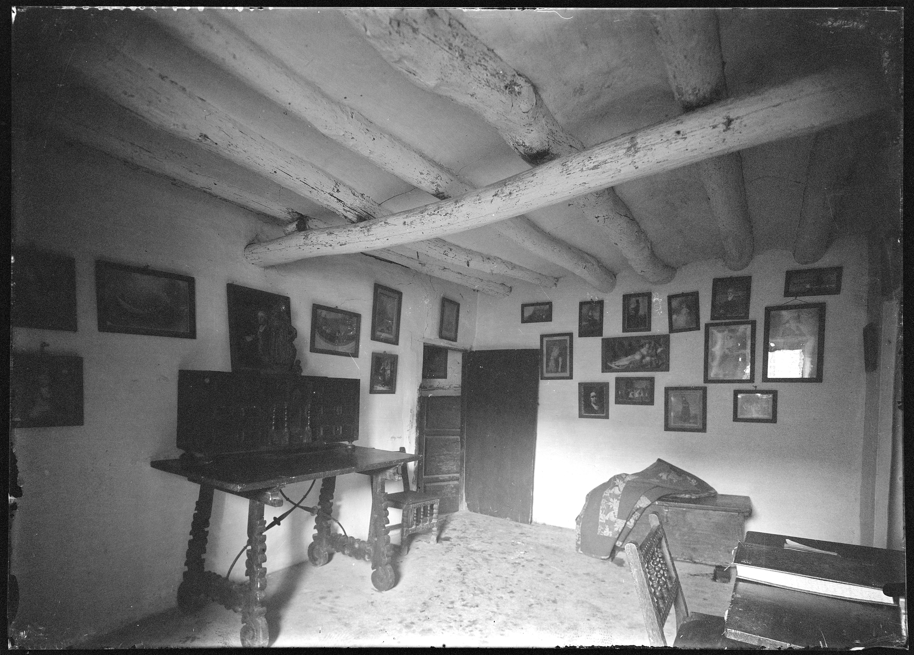
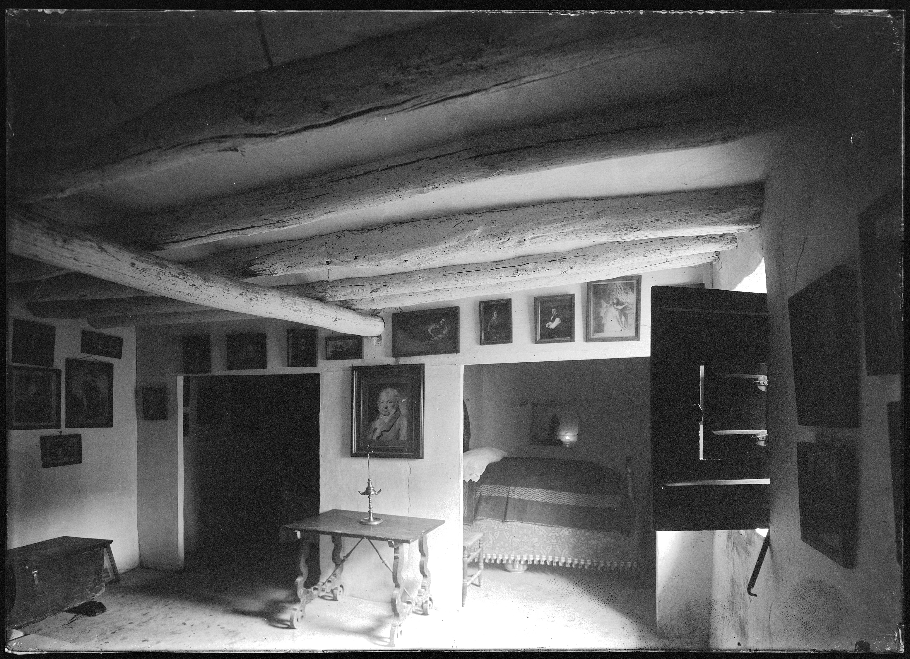

# Main room

The principal room of the house [1] is on the first floor. Its two doors open onto the two flights of stairs, one down to the entrance hall and kitchen and the other up to the attic. It has a rectangular plan with two bedchambers on the south side. Its original ceiling consists of round local pine joists with shallow vaulting between them. A transverse beam added for support [2] was removed in the last restoration. A central pier supports the ceiling of the whole storey and is concealed in the partition walls. The ceilings in this room and the adjoining rooms are low because a new floor structure was built across the storey to take the load off the original ground-floor ceiling, which was preserved. The room’s only window, still fitted with its original pine woodwork, overlooks Calle Alfóndiga. [3]

Detail of the main room in the first-floor axonometric drawing. Drawing by Héctor Arcusa Magallón.

Detail of the main room in the first-floor plan. Drawing by Héctor Arcusa Magallón.

The main room in disarray during the Civil War, looking southwest towards the bedchambers. Unknown photographer. Published in the pamphlet *Goya*, Barcelona, UGT, 1937.

The main room looking towards the door to the ground-floor stairs. Photograph by Juan Mora Insa, before 1928. Provincial Historical Archive of Zaragoza, Government of Aragón.

The main room looking south towards the entrances to the bedchambers. Photograph by Juan Mora Insa, before 1928. Provincial Historical Archive of Zaragoza, Government of Aragón.
