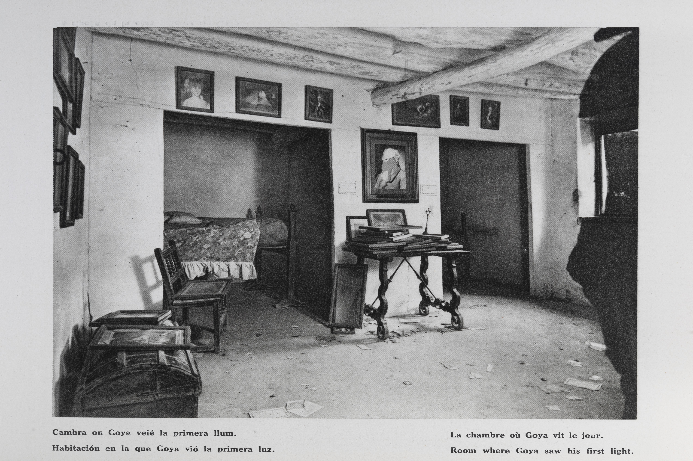
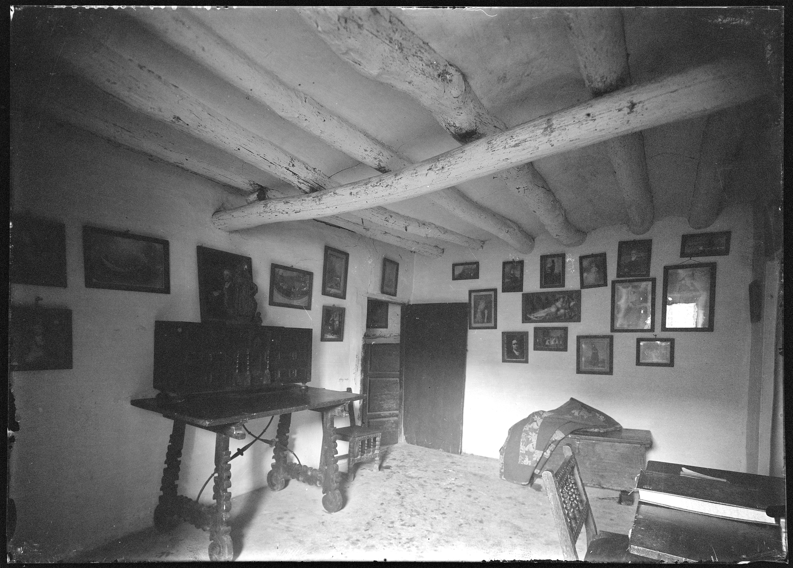
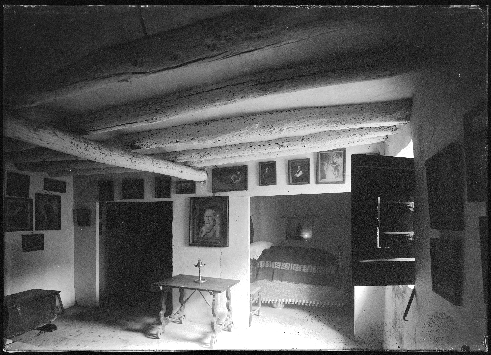

# Salle principale

La pièce principale de la maison [1] est au premier étage. Ses deux portes ouvrent sur les deux volées de l’escalier, l’une descendant au vestibule et à la cuisine, l’autre montant aux combles. De plan rectangulaire, elle dessert deux alcôves sur son côté sud. Le plafond d’origine est formé de rondins de pin local et de voûtains. Une poutre transversale ajoutée en renfort [2] a été retirée lors de la dernière restauration. Un pilier central soutient le plafond de tout l’étage et se trouve dissimulé dans les cloisons. Les plafonds de la salle et des pièces voisines sont bas parce qu’un nouveau plancher a été construit sur toute la surface de l’étage pour décharger le plafond d’origine du rez-de-chaussée, qui a été conservé. L’unique fenêtre, dont la menuiserie en pin est d’origine, donne sur la calle Alfóndiga. [3]

Détail de la salle sur la vue axonométrique du premier étage. Dessin de Héctor Arcusa Magallón.

Détail de la salle sur le plan du premier étage. Dessin de Héctor Arcusa Magallón.

La salle bouleversée par la guerre civile, vue en direction du sud-ouest vers les alcôves. Photographe inconnu. Publié dans la brochure *Goya*, Barcelone, UGT, 1937.

La salle, vue vers la porte qui donne sur l’escalier descendant au rez-de-chaussée. Photographie de Juan Mora Insa, avant 1928. Archives historiques provinciales de Saragosse, Gouvernement d’Aragon.

La salle, vue vers le côté sud où s’ouvrent les alcôves. Photographie de Juan Mora Insa, avant 1928. Archives historiques provinciales de Saragosse, Gouvernement d’Aragon.
