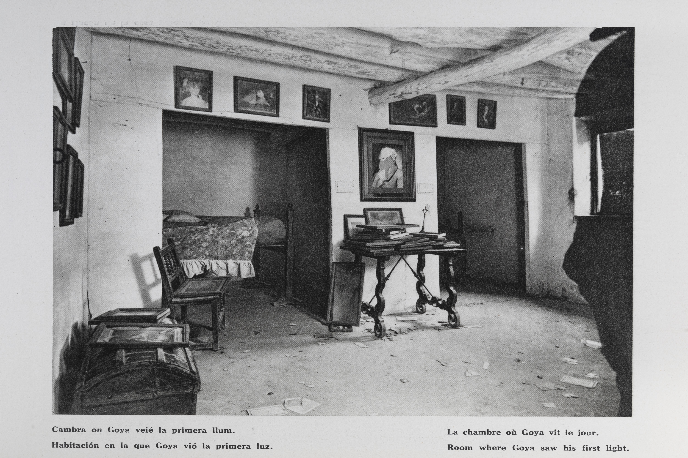
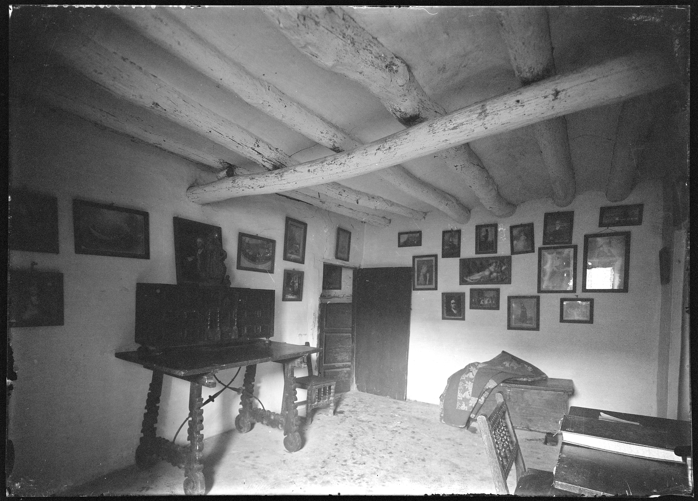
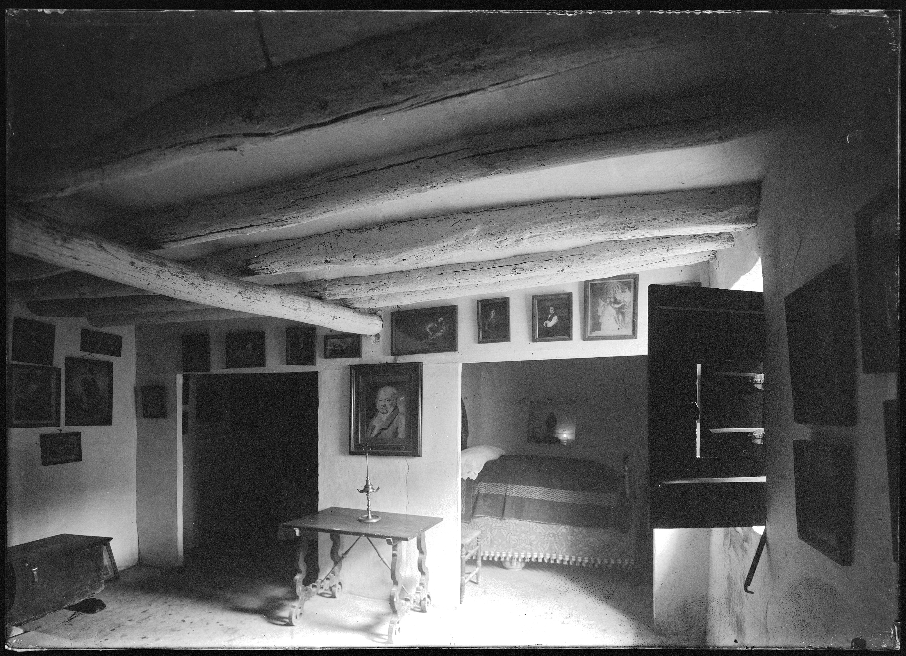

# Sala

Habitación principal de la casa [1] situada en la planta primera cerrada con dos puertas que se abren a los dos ramales de la escalera: el de bajada al zaguán y a la cocina, y el de acceso a la falsa. Tiene planta rectangular y en su lado sur se encuentran las dos alcobas. La techumbre es la original de rollizos de pino del país y revoltón reforzada por una viga puesta de través como apeo [2] que se suprimió en la última rehabilitación del edificio. Un machón central sostiene el techo de toda la planta, pero se ha disimulado con la tabiquería que divide la planta. El techado de esta habitación y de los cuartos es bajo debido al cambio de nivel del suelo producido por la construcción de un nuevo forjado de la planta completa para descargar la techumbre original de la planta baja que se ha conservado. Posee una única ventana cuya carpintería de pino es original, abierta a la fachada de la calle Alfóndiga. [3]

Detalle de la sala de la planta axonométrica del piso primero. Plano de Héctor Arcusa Magallón.

Detalle de la sala de la planta del piso primero. Plano de Héctor Arcusa Magallón.

La sala revuelta por las acciones de la Guerra Civil, vista hacia las alcobas, en dirección suroeste. Fotógrafo desconocido. Publicada en el folleto *Goya*, Barcelona, UGT, 1937.

La sala vista hacia la puerta que da paso al ramal de la escalera dirigido a la planta baja. Fotógrafo Juan Mora Insa, antes de 1928. Archivo Histórico Provincial de Zaragoza, Gobierno de Aragón.

La sala vista hacia el lado sur al que se abren las alcobas. Fotógrafo Juan Mora Insa, antes de 1928. Archivo Histórico Provincial de Zaragoza, Gobierno de Aragón.
