# Southwest bedchamber

This bedchamber is slightly smaller than the one next to it. It had a south-facing window overlooking the road from Belchite to Cariñena, where the village’s medieval fountain stood. The little window was blocked up in the early twentieth century. By 1913, photographs show it filled with masonry. [1] The party wall of the Goya Schools, which opened in 1917 and now house the Ignacio Zuloaga exhibition gallery, permanently concealed it on the south side of the house. The room measures just under seven square metres (6.77 m²). Its flat ceiling consisted of five round timber joists with shallow vaulting between them. The timber was originally painted light blue in insoluble distemper. [2] The red clay-coloured lime mortar floor was renewed during the building’s last restoration, designed in 1982. The walls and ceiling vaulting were whitewashed. As was usual for bedchambers in traditional houses, the room had a whitewashed, timber-framed opening without a door. A curtain would have provided privacy. The original furnishings, as elsewhere in the house, are unknown. They would likely have consisted of a bed, perhaps a chair, and a devotional image. [3]

In a letter to his friend Martín Zapater in 1780, when he was thirty-four, Goya described how little he needed to live. “For my house,” he wrote, “I do not need much furniture. I think that with a print of Our Lady of the Pillar, a table, five chairs, a frying pan, a wineskin and a small guitar, a roasting spit and an oil lamp, everything else is superfluous.” [4]

According to a tradition passed down by the painter’s maternal family, Gracia Lucientes gave birth to Francisco de Goya in this room [5] on Wednesday, 30 March 1746, two days before the Friday of Sorrows, towards the end of Lent. The local painter and scholar Anselmo Gascón de Gotor (1865–1927) first described the interior and the “two little bedchambers” of the house in 1893. [6]

Goya’s parents had him baptised [7] at the parish church of Our Lady of the Assumption [8] the following day, Thursday, 31 March. The old baptismal font [9] survived the destruction of the original Baroque church during the Spanish Civil War. [10] The paintings of the *Altar of the Relics*, which the young Goya painted in the transept sixteen or seventeen years later, were lost. [11]

*Detail of the southwest bedchamber in the axonometric drawing of the first floor*. Drawing by Héctor Arcusa Magallón, 2021.

*Detail of the southwest bedchamber in the first-floor plan*. Drawing by Héctor Arcusa Magallón, 2021.

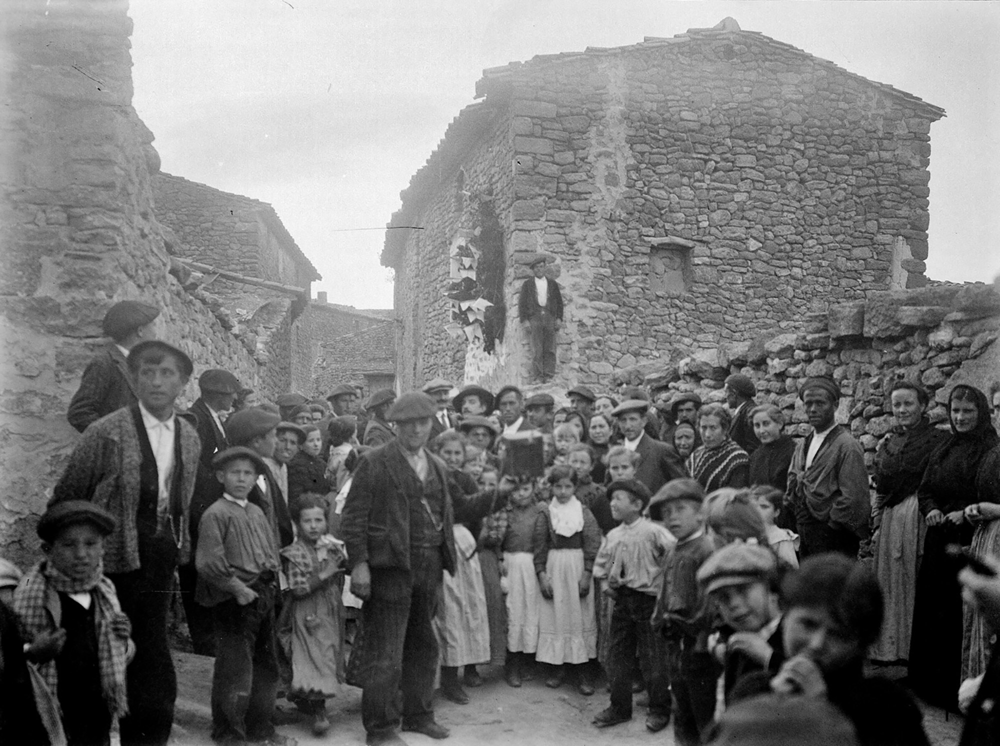
*South side of Goya’s birthplace from Calle Alfóndiga in Fuendetodos, showing the southwest bedchamber window blocked up with masonry*. Photograph by Luis Gandú Mercadal (1888–1968), May 1913. Library and Archive, Provincial Council of Zaragoza.

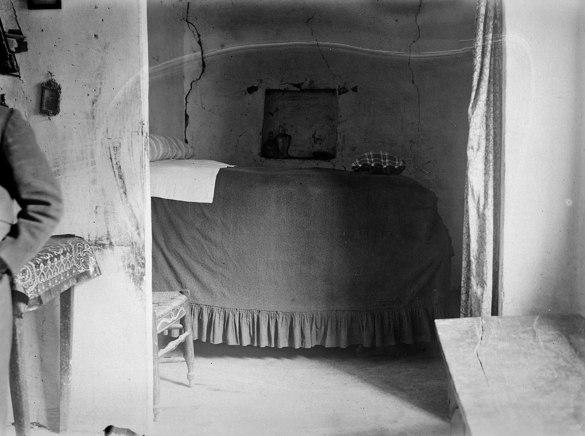
*The bedchamber and its blocked-up window as seen from the main room*. Photograph by Luis Gandú Mercadal (1888–1968), May 1913. Library and Archive, Provincial Council of Zaragoza.

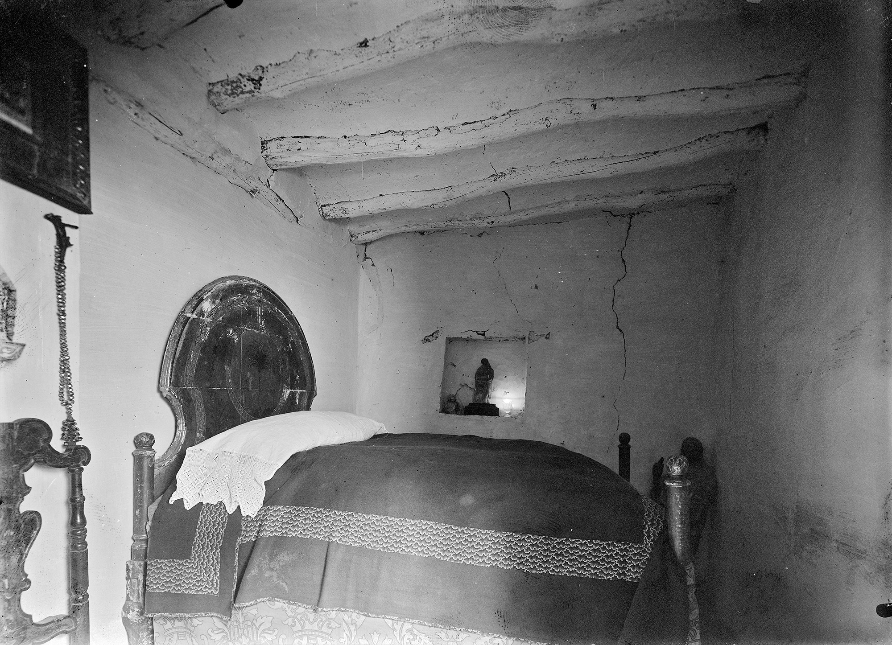
*View of the bedchamber towards the south wall, showing the blocked-up window and the whitewashed walls and ceiling*. The painter Ignacio Zuloaga (1870–1945) installed the furnishings, which were looted during the Civil War. Photograph by Juan Mora Insa (1880–1954), taken before 1928. Provincial Historical Archive of Zaragoza, Government of Aragón.

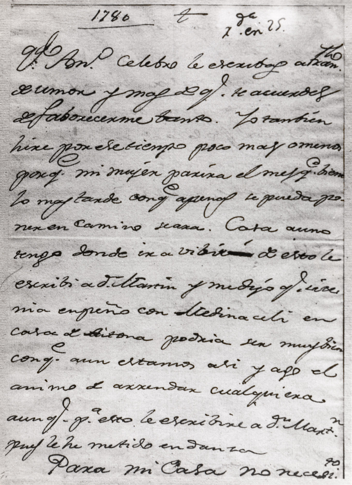
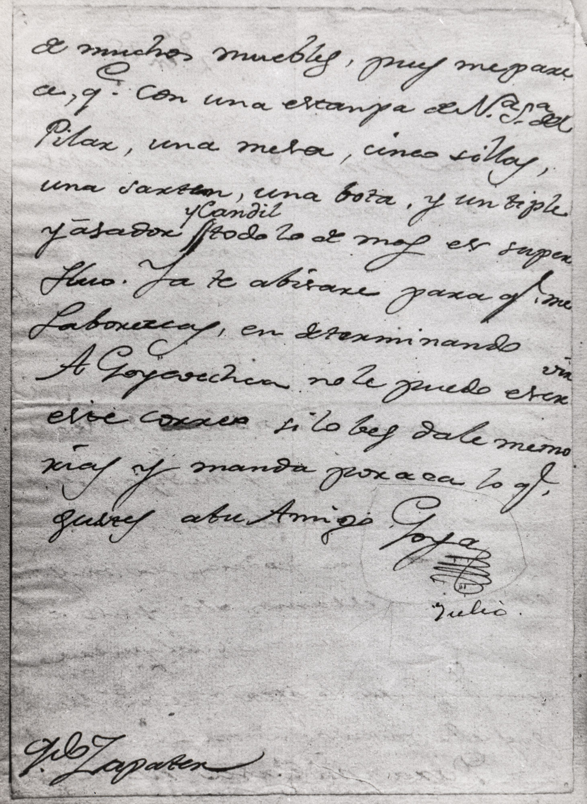
Letter from Francisco de Goya to his friend Martín Zapater, July 1780, describing what he needs for his house. Held at the Museum of Zaragoza. Photograph by Juan Mora Insa (1880–1954), taken before 1928.

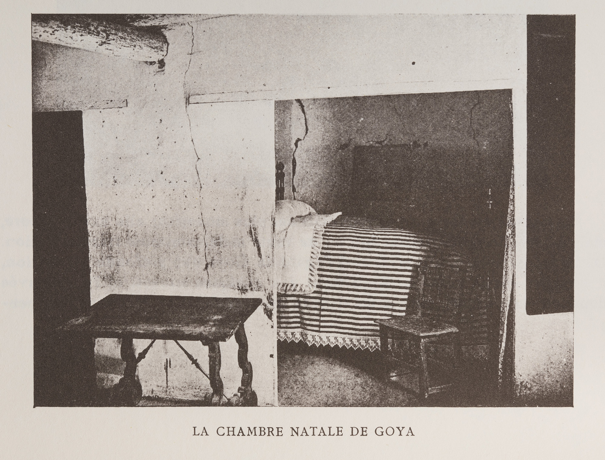
*La chambre natale de Goya* (“The bedchamber where Goya was born”), an illustration published in Loÿs Delteil’s (1869–1927) monograph *Francisco Goya: Le Peintre graveur illustré*, Paris, published by the author, 1922. Unknown photographer, taken before 1913.

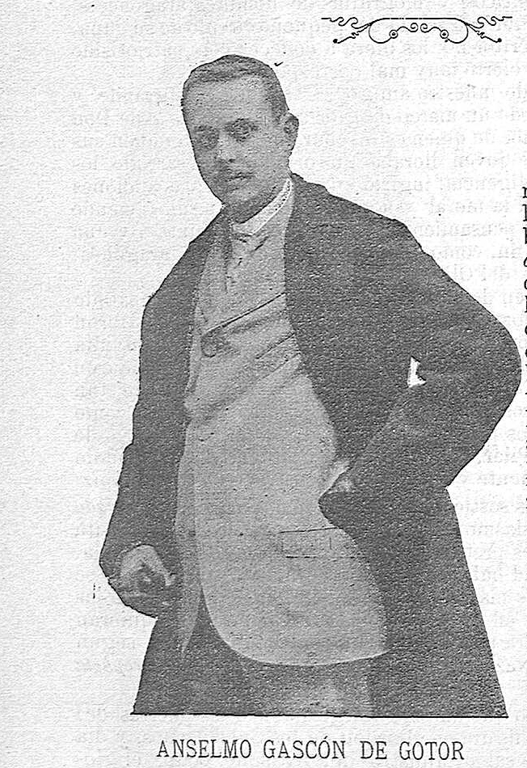
Portrait of Anselmo Gascón de Gotor. Unknown photographer. Published in *El Ateneo*, 1 February 1894.

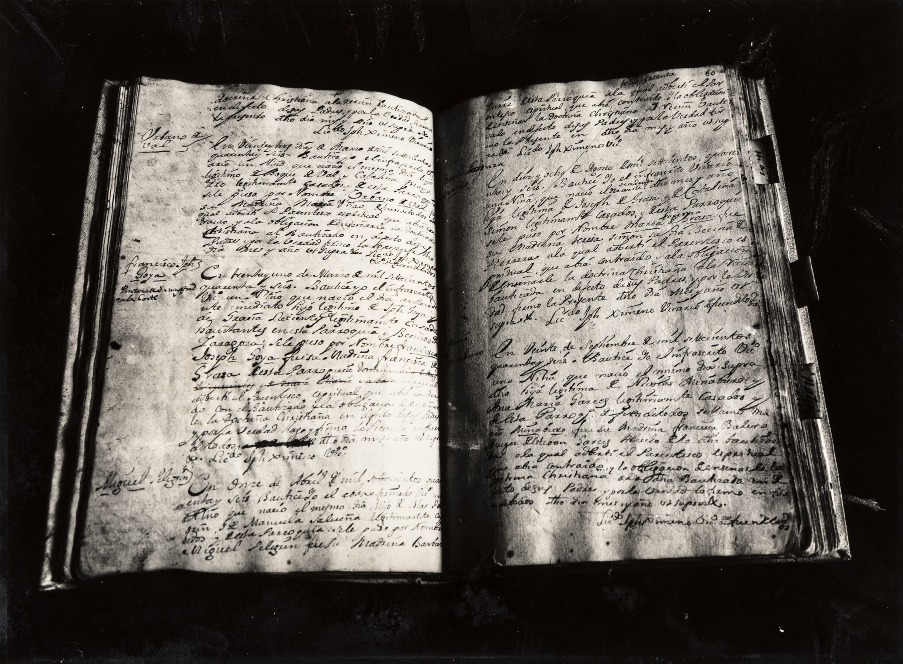
*Baptismal record of Francisco de Goya y Lucientes in Fuendetodos, 31 March 1746*. The original was destroyed in 1936. Photograph by Juan Mora Insa (1880–1954), taken before 1928. Provincial Historical Archive of Zaragoza, Government of Aragón.

## Goya’s baptismal record in Fuendetodos

The baptismal register and the rest of the Fuendetodos parish archive were destroyed in 1936, at the start of the Spanish Civil War. The record survives in photographs taken by Spanish photojournalists who visited the village, particularly around 1928. That year marked the centenary of Goya’s death and brought renewed recognition of the painter in Spain and abroad. The English translation below follows the modernised Spanish transcription.

> *Francisco José Goya*
> *On 31 March 1746, I, the undersigned vicar,*[^1] *baptised a boy born the previous day, the legitimate son of José Goya and Gracia Lucientes, lawfully married, residing in this parish [of Fuendetodos] and residents of Zaragoza. He was given the name Francisco José Goya. His godmother was Francisca Grasa*[^2] *of this parish, [an unmarried woman, daughter of Miguel de Lucientes and Gracia María Salvador: struck out in the original]. I advised her of the spiritual kinship she had entered into with the child and of her obligation to teach him Christian doctrine in the absence of his parents. In witness whereof I draw up and sign this record in Fuendetodos [illegible deletion], on the day, month and year written above, etc.*
> *Licentiate José Ximeno, vicar*

A later parish priest probably wrote below the child’s name, “Painter to His Majesty / at court.” Charles III appointed Goya and his brother-in-law Ramón Bayeu painters to the king on 25 June 1786. The note in the parish register records how much importance Goya had come to hold for the people of his former village.

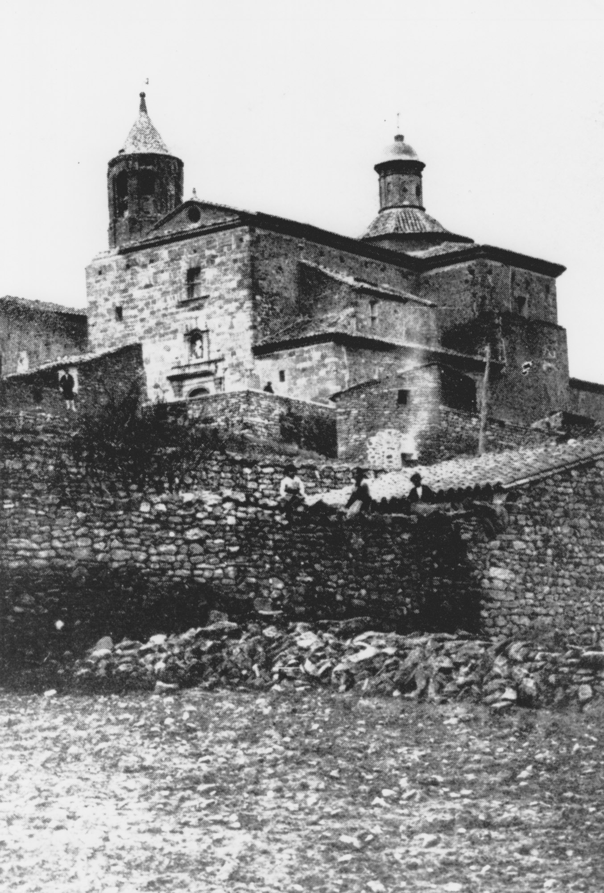
*Parish church of Our Lady of the Assumption in Fuendetodos before its destruction*. Unknown photographer. Library and Archive, Provincial Council of Zaragoza, Goya Fuendetodos Consortium.

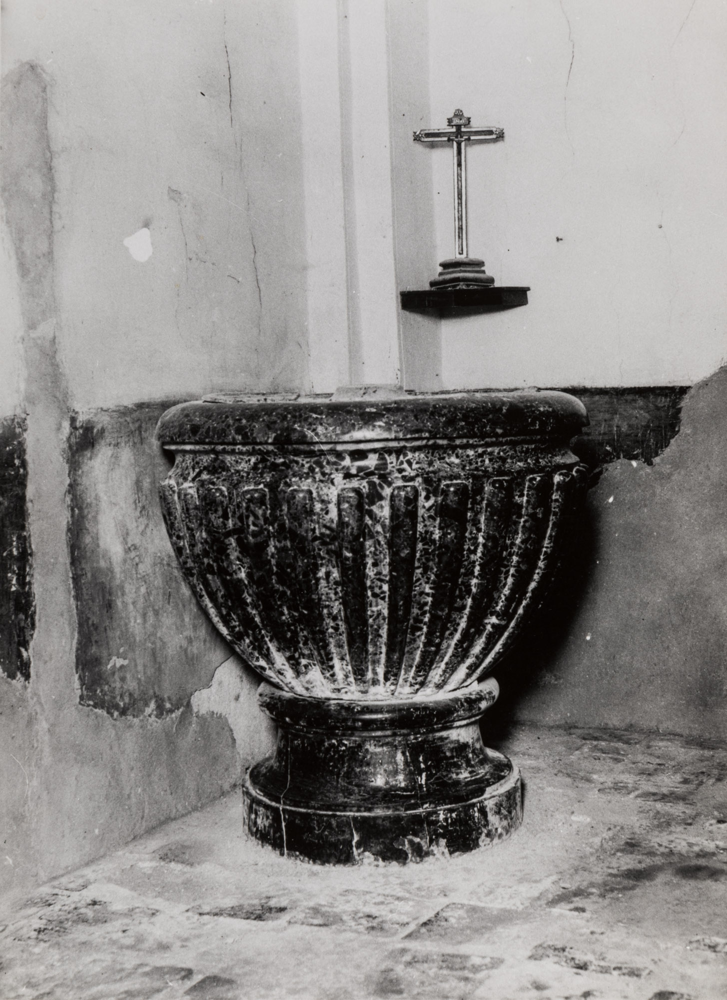
*Font in which Francisco de Goya y Lucientes was baptised in the parish church of Fuendetodos on 31 March 1746*. Photograph by José Vidal Gabarró, 1917. Library and Archive, Provincial Council of Zaragoza, Goya Fuendetodos Consortium.

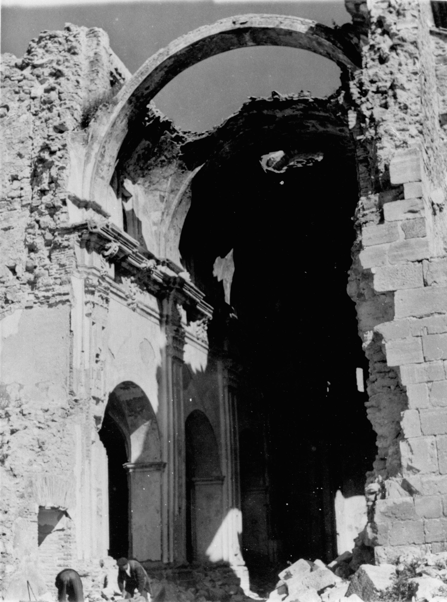
*Ruins of the parish church of Our Lady of the Assumption in Fuendetodos after its destruction during the Civil War*. Photograph by Miguel París Plou (1921–2004), taken between 1949 and 1953. Library and Archive, Provincial Council of Zaragoza.

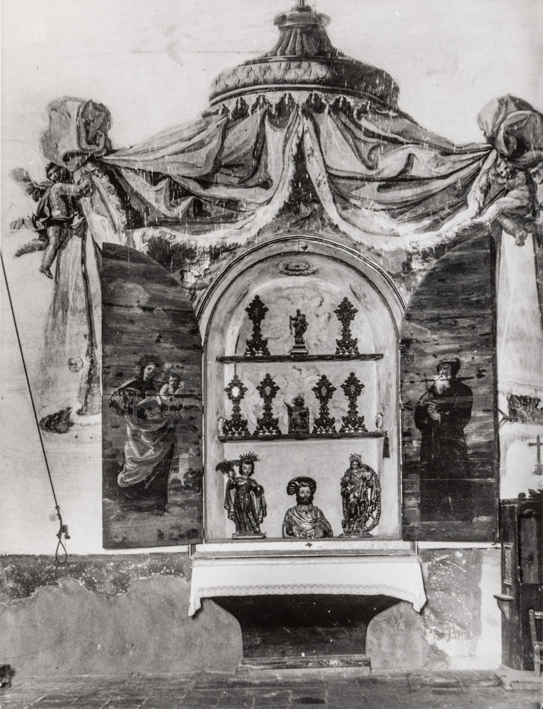
*Altar of the Relics painted by Goya on the west side of the transept of the parish church of Fuendetodos, destroyed in 1936*. Photograph by José Vidal Gabarró, 1917. Library and Archive, Provincial Council of Zaragoza, Goya Fuendetodos Consortium.

[^1]: Parish priest.

[^2]: She was Goya’s mother’s elder sister, and therefore his aunt. She suffered from dementia.
