# Alcôve sud-ouest

Cette alcôve est légèrement plus petite que sa voisine, mais elle disposait d’une fenêtre au sud, donnant sur la route de Belchite à Cariñena où se trouvait la fontaine médiévale du village. La petite fenêtre a été condamnée au début du XXe siècle. En 1913, elle apparaît comblée de maçonnerie. [1] Le mur mitoyen des écoles Goya, inaugurées en 1917 et devenues la salle d’exposition Ignacio Zuloaga, l’a définitivement masquée sur le côté sud de la maison. La pièce mesure à peine sept mètres carrés (6,77 m²). Son plafond plat se composait de cinq rondins et de voûtains. Le bois était à l’origine peint en bleu clair à la détrempe insoluble. [2] Le sol en mortier de chaux de couleur rouge argile a été refait lors de la dernière restauration, conçue en 1982. Les murs et les voûtains étaient blanchis à la chaux. Comme c’était l’usage dans l’habitat traditionnel, l’alcôve s’ouvrait par une baie à encadrement de bois, blanchie à la chaux, sans porte. Un rideau devait préserver l’intimité. Le mobilier d’époque, comme celui du reste de la maison, est inconnu. Il se limitait probablement à un lit, peut-être une chaise et une image de dévotion. [3]

Dans une lettre à son ami Martín Zapater en 1780, alors âgé de trente-quatre ans, Goya expliquait combien peu de choses lui suffisaient pour vivre. « Pour ma maison, écrit-il, je n’ai pas besoin de beaucoup de meubles. Il me semble qu’avec une estampe de Notre-Dame du Pilar, une table, cinq chaises, une poêle, une outre et une petite guitare, une broche et une lampe à huile, tout le reste est superflu. » [4]

Selon la tradition transmise par la famille maternelle du peintre, Gracia Lucientes donna naissance à Francisco de Goya dans cette pièce [5] le mercredi 30 mars 1746, deux jours avant le vendredi des Douleurs, vers la fin du carême. Le peintre et érudit local Anselmo Gascón de Gotor (1865–1927) décrivit pour la première fois l’intérieur et les « deux petites alcôves » de la maison en 1893. [6]

Les parents firent baptiser le nouveau-né [7] à l’église paroissiale Notre-Dame-de-l’Assomption [8] le lendemain, jeudi 31 mars. Les anciens fonts baptismaux [9] ont survécu à la destruction de l’église baroque pendant la guerre civile espagnole. [10] L’ensemble peint de l’*Autel des Reliques*, réalisé par le jeune Goya seize ou dix-sept ans plus tard dans le transept, a disparu. [11]

*Détail de l’alcôve sud-ouest sur la vue axonométrique du premier étage*. Dessin de Héctor Arcusa Magallón, 2021.

*Détail de l’alcôve sud-ouest sur le plan du premier étage*. Dessin de Héctor Arcusa Magallón, 2021.

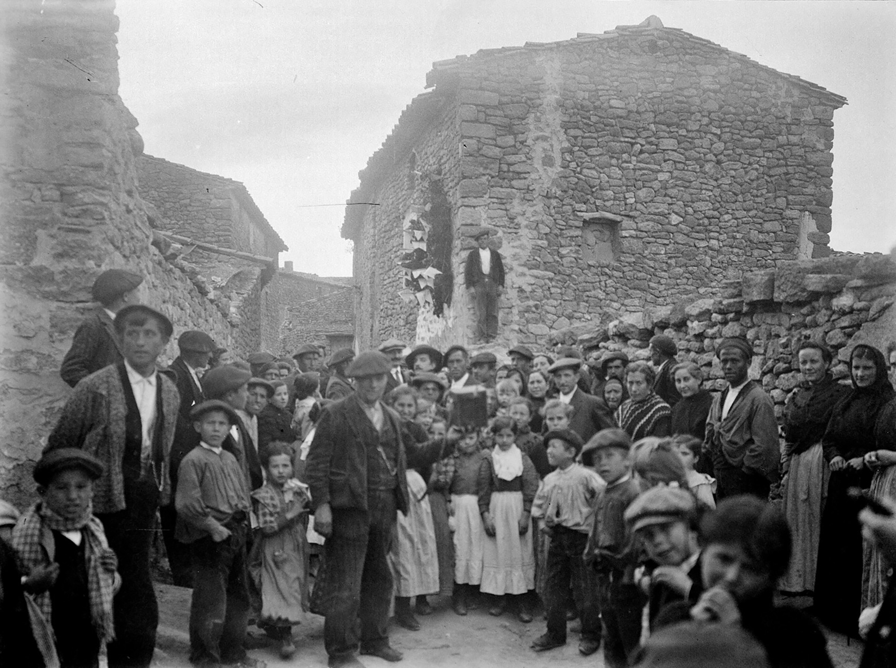
*Vue du côté sud de la maison natale depuis la calle Alfóndiga à Fuendetodos, montrant la fenêtre de l’alcôve sud-ouest comblée de maçonnerie*. Photographie de Luis Gandú Mercadal (1888–1968), mai 1913. Bibliothèque et archives de la Diputación Provincial de Zaragoza.

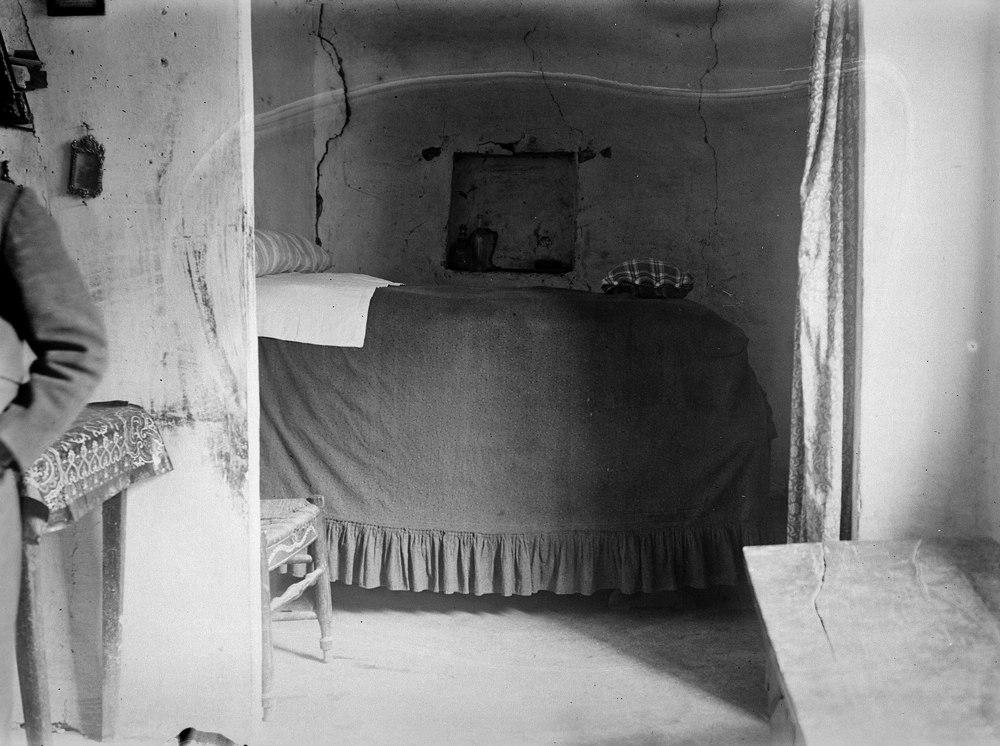
*L’alcôve et sa fenêtre murée vues depuis la salle*. Photographie de Luis Gandú Mercadal (1888–1968), mai 1913. Bibliothèque et archives de la Diputación Provincial de Zaragoza.

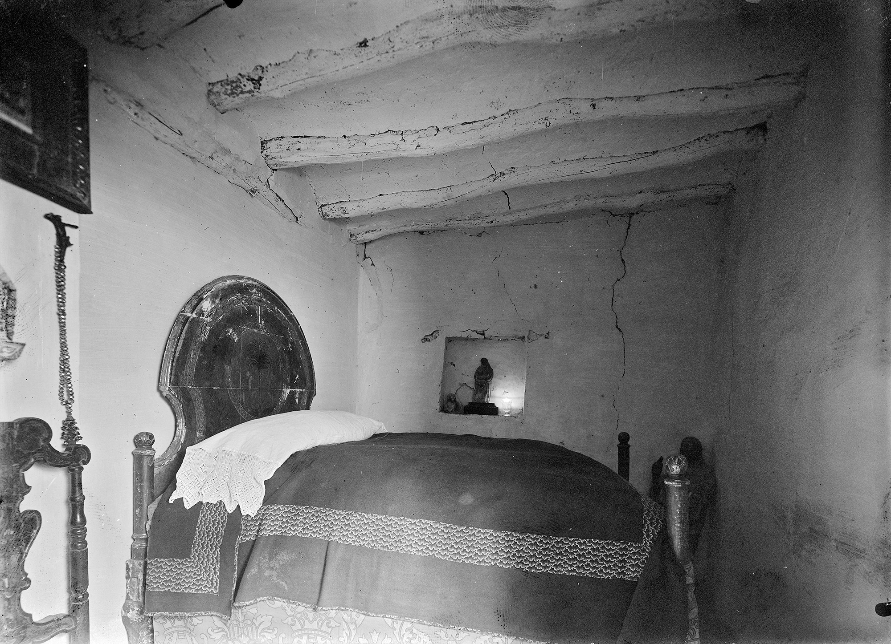
*Vue de l’alcôve vers le mur sud, avec la fenêtre murée et les murs et le plafond blanchis à la chaux*. Le mobilier installé par le peintre Ignacio Zuloaga (1870–1945) a été pillé pendant la guerre civile. Photographie de Juan Mora Insa (1880–1954), avant 1928. Archives historiques provinciales de Saragosse, Gouvernement d’Aragon.

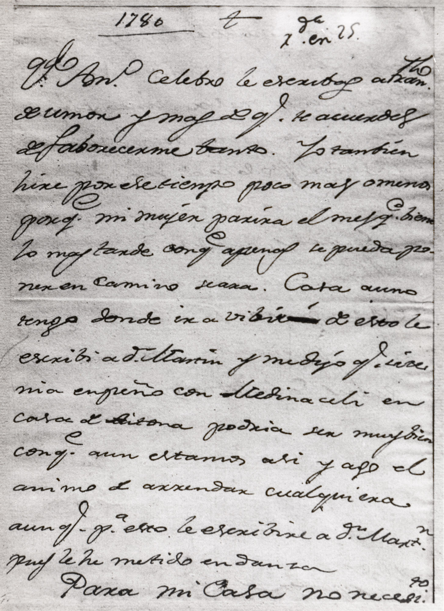
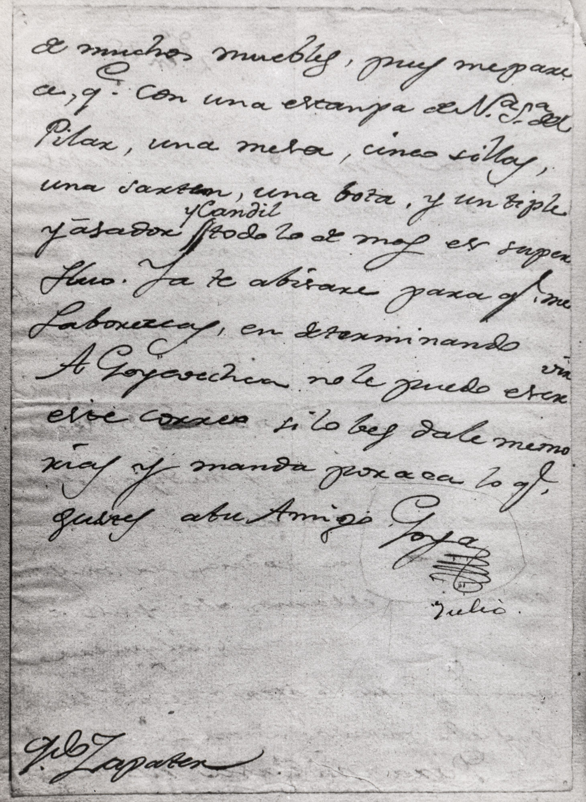
Lettre de Francisco de Goya à son ami Martín Zapater, en juillet 1780, décrivant ce dont il a besoin pour sa maison. Conservée au musée de Saragosse. Photographie de Juan Mora Insa (1880–1954), avant 1928.

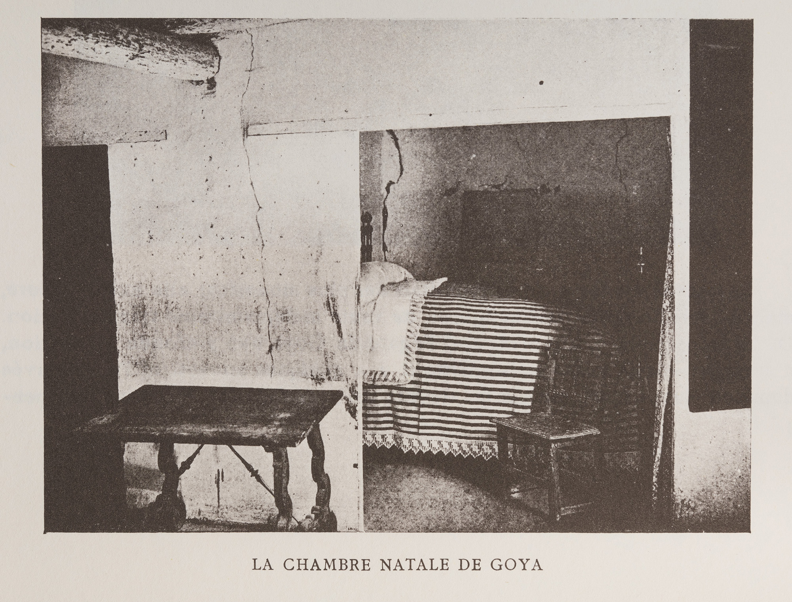
*La chambre natale de Goya*, illustration publiée dans la monographie de Loÿs Delteil (1869–1927), *Francisco Goya: Le Peintre graveur illustré*, Paris, chez l’auteur, 1922. Photographe inconnu, avant 1913.

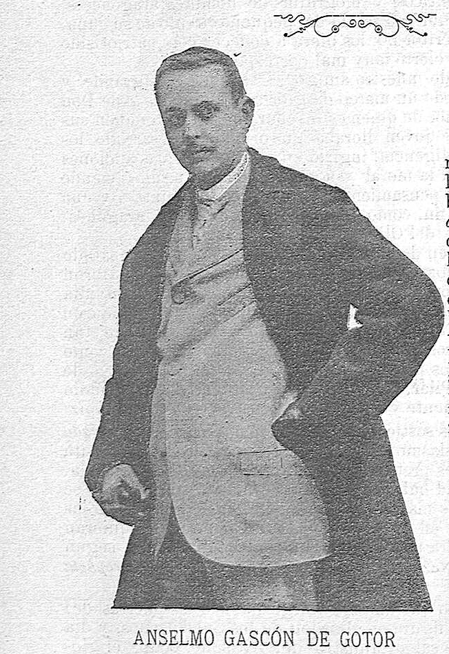
Portrait d’Anselmo Gascón de Gotor. Photographe inconnu. Publié dans *El Ateneo*, le 1er février 1894.

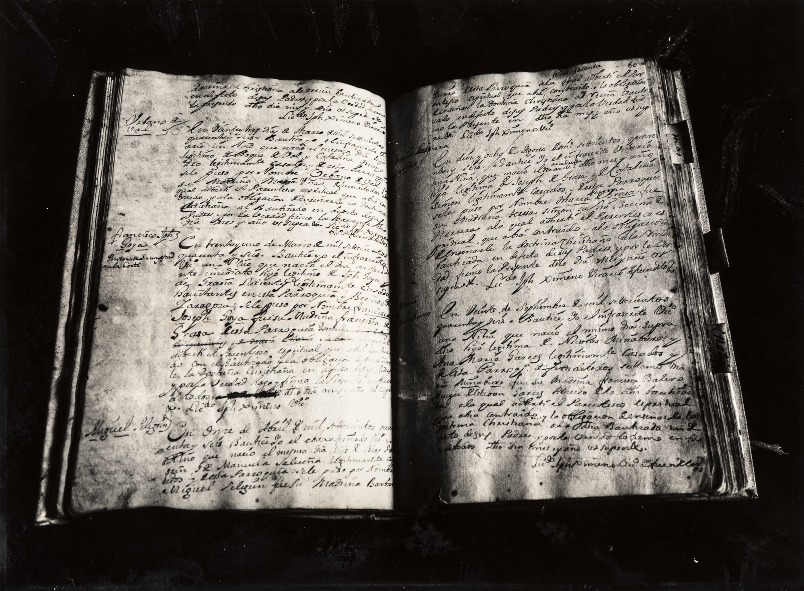
*Acte de baptême de Francisco de Goya y Lucientes à Fuendetodos, le 31 mars 1746*. L’original a été détruit en 1936. Photographie de Juan Mora Insa (1880–1954), avant 1928. Archives historiques provinciales de Saragosse, Gouvernement d’Aragon.

## Acte de baptême de Goya à Fuendetodos

Le registre des baptêmes et le reste des archives paroissiales de Fuendetodos ont été détruits en 1936, au début de la guerre civile espagnole. L’acte est connu grâce à plusieurs photographies prises par des reporters espagnols venus au village, notamment autour de 1928, année du centenaire de la mort de Goya. Cette commémoration a ravivé la reconnaissance du peintre en Espagne et à l’étranger. La traduction française ci-dessous suit la transcription espagnole modernisée.

> *Francisco José Goya*
> *Le 31 mars 1746, moi, le vicaire soussigné,*[^1] *ai baptisé un garçon né la veille, fils légitime de José Goya et de Gracia Lucientes, légitimement mariés, demeurant dans cette paroisse [de Fuendetodos] et domiciliés à Saragosse. On lui a donné le nom de Francisco José Goya. Sa marraine fut Francisca Grasa,*[^2] *de cette paroisse, [jeune fille, fille de Miguel de Lucientes et de Gracia María Salvador : rayé dans l’original]. Je l’ai avertie de la parenté spirituelle qu’elle avait contractée avec le baptisé et de son obligation de lui enseigner la doctrine chrétienne en l’absence de ses parents. En foi de quoi je dresse et signe le présent acte à Fuendetodos [rature illisible], aux jour, mois et an susdits, etc.*
> *Licencié José Ximeno, vicaire*

Un autre curé a probablement ajouté plus tard, sous le nom de l’enfant : « Peintre de Sa Majesté / à la cour ». Charles III nomma Goya et son beau-frère Ramón Bayeu peintres du roi le 25 juin 1786. Cette mention dans le registre conserve la mémoire de l’importance que Goya avait acquise aux yeux des habitants de son village natal.

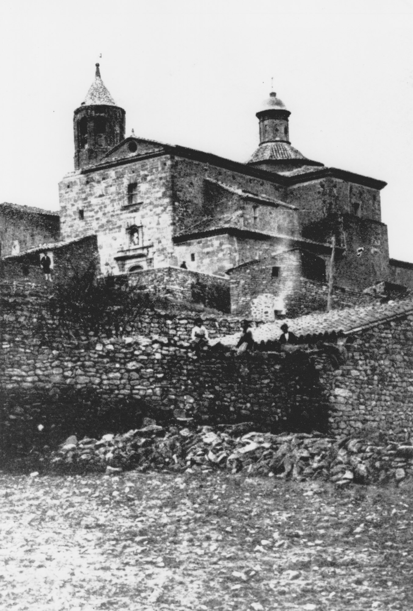
*Église paroissiale Notre-Dame-de-l’Assomption de Fuendetodos avant sa destruction*. Photographe inconnu. Bibliothèque et archives de la Diputación Provincial de Zaragoza, Consorcio Goya Fuendetodos.

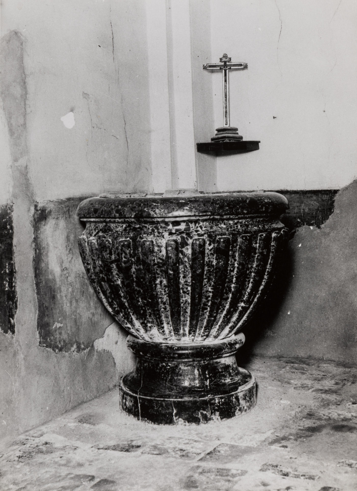
*Fonts baptismaux dans lesquels Francisco de Goya y Lucientes fut baptisé à l’église paroissiale de Fuendetodos le 31 mars 1746*. Photographie de José Vidal Gabarró, 1917. Bibliothèque et archives de la Diputación Provincial de Zaragoza, Consorcio Goya Fuendetodos.

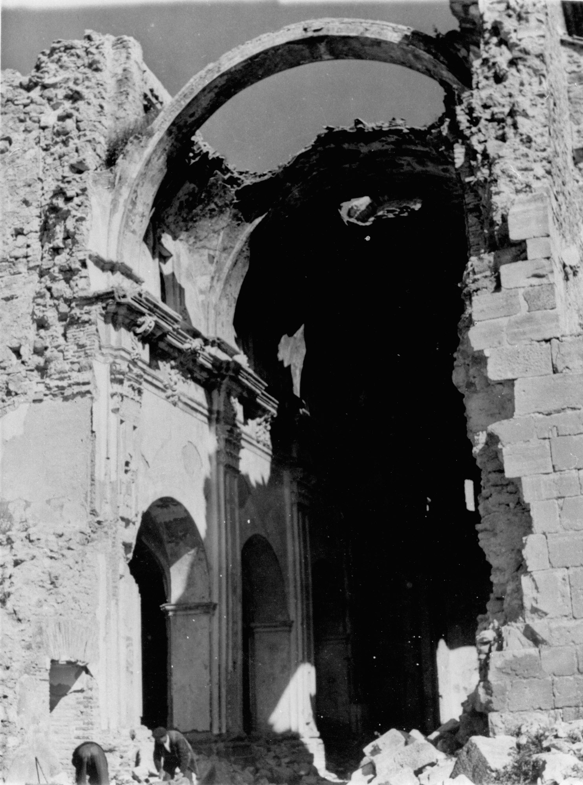
*Ruines de l’église paroissiale Notre-Dame-de-l’Assomption de Fuendetodos après sa destruction pendant la guerre civile*. Photographie de Miguel París Plou (1921–2004), entre 1949 et 1953. Bibliothèque et archives de la Diputación Provincial de Zaragoza.

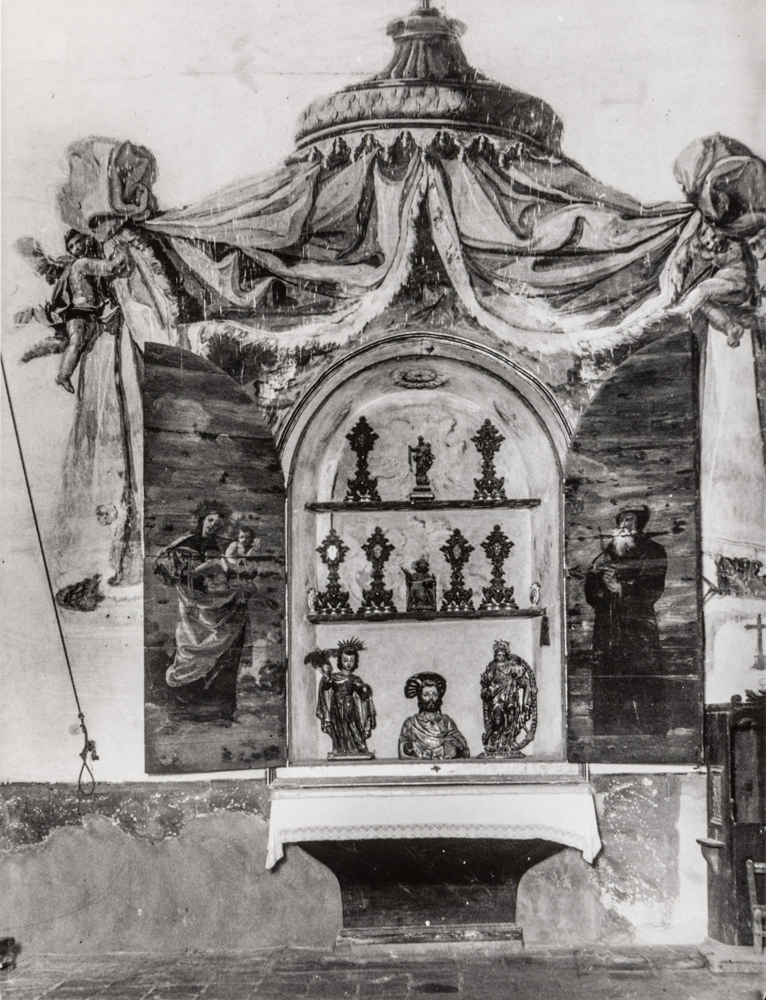
*Autel des Reliques peint par Goya du côté ouest du transept de l’église paroissiale de Fuendetodos et détruit en 1936*. Photographie de José Vidal Gabarró, 1917. Bibliothèque et archives de la Diputación Provincial de Zaragoza, Consorcio Goya Fuendetodos.

[^1]: Curé de la paroisse.

[^2]: Elle était la sœur aînée de la mère de Goya, et donc sa tante. Elle souffrait de démence.
