# Alcoba suroeste [A] [B]

Esta alcoba es ligeramente de menor tamaño que su vecina, pero contó con una ventana orientada al sur, con vistas hacia la vía de Belchite a Cariñena en la que se encontraba la fuente medieval del pueblo. El ventanuco fue cegado a comienzos del siglo XX —en 1913 aparece tapado con mampostería—.[1] El medianil de las Escuelas de Goya del municipio —actual sala de exposiciones Ignacio Zuloaga— inauguradas en 1917, la ocultó definitivamente por la cara sur de la casa. La superficie es muy pequeña, de apenas siete metros cuadrados (6,77 m2). Se cubrió con una techumbre plana de cinco rollizos y revoltón; la madera estaba en origen pintada al temple insoluble de color azul claro;[2] el piso —rehecho nuevo en la última rehabilitación del edificio proyectada en 1982— es de mortero de cal de color rojo arcilla; las paredes y el revoltón estaban encaladas. Como era habitual en la organización de las alcobas en la arquitectura tradicional, ésta no tuvo puerta tan sólo un vano enmarcado de madera y encalado; una cortina preservaría la intimidad del interior. El mobiliario de época no se conoce como ocurre con el resto de la casa, pero no pasaría de una cama, quizá una silla y alguna imagen de devoción.[3]

	Goya cuando contaba con treinta y cuatro años, describió en una carta dirigida a su amigo Martín Zapater, en 1780, lo poco que precisaba para vivir. «Para mi casa —escribió el de Fuendetodos— no necesito muchos muebles, pues me parece que con una estampa de Nuestra Señora del Pilar, una mesa, cinco sillas, una sartén, una bota y un tiple, y asador, y candil todo lo demás es superfluo».[4]

	Esta alcoba fue la cámara  donde según la tradición contada por la familia materna del pintor dio a luz Gracia Lucientes a su hijo Francisco de Goya, [5] el miércoles día 30 de marzo de 1746, antevíspera del Viernes de Dolores, al final de la cuaresma. El pintor y erudito local Anselmo Gascón de Gotor (1865-1927) describió por vez primera el interior y las «dos alcobitas» de la casa natal, en 1893. [6]

	Los padres bautizaron al recién nacido [7] en la iglesia parroquial de Nuestra Señora de la Asunción [8] al día siguiente, jueves, 31 de marzo. Se ha conservado la antigua pila [9] que sobrevivió a la destrucción del templo barroco original durante la Guerra Civil. [10] No se salvó el conjunto pictórico del *Altar de las Reliquias* que el joven Goya pintó dieciséis o diecisiete años después en el crucero. [11]

*Detalle de la alcoba suroeste de la planta axonométrica del piso primero*. Plano de Héctor Arcusa Magallón, 2021.

*Detalle de la alcoba suroeste de la planta del piso primero*. Plano de Héctor Arcusa Magallón, 2021.

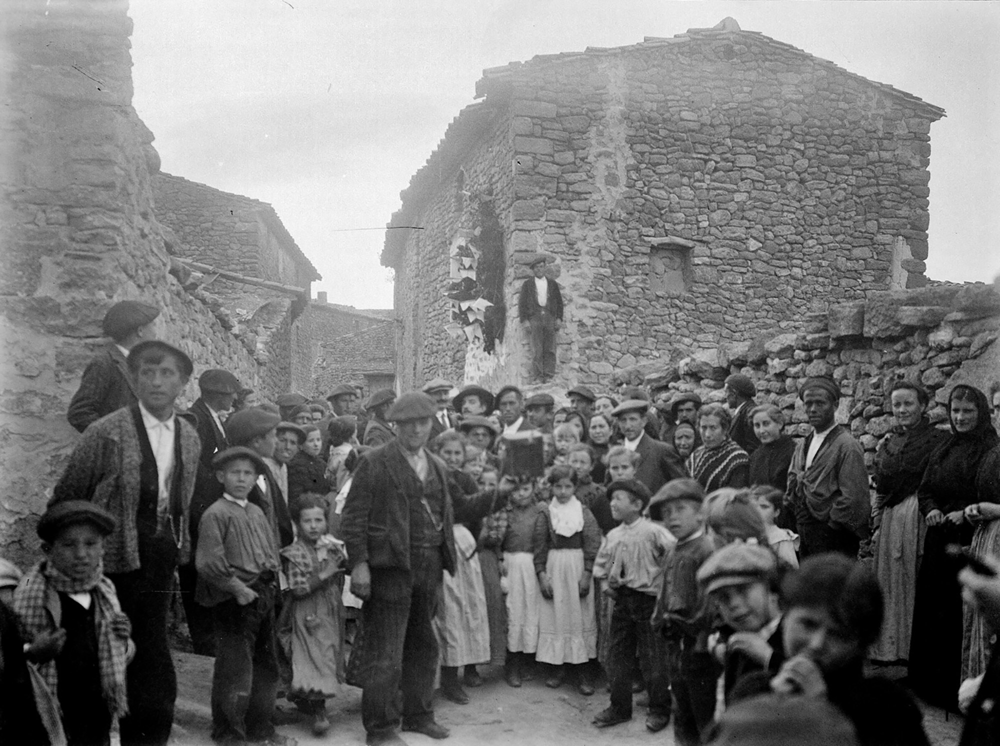
*Cara sur de la casa natal de Goya vista desde la calle Alfóndiga de Fuendetodos donde se observa la ventana cegada con mampostería de la alcoba suroeste.* Fotografía de Luis Gandú Mercadal (1888-1968) realizada en mayo de 1913. Biblioteca-Archivo, Diputación Provincial de Zaragoza.

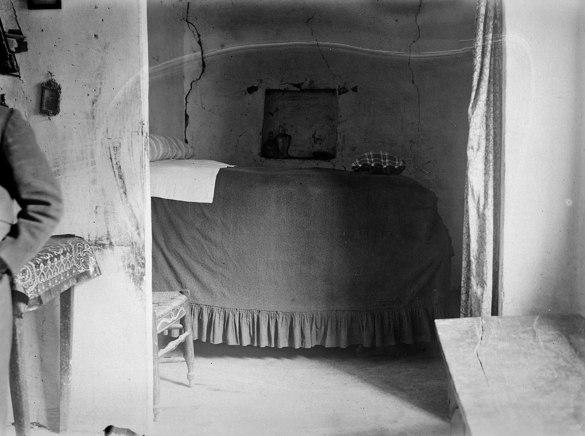
*La alcoba con la ventana cegada vista desde la sala*. Fotografía de Luis Gandú Mercadal (1888-1968) realizada en mayo de 1913. Biblioteca-Archivo, Diputación Provincial de Zaragoza.

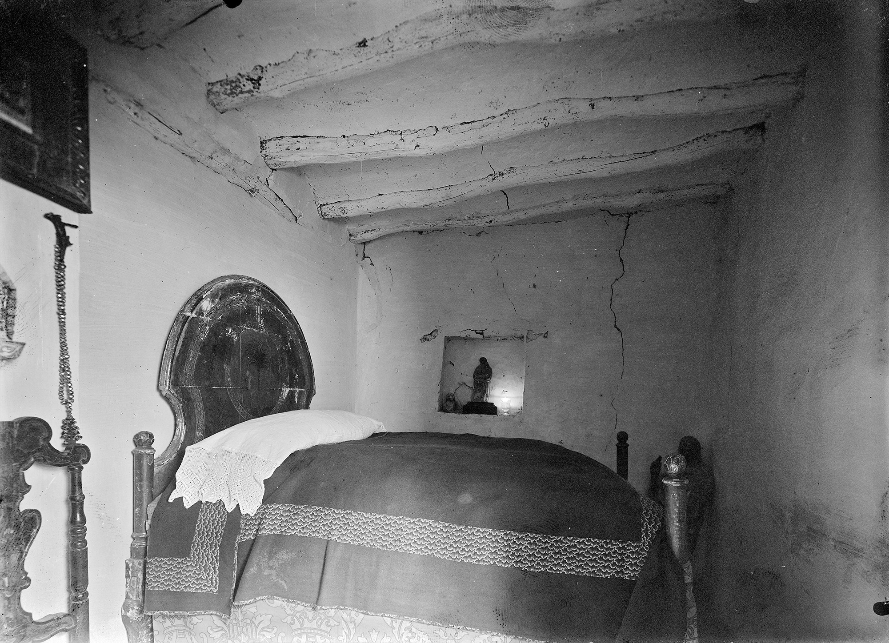
*La alcoba vista en dirección al muro sur con la ventana cegada, y las paredes y el techo encalados*. Mobiliario postizo instalado por el pintor Ignacio Zuloaga (1870-1945) y saqueado durante la Guerra Civil. Fotografía de Juan Mora Insa (1880-1954) realizada antes de 1928. Zaragoza, Archivo Histórico Provincial de Zaragoza, Gobierno de Aragón.

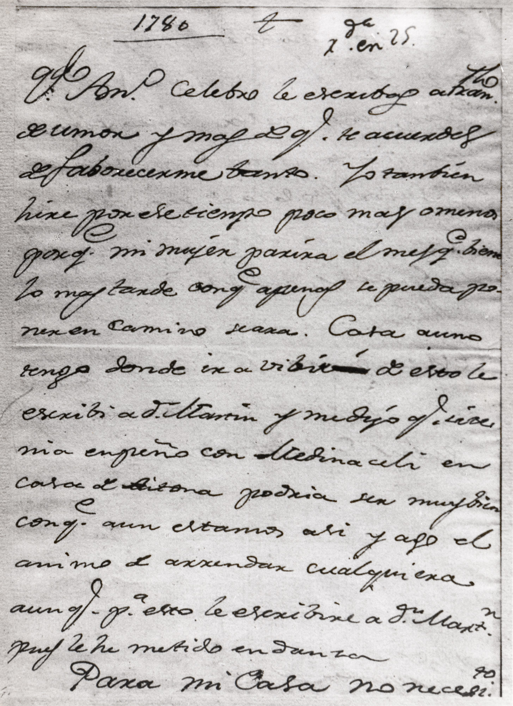
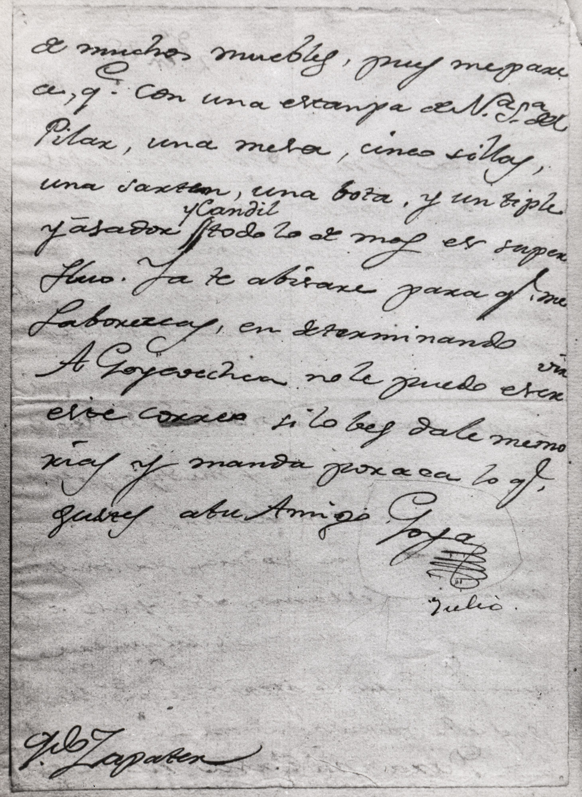
Carta de Francisco de Goya dirigida en julio de 1780 a su amigo Martín Zapater en la que describe que lo que necesita para su casa; depositada en el Museo de Zaragoza. Fotografía de Juan Mora Insa (1880-1954) realizada antes de 1928.

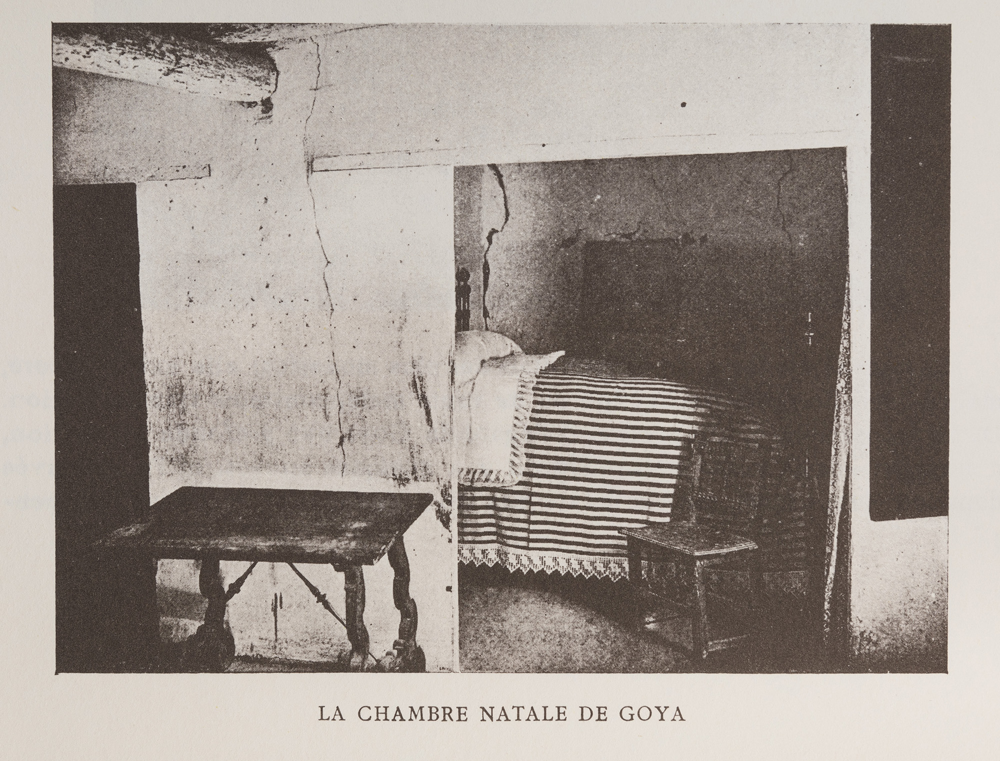
*La chambre* *natale de Goya* («El dormitorio natal de Goya»), ilustración publicada en la monografía de Loÿs Delteil (1869-1927), *Francisco Goya: Le Peintre* *graveur ilustré*, Paris, Chez l’Auteur, 1922. Fotógrafo desconocido; realizada antes de 1913.

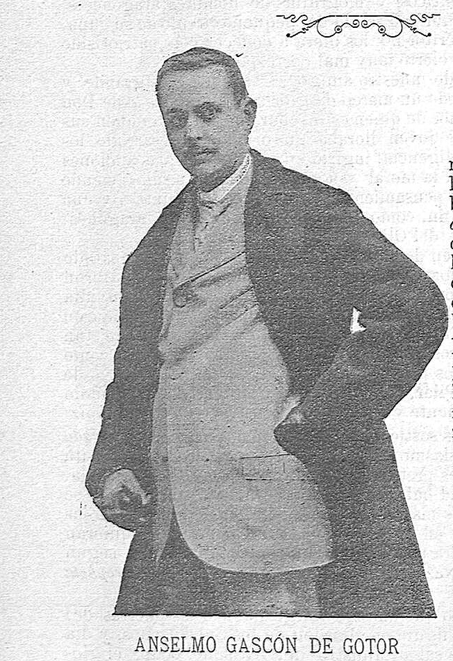
Retrato de Anselmo Gascón de Gotor. Fotógrafo desconocido; publicado en el periódico *El Ateneo*, 1.II.1894.

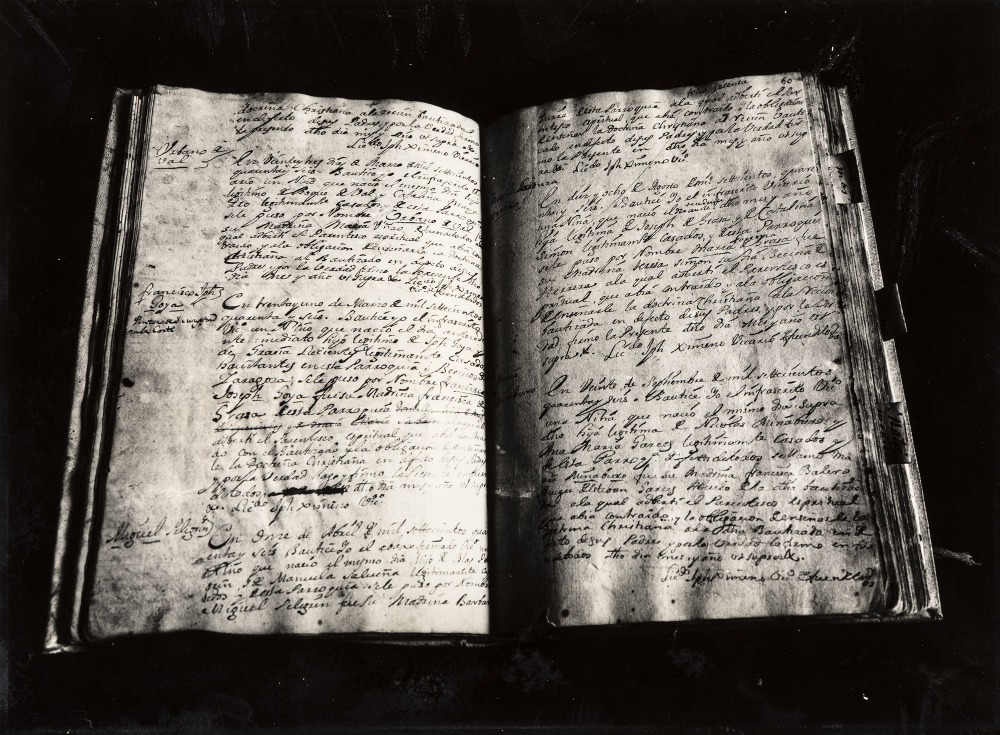
*Acta de bautismo de Francisco de Goya y Lucientes en Fuendetodos, a 31 de marzo de 1746*. Documento destruido en 1936. Fotografía de Juan Mora Insa (1880-1954) realizada antes de 1928. Zaragoza, Archivo Histórico Provincial de Zaragoza, Gobierno de Aragón.

<!-- texto de la figura -->

## Acta de bautismo de Goya en Fuendetodos

El libro de bautizados como el resto del archivo de la parroquia de Fuendetodos fue destruido en 1936, al comienzo de la Guerra Civil. Se conoce el acta por varias fotografías realizadas por reporteros gráficos españoles que visitaron el municipio, especialmente en torno a 1928, fecha de la celebración del primer centenario de la muerte de Goya, efemérides en la que el pintor fue reivindicado nacional e internacionalmente. A continuación se ha transcrito el documento modernizando su ortografía y su forma.

> *Francisco José Goya*	*En 31 de marzo de 1746, bauticé —el infrascrito vicario—*[^1]*  un niño que nació la víspera, hijo legítimo de José Goya y de Gracia Lucientes legítimamente casados, habitantes en esta parroquia [de Fuendetodos] y vecinos de Zaragoza. Se le puso por nombre Francisco José Goya. Fue su madrina Francisca Grasa*[^2]* de esta parroquia, [doncella, hija de Miguel de Lucientes y de Gracia María Salvador: tachado en el original] a quien advertí el parentesco espiritual que había contraído con el bautizado y la obligación de enseñarle la doctrina cristiana en defecto de sus padres. Y por la verdad hago y firmo la presente en Fuendetodos [tachado ilegible] dicho día, mes y año escritos arriba, etc.*
> *Licenciado José Ximeno, vicario*

	Probablemente otro párroco posterior anotó debajo del nombre del bautizado: «Pintor de su majestad / en la corte». Goya y su cuñado Ramón Bayeu recibieron de Carlos III el nombramiento de pintores del rey el día 25 de junio de 1786. Este apunte en el libro sacramental dejó memoria de la importancia alcanzada por Goya entre sus antiguos convecinos.

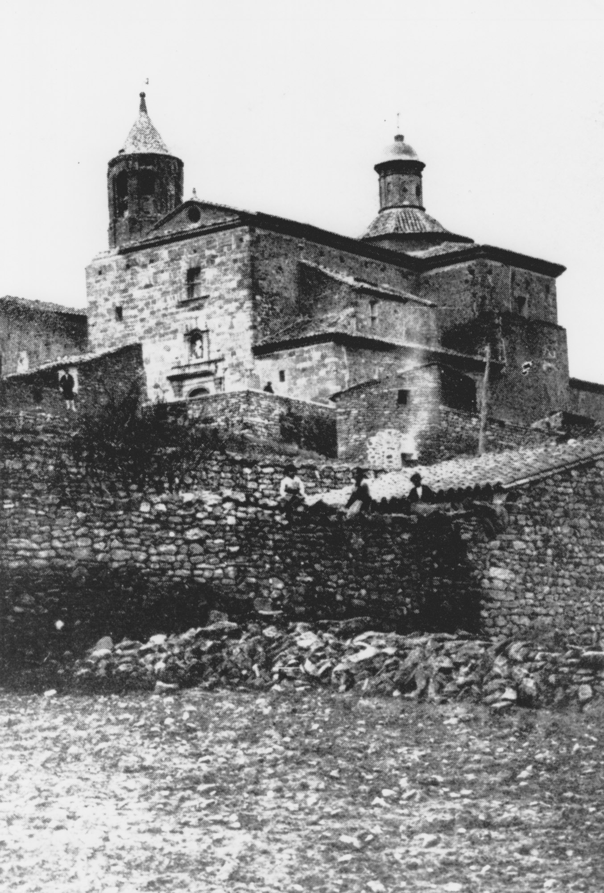
*Iglesia parroquial de Nuestra Señora de la Asunción de Fuendetodos antes de su destrucción*. Fotógrafo desconocido. Biblioteca-Archivo, Diputación Provincial de Zaragoza, Consorcio Goya Fuendetodos.

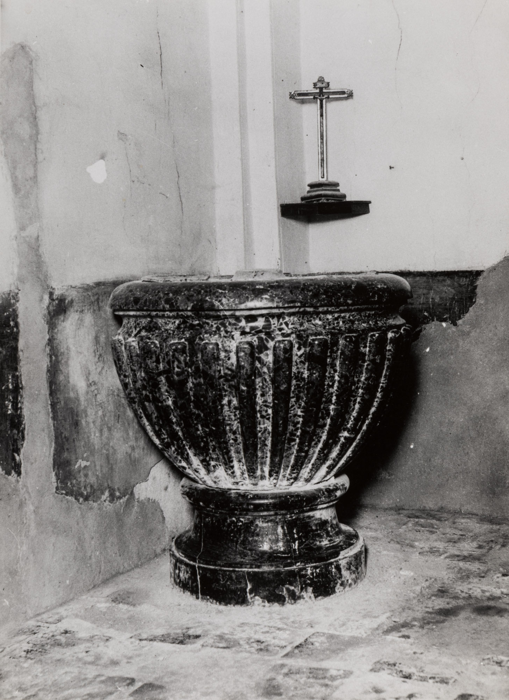
*Pila donde fue bautizado Francisco de Goya y Lucientes en la iglesia parroquial de Fuendetodos, a 31 de marzo de 1746*. Fotografía de José Vidal Gabarró, realizada en 1917. Biblioteca-Archivo, Diputación Provincial de Zaragoza, Consorcio Goya Fuendetodos.

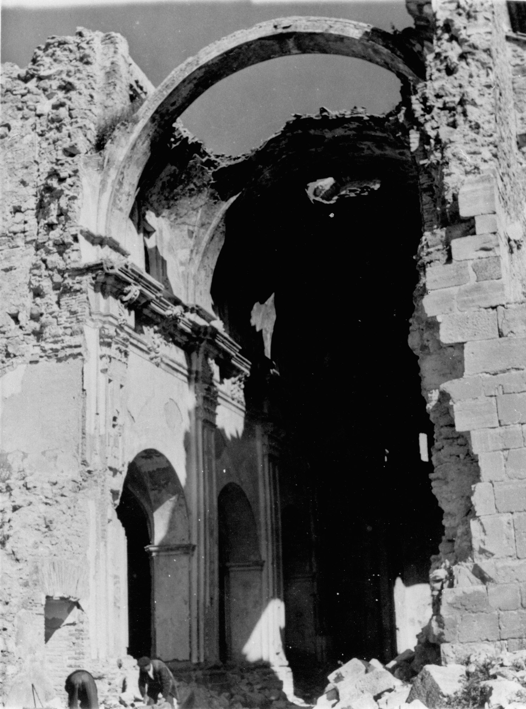
*Ruinas de la iglesia parroquial de Nuestra Señora de la Asunción de Fuendetodos después de su destrucción durante la Guerra Civil*. Fotografía de Miguel París Plou (1921-2004), realizada entre 1949 y 1953. Biblioteca-Archivo, Diputación Provincial de Zaragoza.

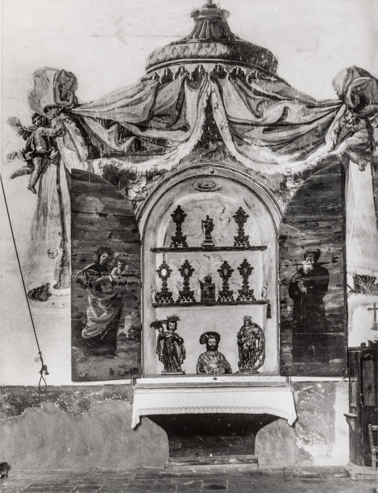
*Altar de las reliquias pintado por Goya situado en el lado del colateral oeste del crucero de la iglesia parroquial de Fuendetodos y destruido en 1936*. Fotografía de José Vidal Gabarró, realizada en 1917. Biblioteca-Archivo, Diputación Provincial de Zaragoza, Consorcio Goya Fuendetodos.

[^1]: Cura párroco.

[^2]: Fue hermana mayor de la madre de Goya y por tanto, tía suya. Padeció demencia.
