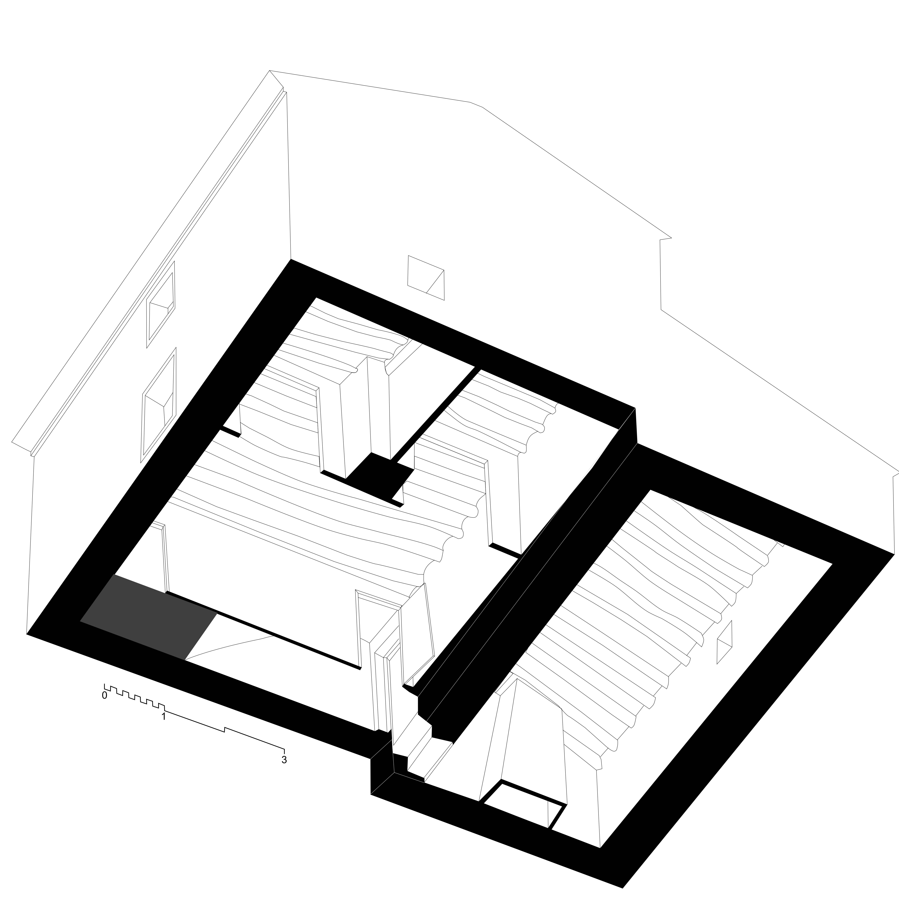
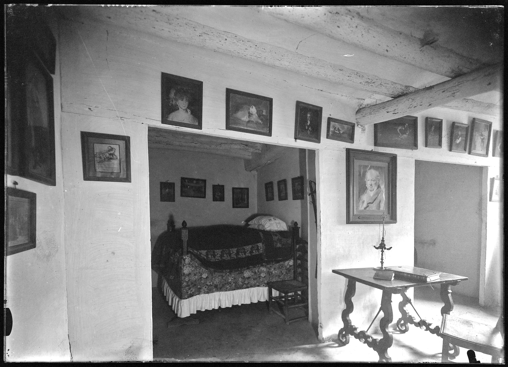

# Southeast bedchamber

This room is built much like its neighbour to the right but is larger. Its only natural light comes from the main room. [1] In colder months it benefited from the warmth of the animals in the stable directly below.

Detail of the southeast bedchamber in the first-floor axonometric drawing. Drawing by Héctor Arcusa Magallón.

Detail of the southeast bedchamber in the first-floor plan. Drawing by Héctor Arcusa Magallón.

The south bedchamber from the main room. Photograph by Juan Mora Insa (1888–1968), before 1928. Provincial Historical Archive of Zaragoza, Government of Aragón.
