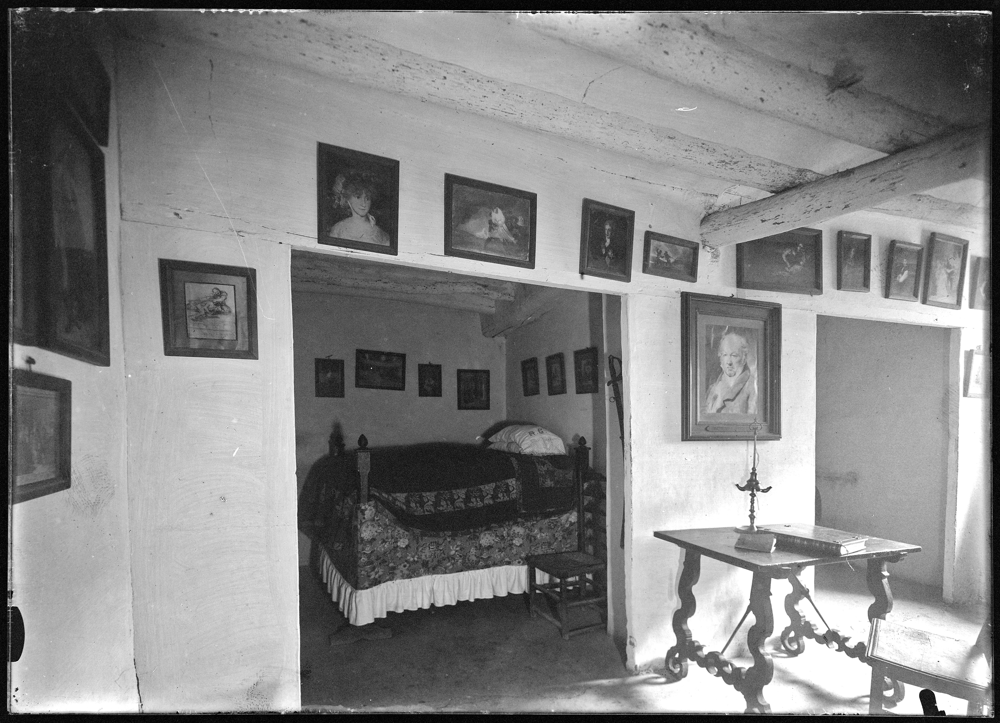

# Alcôve sud-est

Cette alcôve est construite comme celle qui se trouve à sa droite, mais elle est plus grande. Sa seule lumière naturelle vient de la salle. [1] Pendant les mois froids, elle bénéficiait de la chaleur des animaux de l’écurie située juste au-dessous.

Détail de l’alcôve sud-est sur la vue axonométrique du premier étage. Dessin de Héctor Arcusa Magallón.

Détail de l’alcôve sud-est sur le plan du premier étage. Dessin de Héctor Arcusa Magallón.

L’alcôve sud vue depuis la salle. Photographie de Juan Mora Insa (1888–1968), avant 1928. Archives historiques provinciales de Saragosse, Gouvernement d’Aragon.
