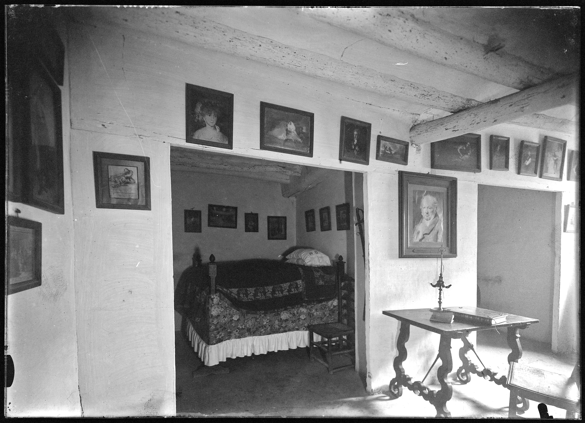

# Alcoba sureste

Cámara de construcción similar a la que tiene pareja situada a su derecha aunque de mayor tamaño, pero sin luz natural salvo la que penetra por la sala. [1] Poseía en los meses fríos la comodidad del calor que procuraban las bestias de la cuadra que se situaba debajo justo.

Detalle de la alcoba sureste de la planta axonométrica del piso primero. Plano de Héctor Arcusa Magallón.

Detalle de la alcoba sureste de la planta del piso primero. Plano de Héctor Arcusa Magallón.

La alcoba sur desde la sala. Fotografía de Juan Mora Insa (1888-1968) realizada antes de 1928. Archivo Histórico Provincial de Zaragoza, Gobierno de Aragón.
