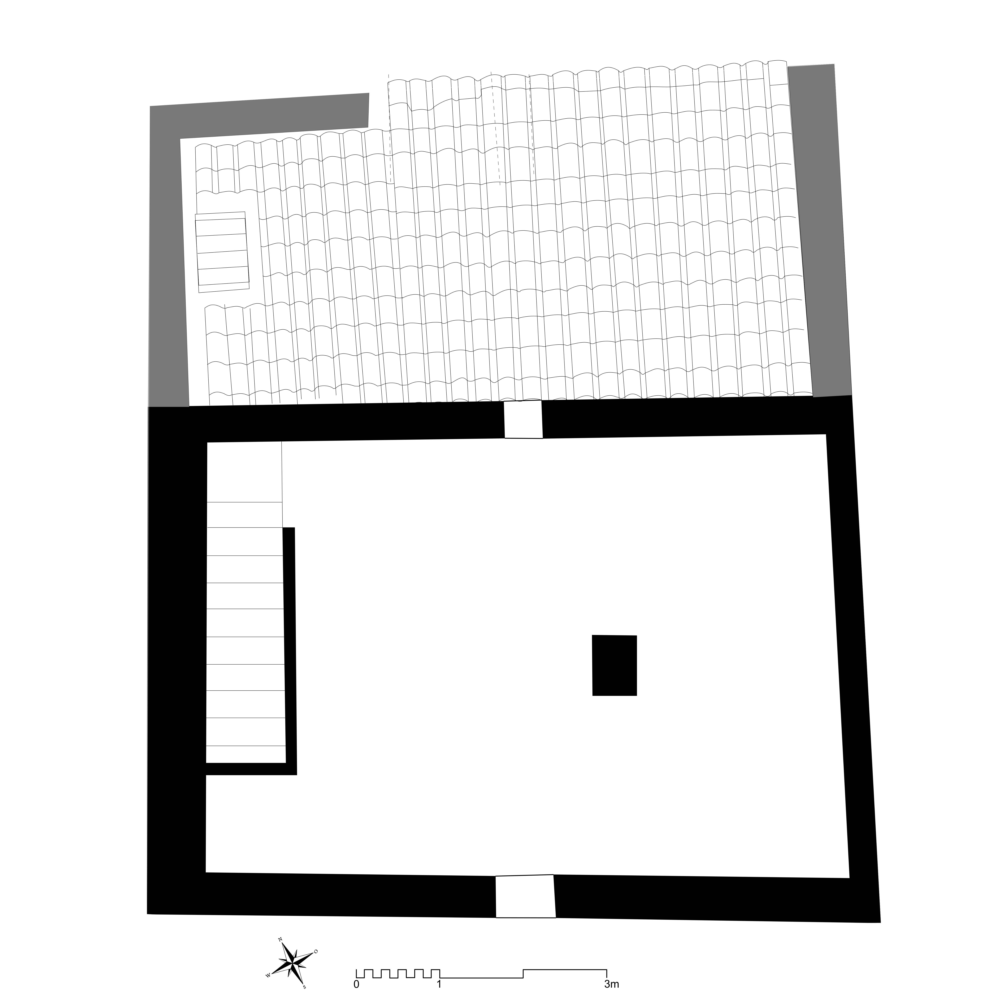

# Escalier : volée d’accès aux combles

La seconde volée mène aux combles. Elle se termine par un parapet antérieur à la restauration de 1983. Elle compte treize marches taillées dans la pierre, d’une hauteur moyenne de 19 cm. Un petit creux au centre de chaque contremarche donne davantage de place au pied sur le giron.

Arrivée de l’escalier dans les combles, au deuxième étage. Dessin de Héctor Arcusa Magallón.
