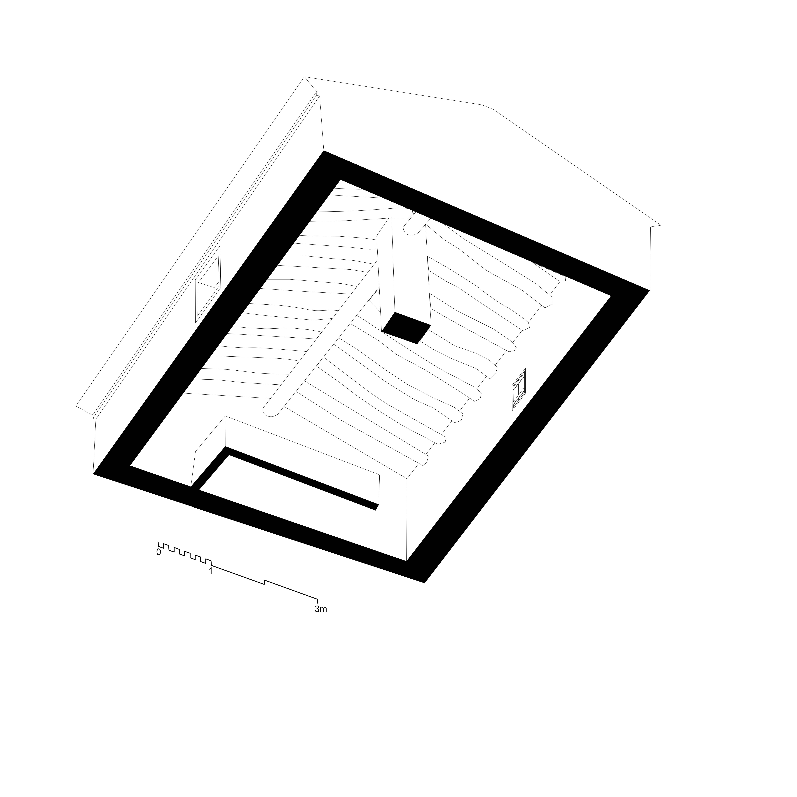
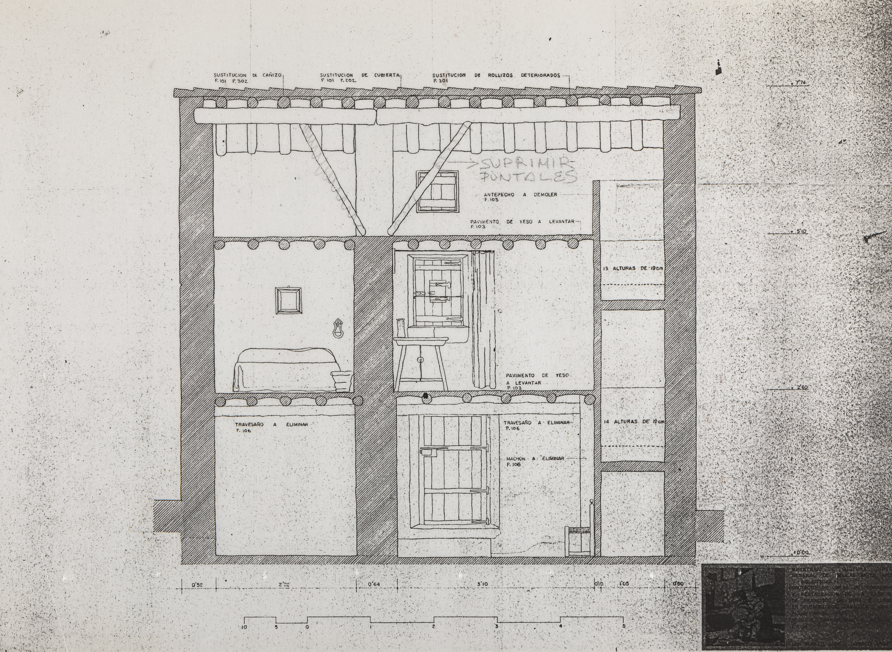
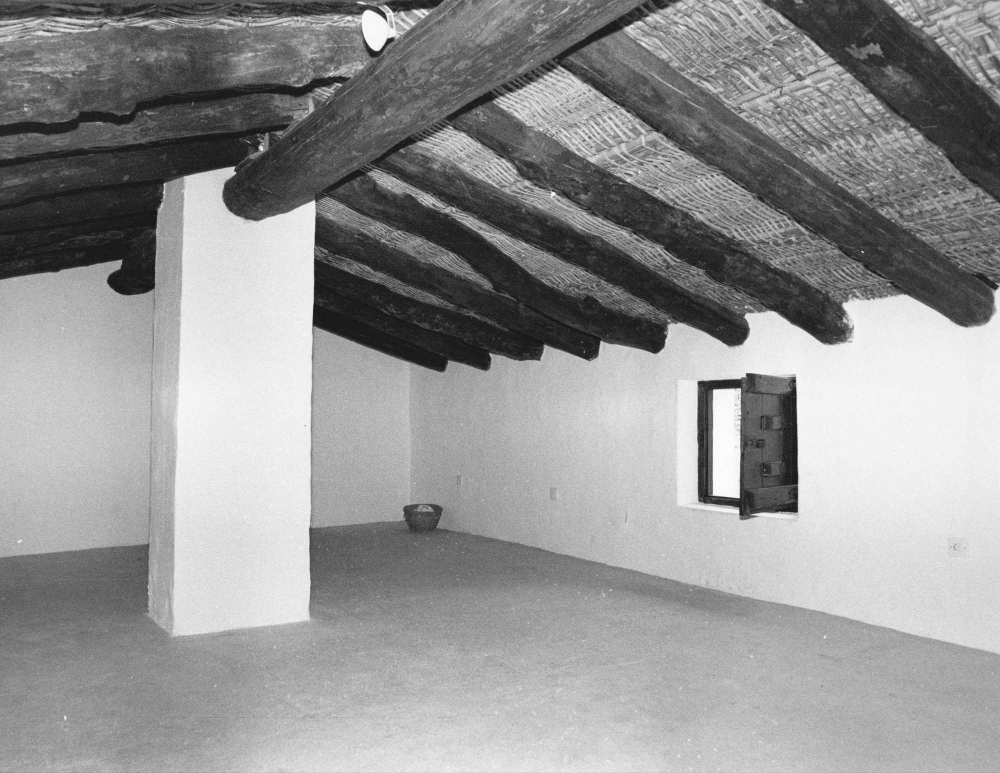

# Attic

In Aragón the term *falsa* refers to the space under the roof whose walls are lower than those of the other storeys. The noun comes from the adjective *falso, sa*, according to sense 6 of the *Diccionario de la lengua española* (*DLE*), because the space serves in place of a room of normal height.

It was well suited to storing, preserving and drying grain and other farm produce or provisions, as well as storing household items that were rarely used. It could occasionally serve as a bedroom for travellers. Small windows facing each other on the east and west sides of the house provided good ventilation.

The floor was made of gypsum mortar and the walls were whitewashed. The double-pitched roof had local pine rafters with reedwork between them. The two ridge beams rested on a pier that ran through all the storeys and on two props, one on either side, bearing on the base of the pier. [1]

The old roof was completely dismantled [see area 14]. Some round pine timbers were reused and others replaced with poplar. Three courses of limestone were added to the walls when new floor structures were built to preserve the original first-floor ceiling. The props were removed. The original woodwork of the two small windows and the parapet at the head of the stairs were retained. [2]

Axonometric view of the attic roof structure on the second floor. Drawing by Héctor Arcusa Magallón.

Second-floor plan. Drawing by Héctor Arcusa Magallón.

East–west section of the house in 1982, before the last restoration. Library and Archive, Provincial Council of Zaragoza.

The attic shortly after restoration, looking southeast from the staircase. Unknown photographer. Library and Archive, Provincial Council of Zaragoza.
