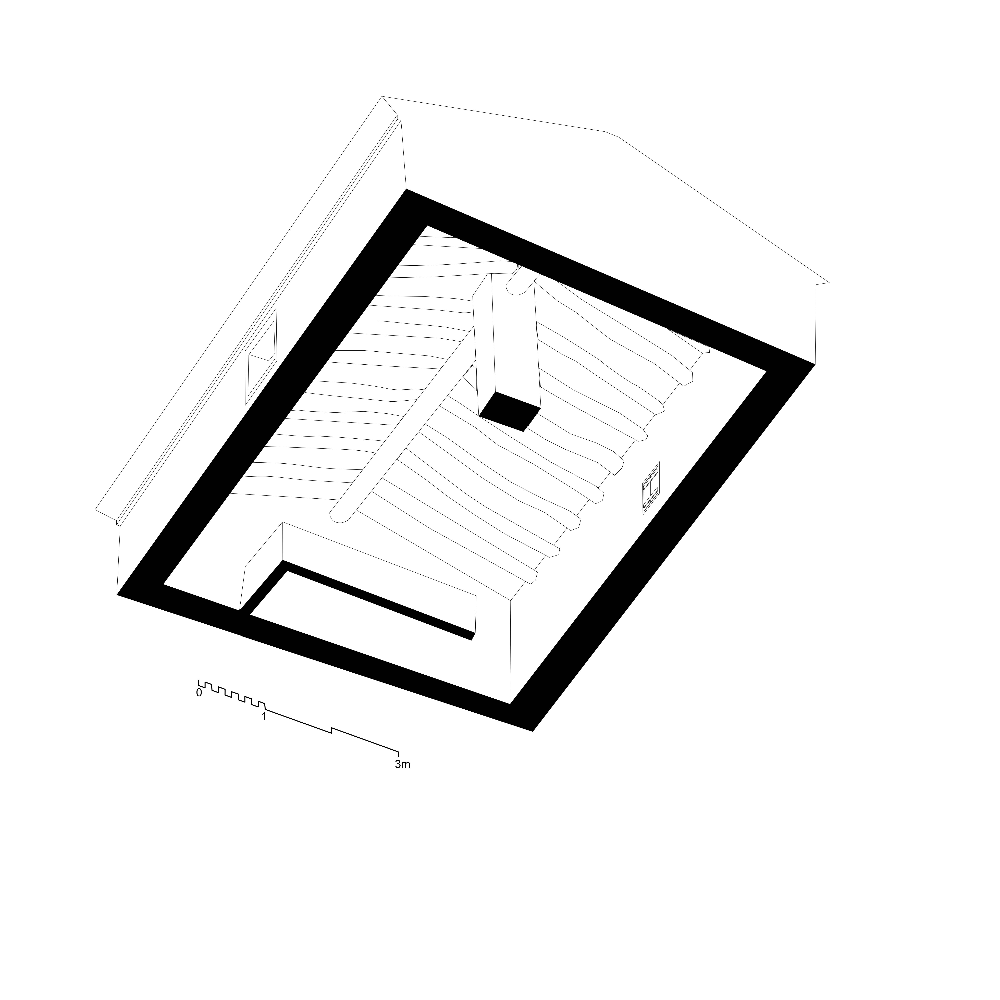
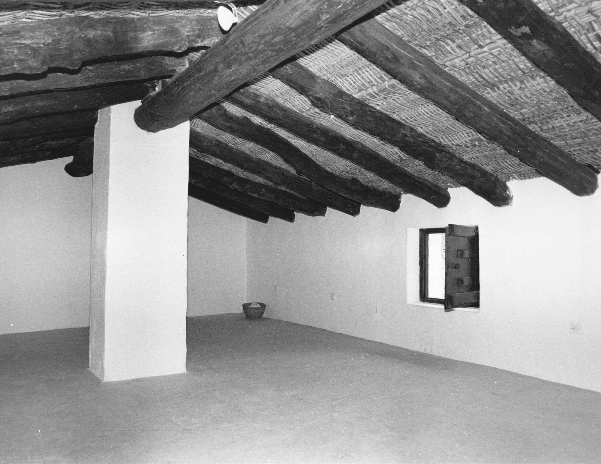

# Combles

En Aragon, le terme *falsa* désigne l’espace sous le toit, dont les murs sont moins hauts que ceux des autres étages. Le nom vient de l’adjectif *falso, sa*, selon la sixième acception du *Diccionario de la lengua española* (*DLE*), car cet espace tient lieu de pièce de hauteur normale.

On y conservait et séchait le grain et d’autres produits agricoles ou denrées alimentaires. On y rangeait aussi les objets domestiques peu utilisés. À l’occasion, les combles pouvaient servir de chambre à des voyageurs de passage. Deux petites fenêtres en vis-à-vis, à l’est et à l’ouest, assuraient une bonne aération.

Le sol était en mortier de plâtre et les murs blanchis à la chaux. La charpente à deux versants était faite de chevrons de pin local, avec un lattis de cannes entre eux. Les deux faîtières reposaient sur un pilier traversant les étages et sur deux étais, de part et d’autre, prenant appui sur la base du pilier. [1]

L’ancienne toiture a été entièrement démontée [voir espace 14]. Certains rondins de pin ont été réutilisés, d’autres remplacés par du peuplier. Trois assises de calcaire ont rehaussé les murs lors de la construction de nouveaux planchers destinés à préserver le plafond d’origine du premier étage. Les étais ont été supprimés. La menuiserie d’origine des deux petites fenêtres et le parapet à l’arrivée de l’escalier ont été conservés. [2]

Vue axonométrique de la charpente des combles au deuxième étage. Dessin de Héctor Arcusa Magallón.

Plan du deuxième étage. Dessin de Héctor Arcusa Magallón.

Coupe est-ouest de la maison en 1982, avant la dernière restauration. Bibliothèque et archives de la Diputación Provincial de Zaragoza.

Les combles peu après la restauration, vus depuis l’escalier en direction du sud-est. Photographe inconnu. Bibliothèque et archives de la Diputación Provincial de Zaragoza.
