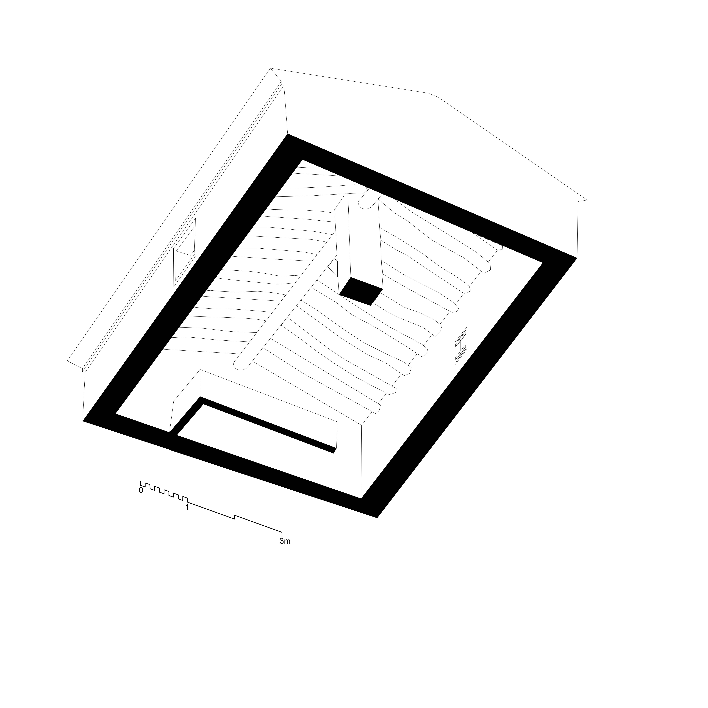
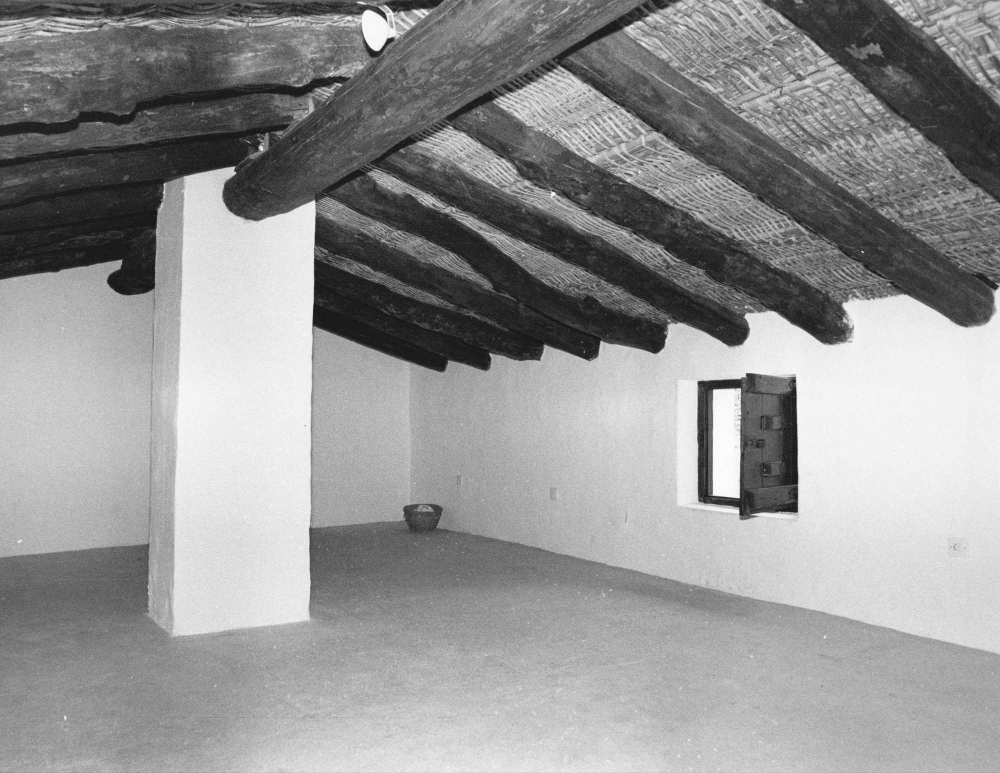

# Falsa

Falsa se denomina en Aragón a la parte de la casa bajo tejado y cuyos muros son de menor altura que en los del resto de las plantas. Este sustantivo deriva del adjetivo falso, sa —*Diccionario de la lengua española* [*DLE*], lema 6— porque esta cámara suple la escasez de dimensiones de una estancia de altura normal.

	Era el lugar idóneo para almacenar, conservar y secar el grano y otros productos agrícolas o de consumo alimenticio así como los enseres domésticos que no fueran a usarse habitualmente. En momentos concretos, podía servir también como dormitorio de personas transeúntes. Estaba bien ventilado con sendos ventanucos enfrentados y abiertos a cada lado de la casa, en dirección este y oeste.

	El suelo era de mortero de yeso y las paredes encaladas. Se cubría con una armadura de parhilera a dos aguas de madera de pino del país  y entre los pares cañizo; las dos cumbreras apeaban en un machón que recorría todas las plantas y en sendos puntales que apoyaban a cada lado apoyados en la base del pilar. [1]

	La cubierta antigua fue desmontada completamente [ver ámbito 14] y parte de los rollizos de pino fueron aprovechadas, pero otros se repusieron en madera de chopo. Las paredes se recrecieron con tres hiladas de piedra caliza porque se construyeron nuevos forjados para conservar el techo original de la primera planta y se suprimieron los puntales. Se mantuvo la carpintería original de las dos ventanas pequeñas y el antepecho de la salida de la escalera. [2]

Vista axonométrica de la armadura de la falsa del piso segundo. Plano de Héctor Arcusa Magallón.

Planta del piso segundo. Plano de Héctor Arcusa Magallón.

Sección E-O de la casa en 1982 antes de la última rehabilitación. Archivo-Biblioteca, Diputación Provincial de Zaragoza.

La falsa recién rehabilitada la casa vista desde la escalera en dirección sureste. Fotógrafo desconocido. Archivo-Biblioteca, Diputación Provincial de Zaragoza.
