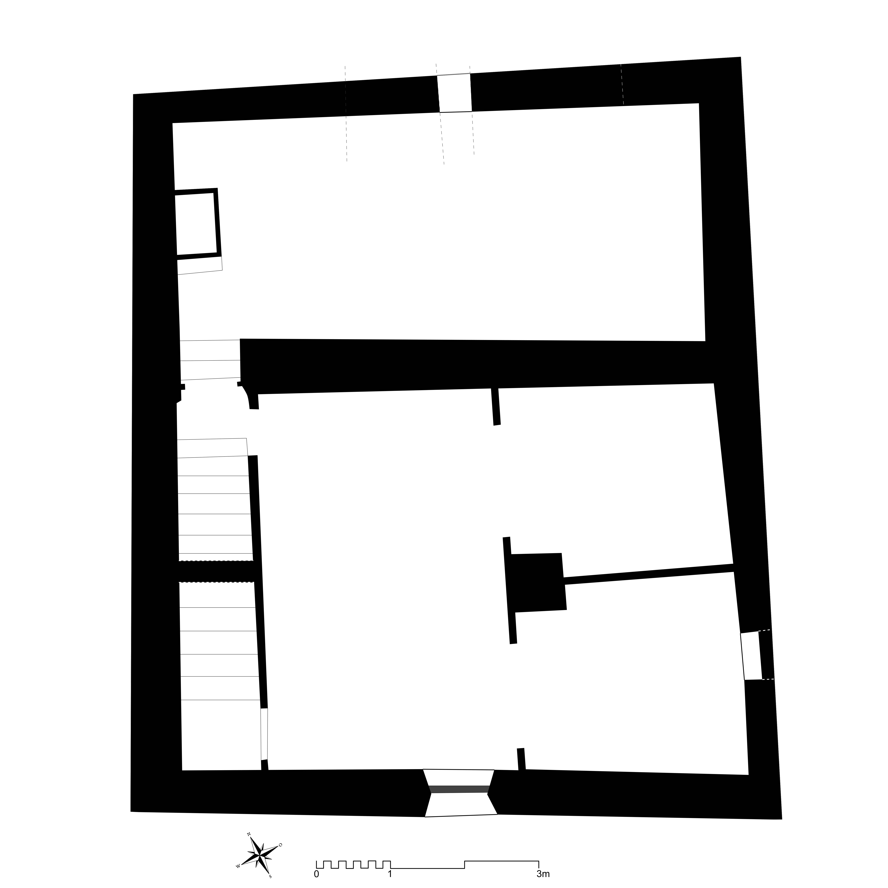
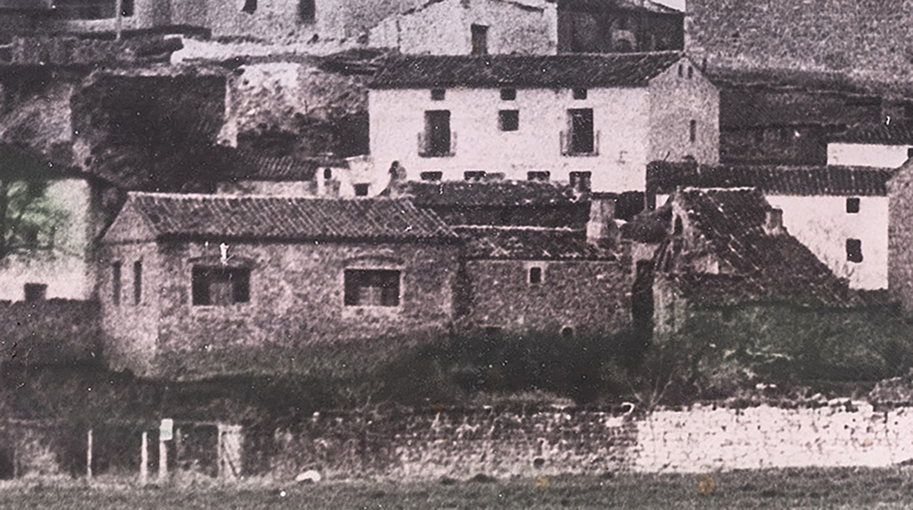
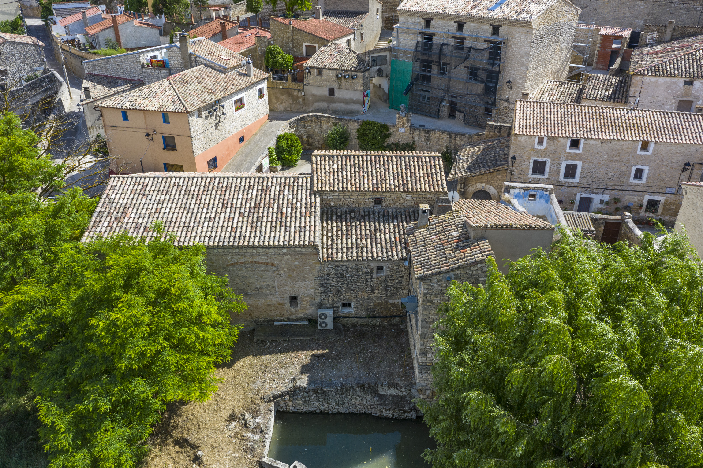
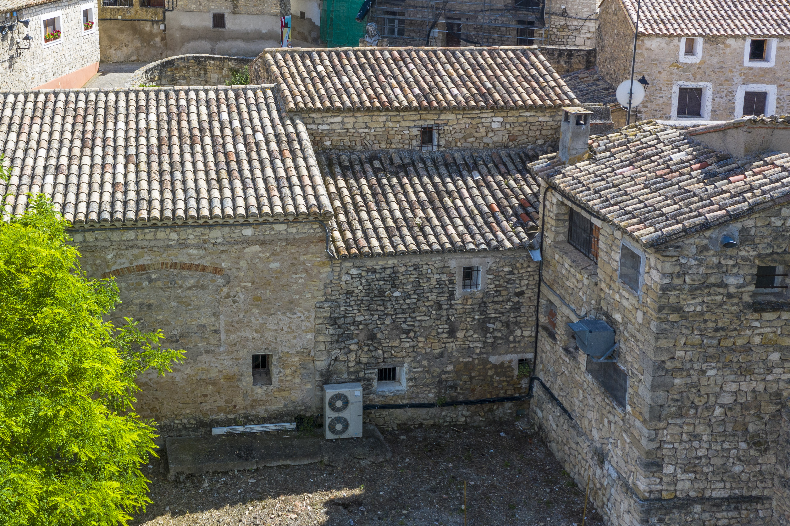
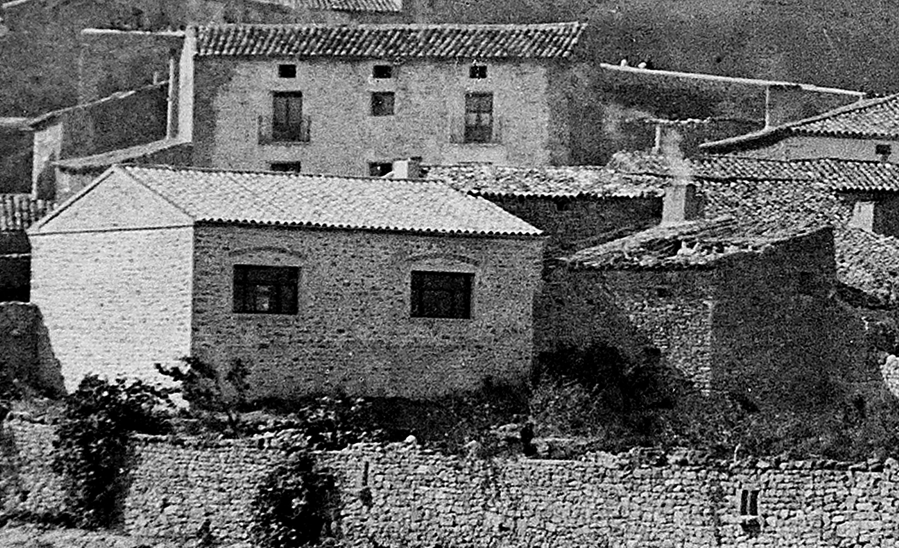

# Rear east façade

The east exterior wall is built of very rough masonry. [1] It has two openings at ground level. The left one serves the kitchen and the right one serves the room beside the Zuloaga Gallery, formerly the Goya Schools. Another opening serves the east room on the first floor, and a small opening ventilates the attic. A clear change in colour marks the three courses of stone added to the attic walls when new floor structures were installed to adjust the storey levels during the last restoration. [2]

The former Goya Schools were built in 1917. Parts of their east and north walls can be seen bearing against and interlocking with the walls of Goya’s birthplace. [3]

At kitchen level, the east wall originally had no openings. It was probably a party wall shared with another stone house whose single-pitch roof can be seen partly collapsed in early twentieth-century photographs. [4]

First-floor plan. Drawing by Héctor Arcusa Magallón.

Detail of the east façade of Goya’s birthplace and the Goya Schools. Undated photograph by Luis Carceller Lamo (c. 1960). Parish Church of Our Lady of the Assumption in Fuendetodos, Archdiocese of Zaragoza.

East façade of Goya’s birthplace and the Goya Schools, with the Mesón La Maja. Photograph by Javier Romeo Francés, 2020. Library and Archive, Provincial Council of Zaragoza.

Detail of the east façade of Goya’s birthplace and the Goya Schools, with the Mesón La Maja. Photograph by Javier Romeo Francés, 2020. Library and Archive, Provincial Council of Zaragoza.

Detail of the east façade of the Goya Schools and Goya’s birthplace, partly obscured by a house with a collapsed roof. Gelatin silver bromide photograph by Manuel Arribas Andrés, 1917. Digital copy by Javier Romeo Francés, 2020. The negative belongs to the Sindicato de Iniciativa y Propaganda de Aragón (SIPA) and is held at the Provincial Historical Archive of Zaragoza.
