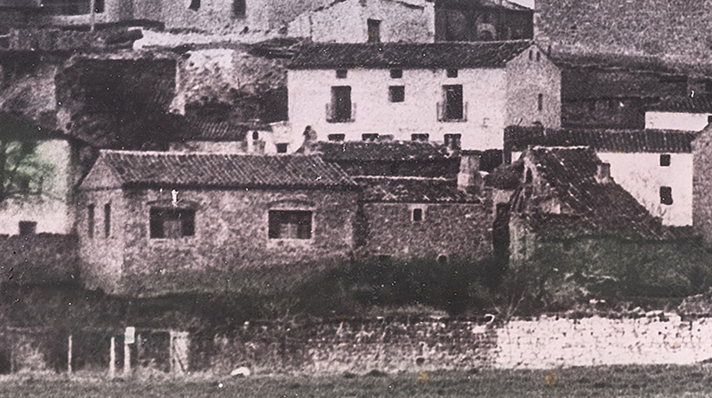
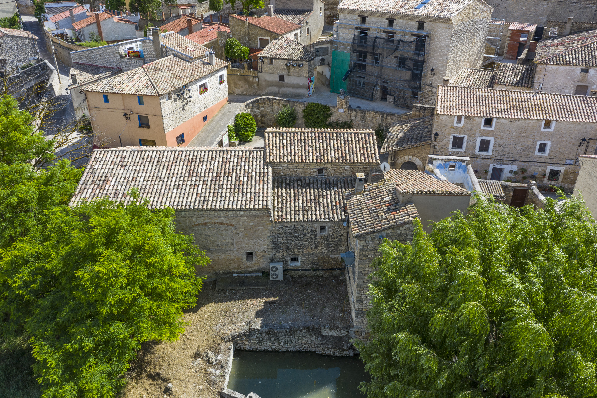
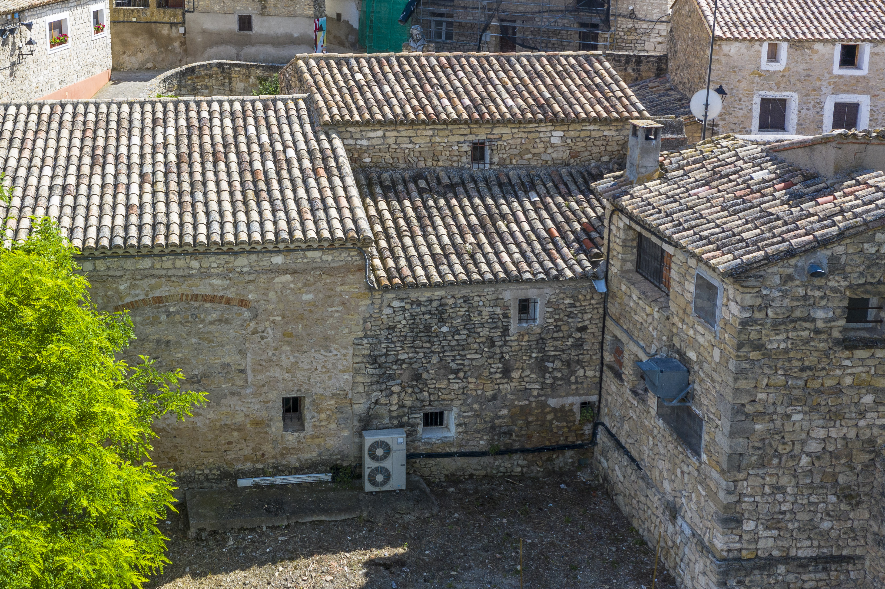
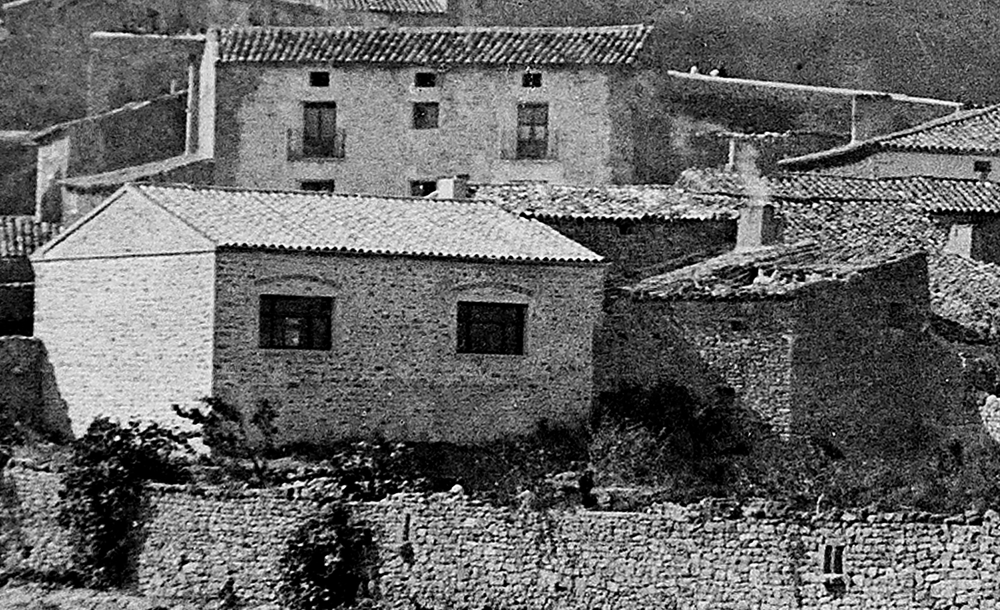

# Façade arrière est

Le parement extérieur est est en maçonnerie très grossière. [1] Deux ouvertures sont visibles au rez-de-chaussée : celle de gauche dessert la cuisine, celle de droite la pièce voisine de la salle Zuloaga, qui occupe les anciennes écoles Goya. Au premier étage se trouve l’ouverture de la pièce est, puis, plus haut, le petit jour qui aère les combles. La différence de couleur révèle trois assises de pierre ajoutées aux murs des combles pour réorganiser les niveaux des étages lors de la pose de nouveaux planchers au cours de la dernière restauration. [2]

On voit que les anciennes écoles Goya, construites en 1917, prennent partiellement appui sur la maison natale. Les maçonneries de leurs murs est et nord s’imbriquent dans celles de la maison. [3]

Au niveau de la cuisine, le mur est, autrefois dépourvu d’ouvertures, devait être mitoyen d’une autre maison en pierre. Le toit à un seul versant de cette maison apparaît en partie effondré sur des photographies du début du XXe siècle. [4]

Plan du premier étage. Dessin de Héctor Arcusa Magallón.

Détail de la façade est de la maison natale de Goya et des écoles Goya. Photographie de Luis Carceller Lamo, non datée (vers 1960). Église paroissiale Notre-Dame-de-l’Assomption de Fuendetodos, archidiocèse de Saragosse.

Façade est de la maison natale de Goya et des écoles Goya, avec le Mesón La Maja. Photographie de Javier Romeo Francés, 2020. Bibliothèque et archives de la Diputación Provincial de Zaragoza.

Détail de la façade est de la maison natale de Goya et des écoles Goya, avec le Mesón La Maja. Photographie de Javier Romeo Francés, 2020. Bibliothèque et archives de la Diputación Provincial de Zaragoza.

Détail de la façade est des écoles Goya et de la maison natale, en partie masquée par une autre maison dont le toit est effondré. Photographie au gélatino-bromure d’argent de Manuel Arribas Andrés, 1917. Copie numérique de Javier Romeo Francés, 2020. Négatif appartenant au Sindicato de Iniciativa y Propaganda de Aragón (SIPA), déposé aux Archives historiques provinciales de Saragosse.
