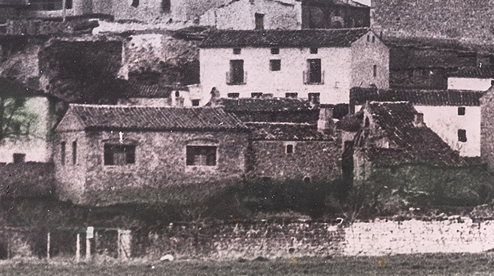
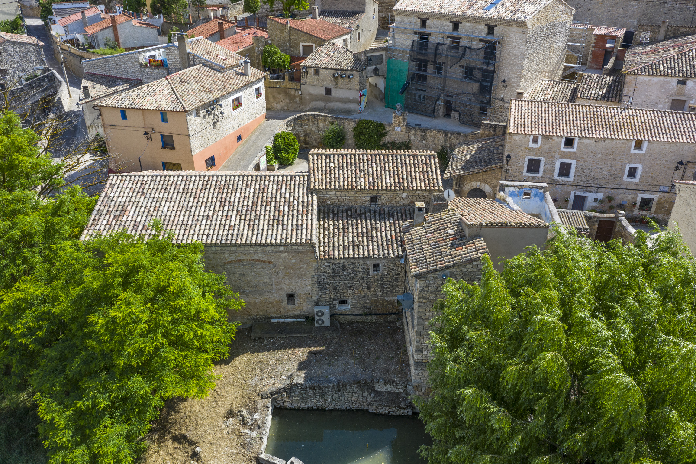
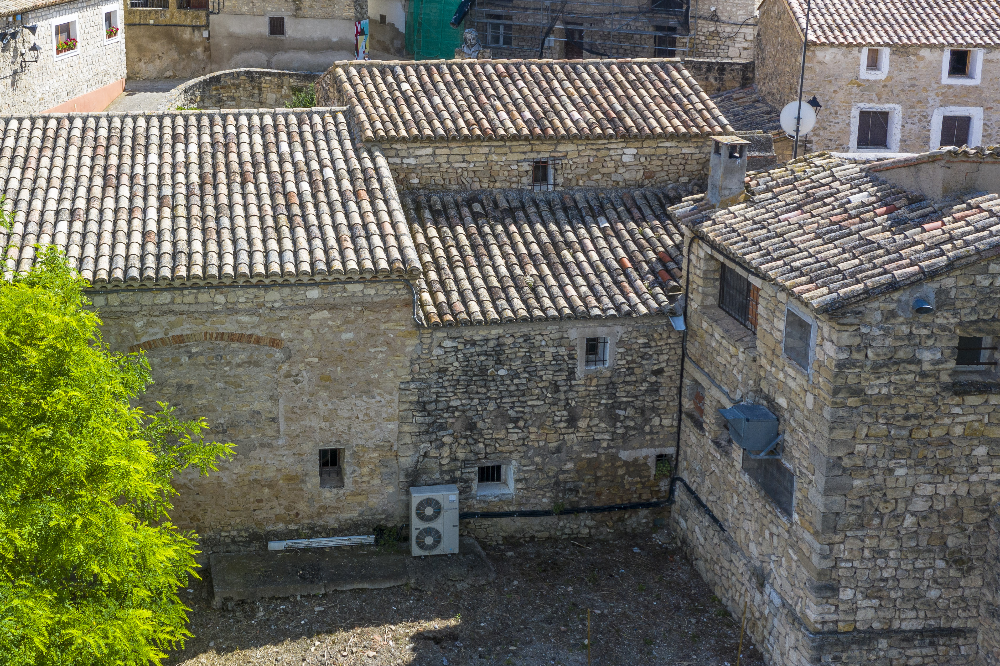
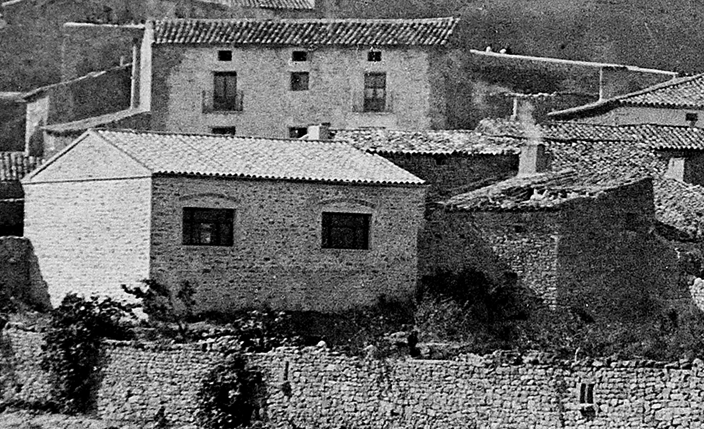

# Fachada posterior este [A]

El paramento exterior este del edificio es de mampostería muy basta. [1] Muestra dos vanos en la planta baja correspondientes: el de la izquierda a la cocina, y el de la derecha a la habitación que media con la Sala Zuloaga —antiguas Escuelas de Goya—; otro en la planta principal perteneciente a la habitación este; y el ventanuco de ventilación de la falsa. Se aprecian claramente por el cambio de color las tres hiladas de piedra añadidas a los muros de la falsa para reorganizar los niveles de las plantas debido a la construcción de nuevos forjados en la última rehabilitación. [2]

	El edificio de las antiguas Escuelas de Goya levantado en 1917 se observa que apoyó parte de la construcción de los muros este y norte en la casa natal de Goya con los que se traba. [3]

	El muro este, en el nivel primero de la cocina —que no tenía vanos hacia esta parte— debió ser medianil con otra casa construida en piedra y con un tejado a una sola agua que se observa en parte arruinado en las fotografías de comienzos del siglo XX. [4]

Planta del piso primero. Plano de Héctor Arcusa Magallón.

Detalle de la fachada este de la casa natal de Goya y de las Escuelas de Goya. Fotografía Luis Carceller Lamo, sin año [hacia 1960]. Iglesia parroquial de Nuestra Señora de la Asunción de Fuendetodos, Arzobispado de Zaragoza.

La fachada este de la casa natal de Goya y de las Escuelas de Goya y el Mesón La Maja. Fotografía Javier Romeo Francés, 2020. Archivo-Biblioteca Diputación Provincial de Zaragoza.

Detalle de la fachada este de la casa natal de Goya y de las Escuelas de Goya y el Mesón La Maja. Fotografía Javier Romeo Francés, 2020. Archivo-Biblioteca Diputación Provincial de Zaragoza.

Detalle de la fachada este de las Escuelas de Goya y de la casa natal de Goya en parte tapada por otra casa cuyo tejado está arruinado. Fotografía de Manuel Arribas Andrés, 1917; gelatino bromuro. Copia digital por Javier Romeo Francés, 2020. Negativo propiedad del Sindicato de Iniciativa y Propaganda de Aragón (SIPA), depositado en el Archivo Histórico Provincial de Zaragoza.
