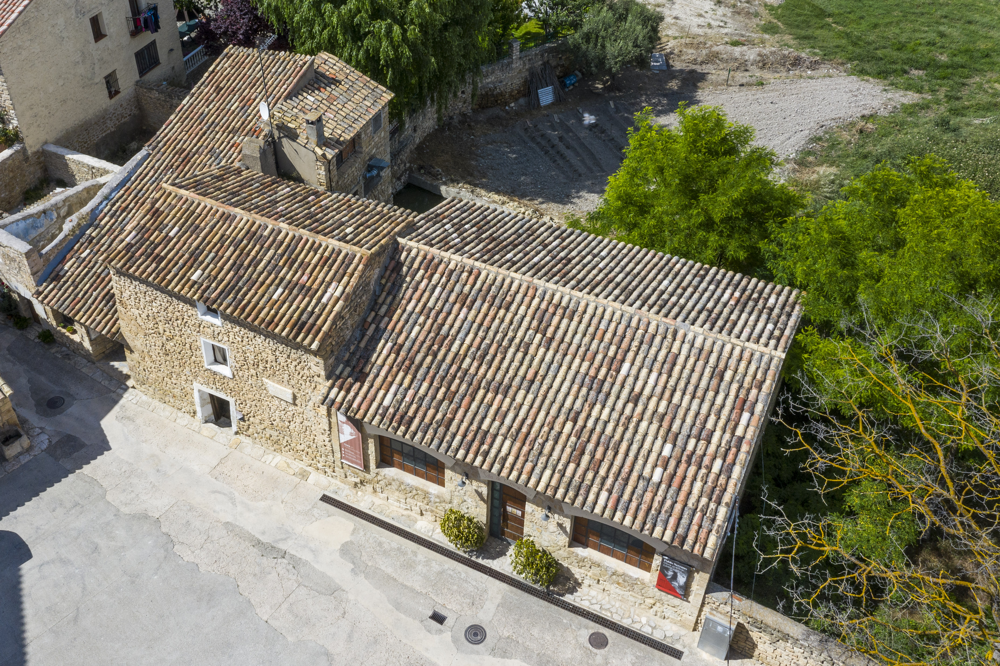
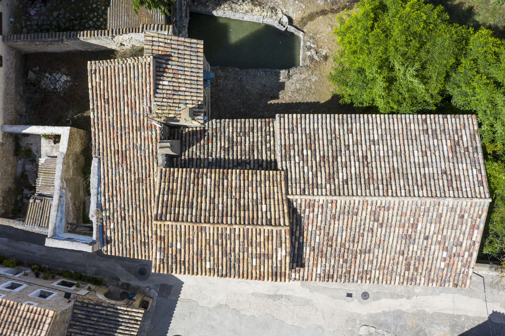

# Roof

The house has a pitched roof with its ridge set slightly west of the north–south axis. [1] The first-floor east room at the rear has a single-pitch roof ending just below the base of the attic. The kitchen chimney rises through this roof on the north side. [B] Curved clay tiles cover the entire roof, including the ridge, and rainwater drains straight to the ground. [2] The old roof, made of twenty-eight round timbers, fourteen on each slope, and reedwork, was completely dismantled during the last restoration to make room for the raised floor structure above the first-floor ceiling.

Detail of the roof levels from the south side of the ground-floor axonometric drawing. Drawing by Héctor Arcusa Magallón.

Detail of the attic plan and the roof of the first-floor east room. Drawing by Héctor Arcusa Magallón.

Aerial view of the roof of Goya’s birthplace (centre), between the Ignacio Zuloaga exhibition gallery (right) and the Mesón La Maja (left). Photograph by Javier Romeo, 2021.

Orthophotograph of the roof of Goya’s birthplace (centre), between the Ignacio Zuloaga exhibition gallery (right) and the Mesón La Maja (left). Photograph by Javier Romeo, 2021.
