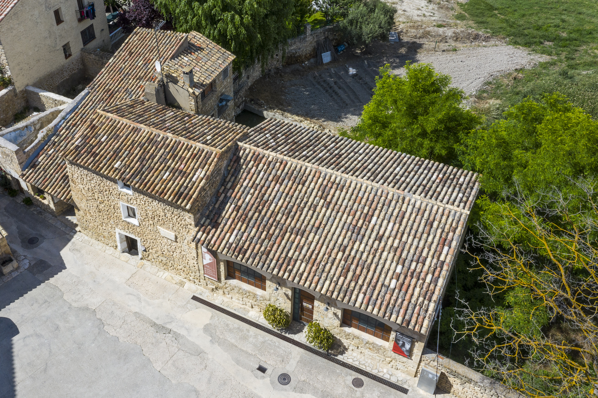
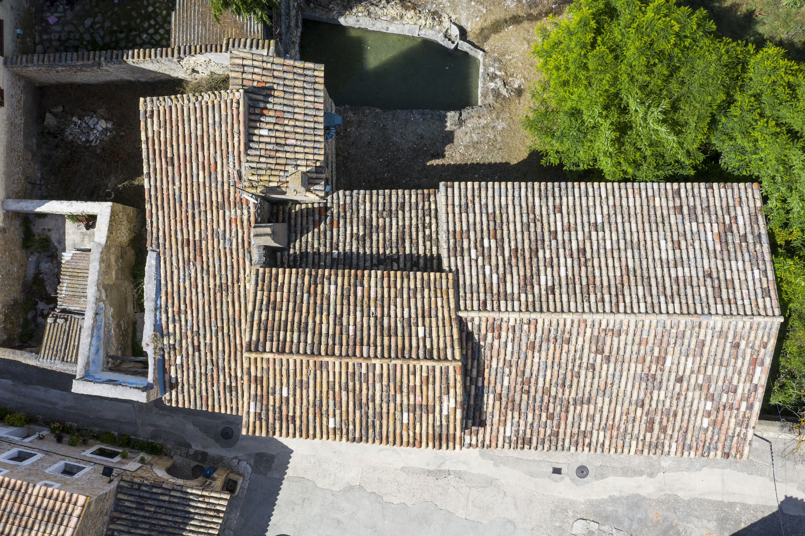

# Toiture

La maison est couverte d’un toit à deux versants dont le faîtage est légèrement décalé vers l’ouest par rapport à l’axe nord-sud. [1] À l’arrière, la pièce est du premier étage est couverte d’un toit à un seul versant, légèrement en dessous de la base des combles. La cheminée de la cuisine émerge du côté nord de ce toit. [B] Des tuiles creuses couvrent toute la toiture, faîtage compris, et l’eau de pluie s’écoule directement au sol. [2] L’ancienne couverture, composée de vingt-huit rondins, quatorze par versant, et d’un lattis de cannes, a été entièrement démontée lors de la dernière restauration pour permettre le rehaussement du nouveau plancher au-dessus du plafond du premier étage.

Détail des niveaux des toits, vus du sud sur la vue axonométrique du rez-de-chaussée. Dessin de Héctor Arcusa Magallón.

Détail du plan des combles et du toit de la pièce est du premier étage. Dessin de Héctor Arcusa Magallón.

Vue aérienne de la toiture de la maison natale (au centre), entre la salle d’exposition Ignacio Zuloaga (à droite) et le Mesón La Maja (à gauche). Photographie de Javier Romeo, 2021.

Orthophotographie de la toiture de la maison natale (au centre), entre la salle d’exposition Ignacio Zuloaga (à droite) et le Mesón La Maja (à gauche). Photographie de Javier Romeo, 2021.
