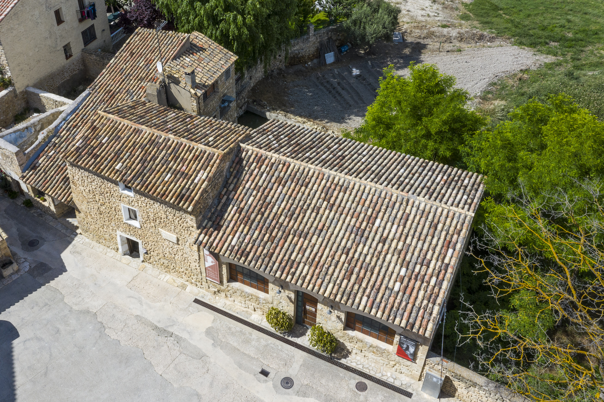
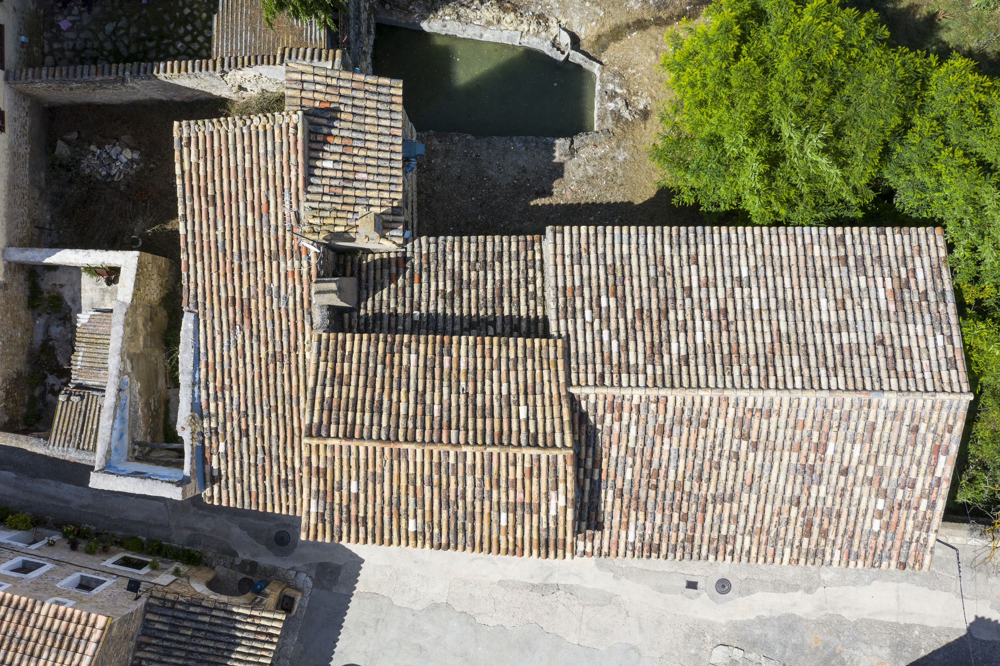

# Tejado

La casa se cubre con un tejado a dos aguas con la cumbrera ligeramente desplazada del eje norte-sur hacia el oeste. [1] El cuerpo posterior de la casa que techa la habitación este de la primera planta posee un tejado a una sola agua terminado a un nivel ligeramente inferior al de la base de la falsa; en esta parte se eleva hacia el lado norte el exterior de la chimenea de la cocina. [B] Todo está cubierto de teja árabe incluida la cumbrera y desagua directamente a suelo. [2] La cubierta antigua de veintiocho rollizos —catorce por cada agua*—* y de cañizo fue desmontada completamente en la última rehabilitación arquitectónica debido a la necesidad de elevación del nuevo forjado del techo de la planta primera.

Detalle de los niveles de los tejados desde la cara sur de la planta baja axonométrica. Plano de Héctor Arcusa Magallón.

Detalle de la planta de la falsa y del tejado de la habitación este de la primera planta. Plano de Héctor Arcusa Magallón.

Vista aérea del tejado de la casa natal (centro) rodeado por los de la sala de exposiciones Ignacio Zuloaga (dcha.) y el Mesón La Maja (izda.). Fotografía Javier Romeo, 2021.

Ortofoto del tejado de la casa natal (centro) rodeado por los de la sala de exposiciones Ignacio Zuloaga (dcha.) y el Mesón La Maja (izda.). Fotografía Javier Romeo, 2021.
